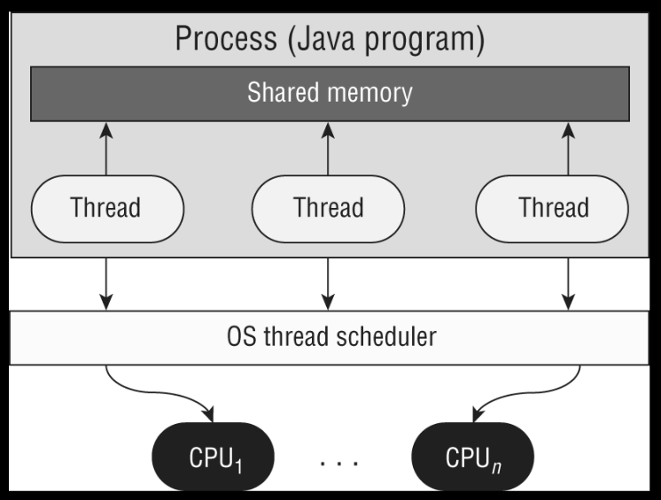
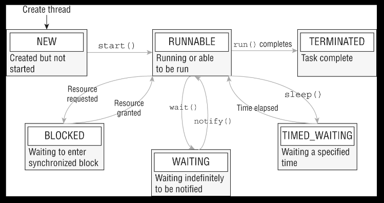
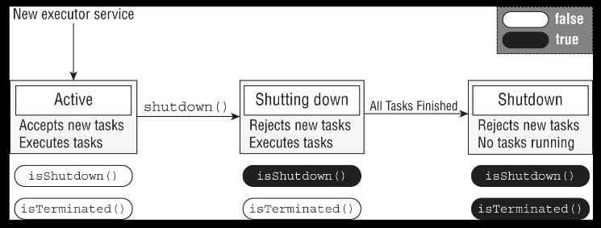
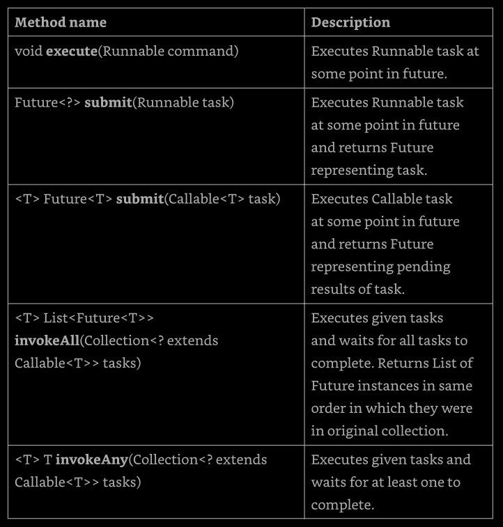
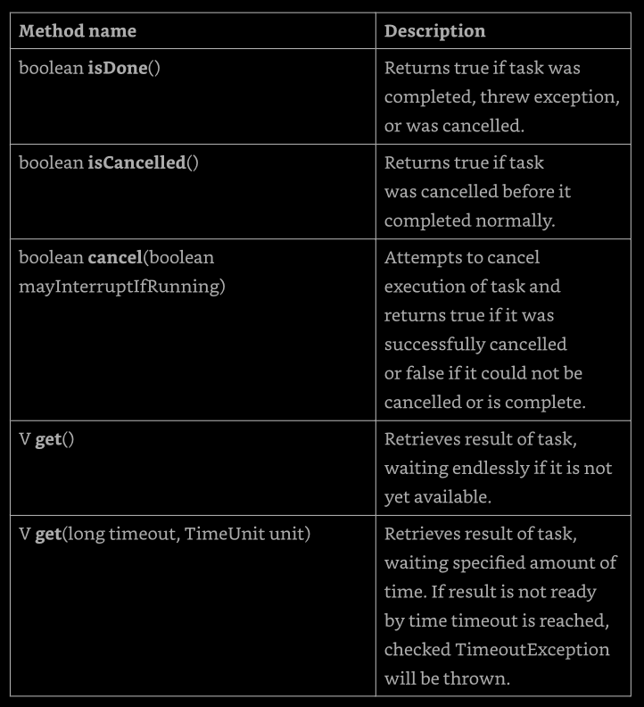
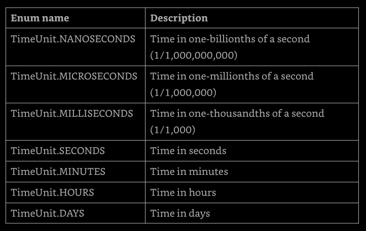
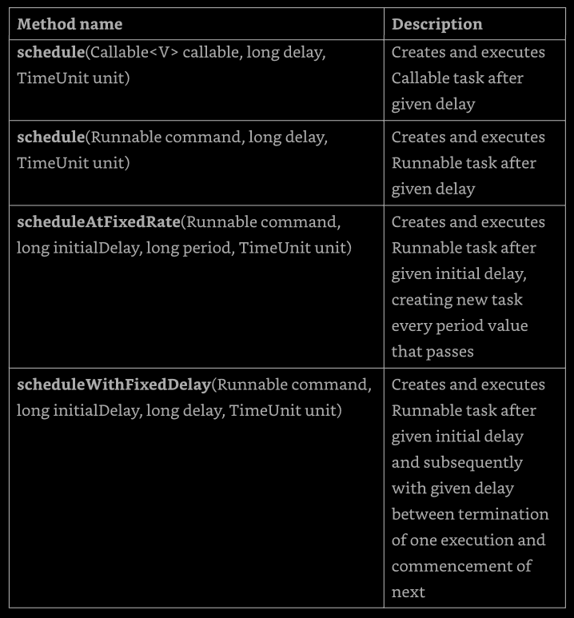
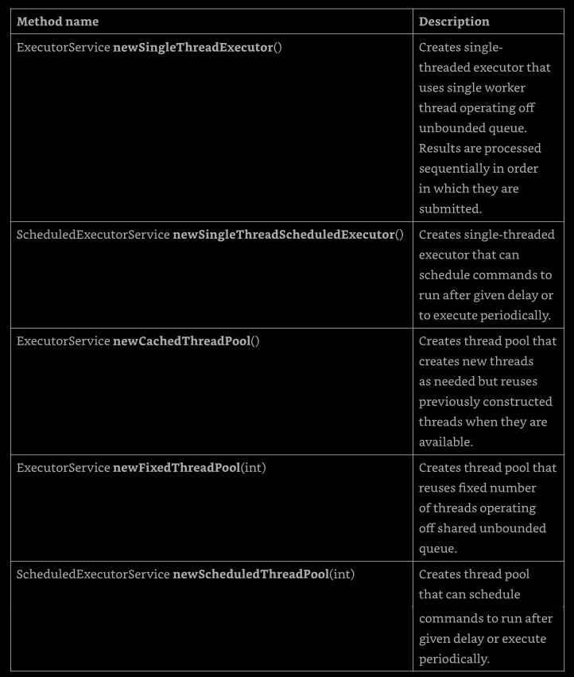

# Chapter 13: Concurrency

* Managing concurrent code execution
  - Create worker threads using `Runnable` and `Callable`, manage the thread lifecycle, 
      including automations provided by different `Executor` services and concurrent API
  - Develop thread-safe code, using different locking mechanisms and concurrent API
  - Process Java collection concurrently including the use of parallel stream.
* Working with Stream and Lambda expressions
  - Perform decomposition, concatenation, and reduction an grouping and partitioning 
      on sequential and parallel streams.

As we will see in Chapter 14, I/O, and Chapter 15, JDBC, computers are capable of 
reading and writing data to external resources. Unfortunately, as compared to CPU 
operations, these disk/network operation tend to be extremely slow. In fact, it is 
so slow that, if our computer's operating system were to stop and wait for every 
disk or network operation to finish, our computer would appear freeze constantly.

Luckily, all operation systems support what is known as _multithreaded processing_. 
The idea behind multithreaded processing is to allow an application or group of 
applications to execute multiple tasks at the same time. This allows tasks waiting 
for other resources to give way to other processing requests.

In this chapter, we will see the concept of threads and numerous way to manage 
threads using the Concurrency API. Threads and concurrency are challenging topics 
for many programmers to grasp, as problems with threads can be frustrating even 
for veteran developers. In practice, concurrency issues are among the most 
difficult problems to diagnose and resolve.


## Introducing Threads

We begin this chapter by reviewing common terminology associated with threads. A 
_thread_ is the smallest unit of execution that can be scheduled by the operation 
system. A _process__ is a group of associated threads that execute in the same 
shared environment. It follows, then, that a _single-threaded process_ is one that 
contains exactly on thread, whereas a _multithreaded process_ supports more than 
one thread.

By _shared environment_, we mean that the threads in the same process share the 
same memory space and can communicate directly with one another. Refer to Figure 13.1 
for an overview of thread and their shared environment within a process.

This figure shows a single process with three threads. It also shows how they are 
mapped to an arbitrary number of _n CPUs_ available within the system.



**Figure 13.1: Process model**

By _shared memory_ in Figure 13.1, we are generally referring to static variables 
as well as instance and local variables passed to a thread. Yes, we will finally see 
how static variables can be useful for performing complex, multithreaded tasks!. From 
Chapter %, Methods, we see that static methods and variables are defined on a single 
class object that all instances share. For example, if on thread updates the value of 
a static object, this information is immediately available for other threads within 
the process to read.


### Understanding Thread Concurrency

The property of executing multiple threads and process at the same time is referred 
to as _concurrency_. How does the system decide what to execute when there are more 
threads available than CPUs? Operating systems use a _thread schedule_ to determine 
which threads should be currently executing, as shown in Figure 13.1. For example, a 
thread schedules may employ a _round-robin scheduler_ in which each available thread 
receives an equal number of CPU cycles with which to execute, with threads visited 
in a circular order.

When a thread's alloted time is complete but the thread has not finished processing, 
a context switch occurs. A _context switch_ is the process of storing a thread's current 
state and later restoring the state of the thread to continue execution. Be aware that a 
cost is often associated with a context switch due to lost time and having to reload a 
thread's state. Intelligent thread schedulers do their best to minimize the number of 
context switches while keeping an application running smoothly.

Finally, a thread can interrupt or supersede another thread if it has a higher thread 
priority than the other thread. A _thread priority_ is a numeric value associated with 
a thread that is taken into consideration by the thread scheduler when determining 
which threads should currently be executing. In java, thread priorities are specified 
as integer values.


### Creating a Thread

One of the most common ways to define a task for a thread is by using the `Runnable` 
instance. `Runnable` is a functional interface that takes no arguments and returns no data.
```
@FunctionalInterface
public interface Runnable {
  void run();
}
```

With this, it's easy to create and start a thread. In fact, we can do so in one line of
code using the `Thread` class:
```
new Thread( () -> System.out.print("Hello") ).start();
System.out.println("Word");
```

The first line create a new `Thread` object and then starts it with the `start()` 
method. Does this code print "HelloWord" or "WordHello"? The answer is that we don't 
know. Depending on the thread priority/scheduler, either is possible. Remember that 
order of thread execution is no often guaranteed.

let's take a look at a more complex example:
```
Runnable printInventory = () -> System.out.println("Printing zoo inventory");
Runnable printRecords = () -> {
  for (int i = 0; i < 3; i++)
    System.out.println("Printing record: " + i)
};
```

Given these instances, what is the output of this block of code? 
```
1: main(String... args){
2:   System.out.println("begin");
3:   new Thread(printInventory).start();
4:   new Thread(printRecord).start();
5:   new Thread(printInventory).start();
6:   System.out.println("end")
7: }
```

The answer is that it is unknown until runtime. The following is just one possible output:
```
begin
Print record: 0
Printing zoo inventory 
end
Printing record: 1
Printing zoo inventory
Printing record: 2
```

This sample uses a total of four thread: the `main()` user thread and three addition 
thread created on lines 3, 4 and 5. Each thread created on these lines is executed as 
an asynchronous task. By _asynchronous_, we men that the thread executing the `main()` 
method does not wait for the results of each newly created thread before continuing. For 
example, lines 4 and 5 may be executed before the thread created on line 3 finishes. The 
opposite of this behavior is a _synchronous_ task in which the program waits (or blocks) 
on line 3 for the thread to finish executing before moving on the next line. The vast
majority of method call used in this book have been synchronous up until this chapter.

While the order of thread execution is indeterminate once the threads have been started, 
the order within a single thread is still linear. In particular, the `for() loop` is 
ordered. Also, "begin" always appears before "end" on the program above.

More generally, we can create a `Tread`and its associated task one of two ways in Java:
- Provide a `Runnable` object or lambda expression to the `Tread` constructor
- Create a class that extends `Thread` and overrides the `run()` method

Throughout this book, we prefer creating tasks with lambda expression. After all, 
it's a lot easier, especially when we get to the Concurrency API. Creating a class that 
extends `Tread` is relatively uncommon and should only be done under certain circumstances, 
such as if we need to overwrite other threads methods.

---
**Calling _run()_ Instead of _start()_**

Sometime we could see code that attempts to start a thread by calling `run()` instead 
of `start()`. Calling `run()` on a `Thread` or a `Runnable` _does not start a new thread_. 
While the following code snippets will compile, none will execute a task on a separate 
thread.
```
{
  System.out.println("begin");
  new Thread(printInventory).run();
  new Thread(printRecords).run();
  new Thread(printInventory).run();
  System.out.println("end");
}
```

Unlike the previous example, each line ot this code will wait until the `run()` method 
is complete before moving on the next line. Also unlike the previous program, the output 
for this code sample wil be the same every time it is executed.

---


### Distinguishing Thread Types

It might be a surprise that all Java applications, including all of the ones that we 
have presented in this book, are multithreaded because the include system threads. A 
_system thread_ is created by the JVM and runs in the background of the application. 
For example, garbage collection is managed by a system thread created by the JVM.

Alternatively, a _user defined thread_ is on created by the application developer to 
accomplish a specific task. The majority of the programs we've presented so far have 
contained only on user-defined thread, which calls the `main()` method. For simplicity, 
we commonly refer to programs that contain only a single user-defined thread as 
_single-threaded applications_.

System and user-defined threads can both be created as daemon threads. A _daemon thread_ 
is on that will no prevent the JVM from exiting when the program finishes. A Java application 
terminates when the only threads that are running are daemon threads. For example, if 
garbage collection is the only thread left running, the JVM will automatically shut down.

Let's take a look at an example. What this program outputs?
```
01: public class Zoo {
02:   public static void pause() {     // defines a thread task
03:     try {
04:       Thread.sleep(10_000);       // wait for 10 seconds
05:     } catch (InterruptedException e) {}
06:     System.out.println("Thread finished");
07:   }
08:   
09:   public static void main(String[] args) {
10:     var job = new Thread( () -> pause() );     // create tread
11:   
12:     job.start();      // start thread
13:     System.out.println("Main method finished");
14:   }
15: }
```

The program will output two statements roughly 10 seconds apart:
```
Main method finished!
--- 10 second wait ---
Thread finished!
```

That's right. Even though the `main()` method is done, the JVM will wait for the 
user thread to be done before ending the program. What if we change `job` to be a 
daemon thread by adding this to line 11?
```
11:     job.setDaemon(true);
```

The program will print the first statement and terminate without ever printing the 
second line.
```
Main method finished
```

We just need to remember that by default, user-defined threads are not daemons, and 
the program will wait for them to finish.


### Managing a Thread's Life Cycle

After a thread has been created, it is in one of six states, shown in Figure 13.2. 
We can query a thread's state by calling `getState()` on the thread object.



**Figure 13.2: Thread states**

Every thread is initialized with a `NEW` state. As soon as `start()` is called, 
the thread is moved to a `RUNNABLE` state. Does that mean it is actually running? Not 
exactly: it may be running, or it may no be. The `RUNNABLE` state just means the thread 
is able to be run. Once the work for the thread is completed or an uncaught exception 
is thrown, the thread state becomes `TERMINATED`, and no more work is performed.

While in a `RUNNABLE` state, the thread may transition to one of three states where it 
pauses its work: `BLOCKED`, `WAITING`, or `TIMED_WAITING`. This figure includes common 
transition between thread states, but there are other possibilities. For example, a 
thread that is interrupted by another thread will exit `TIMED_WAITING` and go straight 
back into `RUNNABLE`.

We cover some (but not all) of these transition in this chapter, Some thread-related 
methods -- such as `wait()`, `notify()`, and `join()` -- are beyond the scope of this 
book and are difficult to use. We should avoid them and use the Concurrency API as much 
as possible. It takes a large amount of skill (and some luck!) to use these methods.


### Polling with Sleep

Even though multithreaded programming allows us to execute multiple tasks at the 
same time, oe thread often needs to wait for the result of another thread to proceed. One 
solution is to use polling. _Polling_ is the the process of intermittently checking data 
at some fixed interval.

Let's say we have a thread that modifies a shared static counter value, and our `main()` 
thread is waiting for the thread to reach 1 million:
```
public class CheckResults {
  private static int counter = 0;
  public static void main(String[] args) {
    new Thread( () -> {
      for (int i = 0; i < 1_000_000; I++) counter++;
    }).start();
    while (counter < 1_000_000) {
      System.out.println("Not reached yet");
    }
    System.out.println("Reached: " + counter);
  }
}
```

How many times does this program print "Not reached yet"? The answer is, we don't 
know! It could output 0, 10, or a million times. Using a `while()` loop to check for 
data without some kind of delay is considered a bad coding practice as it ties up CPU 
resources for no reason.

We can improve this result by using the `Thread.sleep()` method to implement polling 
and sleep for 1000 milliseconds, aks 1 second:
```
public class CheckResultsWithSleep{
  private static int counter = 0;
  public static void main(String[] args) {
    new Thread( () -> {
      for (int i = 0; i < 1_000_000; i++) counter++;
    }).start();
    while (counter < 1_000_000) {
      System.out.println("Not reached yet");
      try {
        Thread.sleep(1_000);     // 1 second
      } catch (InterruptedExecution e) {
        System.out.println("Interrupted");
      }
    }
    System.out.println("Reached: " + counter);
  }
}
```

While one second may seem like a small amount, we have now freed the CPU to do other 
work instead of checking the counter variable infinitely within a loop. Notice that the 
`main()` tread alternated between `TIMED_WAITING` and `RUNNABLE` when `sleep()` is 
entered and exited, respectively.

How many times does the `while()` loop execute in this revised class? Still unknown! 
While polling does prevent the CPU from being overwhelmed with a potentially infinite 
loop, id does not guarantee when the loop will terminate. For example, the separate thread 
could be losing CPU time to a higher-priority process, result in multiple executions 
of the `while()` loop before it finishes.

Another issue to be concerned about is the shared `counter` variable. What if one thread 
is reading the `counter` variable while another thread is writing it? The thread reading 
the shared variable may end up with an invalid or unexpected value. We discuss these 
issues in detail in the upcoming section on writing thread-safe code.


### Interrupting a Thread

While our previous solution prevented the CPU from waiting endlessly on a `while()` loop, 
it did come at the cost of inserting one-second delays into our program. If the task takes 
2.1 seconds to run, the program will use full 3 seconds, wasting 0.9 seconds. 

One way to improve this program is to allow the thread to interrupt the `main()` thread 
when it's done:
```
public class CheckResultsWithSleepAndInterrupt {
  private static int counter = 0;
  public static void main(String[] args) {
    final var mainThread = Thread.currentTread();
    new Thread( () -> {
      for (int i = 0; i < 1_000_000; i++) counter++;
      mainThread.interrupt();     // new
    }).start();
    while (counter < 1_000_000) {
      System.out.println("Not reached yet");
      try {
        Thread.sleep(1_000);     // 1 second
      } catch (InterruptedExecution e) {
        System.out.println("Interrupted");
      }
    }
    System.out.println("Reached: " + counter);
  }
}
```

This improved version includes both `sleep()`, to avoid tying up the CPU, and 
`interrupt()`, so the thread's work ends without delaying the program. As before, 
our `main()` thread's state alternates between `TIMED_WAITING` and `RUNNABLE`. Calling 
`interrupt()`on a thread in the `TIMED_WAITING` or `WAITING` state causes the `main()` 
thread to become `RUNNABLE` again, triggering an `InterruptedException`. The thread may 
also move to a `BLOCKED` state if it needs to reacquire resources when it wakes up.

Calling `interrupt()` on a thread already in a `RUNNABLE` state doesn't change the 
state. In fact, it only changes the behavior if the thread is periodically checking 
the `Thread.isInterrupted()` value state.

[back to top](#chapter-13-concurrency)


## Creating Threads with the Concurrency API

Java includes the `java.util.concurrent` package, which we refer to as the 
Concurrency API, to handle the complicated work of managing threads for us. The 
Concurrency API includes the `ExecutionService` interface, which defines that create 
and manage threads.

We first obtain an instance of an `ExecutionService` interface, and then we send the 
service tasks to be processed. The framework includes numerous useful features, such 
as thread pooling and scheduling. It is recommended that we use this framework any 
time when we need to create and execute a separate task, even if we need only a 
single thread.

When writing multithreaded programs, it is often better to use the Concurrency API 
(or some other multithreaded SDK) rather than work with `Thread` objects directly. The 
libraries are much more robust, and it is easier to handle complex interactions.


### Introducing the Single-Thread Executor

Since `ExecutorService` is an interface, how do we can obtain an instance of it? 
The Concurrency API includes the `Executors` factory class that can be used to create 
instances of the `ExecutionService` object. Let's rewrite out earlier example with the 
two `Runnable` instances to using an `ExecutorService`.
```
{
  ExecutorService service = Executors.newSingleThreadExecutor();
  try {
    System.out.println("begin");
    service.execute(printInventory);
    service.execute(printRecords);
    service.execute(printInventory);
    System.out.println("end");
  } finally {
    service.shutdown();    // extremely necessary
  }
}
```

In this example, we use the `newSingleThreadExecutor()` method to create the service. 
Unlike our earlier example, in which we had four threads (one `main()` and three new 
thread), we have only two threads (one `main()` and one new thread). This means that 
the output, while still unpredictable, will have less variation than before. For example, 
the following is one possible output:
```
begin
Printing zoo inventory
Printing record: 0
Printing record: 1
end
Printing record: 2
Printing inventory
```

Noting that the `printRecords` loop is no longer interrupted by other `Runnable` tasks 
sent to the thread executor. With a single-thread executor, tasks are guaranteed to be 
executed sequentially. Notice that the `end` text is output while our thread executor 
tasks are still running. This is because the `main()` method is still an independent 
thread from the `ExecutorService`. 


### Shutting Down a Thread Executor

Once we have finished using a thread executor, it is important that we call the 
`shutdown()` method. A thread executor creates a `non-daemon` thread on the first task 
that is executed, so failing to call `shutdown()` will result in our application 
_never terminating_.

The shutdown process for a thread executor involves first rejecting any new tasks 
submitted to the thread executor while continuing to execute any previously submitted 
tasks. During this time, calling `isShutdown()` will return `true`, while `isTerminated()` 
will return `false`. If a new task is submitted to the thread executor while it is 
shutting down, a `RejectedExecutionException` will be thrown. Once all active task have 
been completed, `isShutdown()` and `isTerminated()` will both return `true`. Figure 13.3 
shows the life cycle of an `ExecutorService` object.



**Figure 13.3: ExecutorService life cycle**

We should be aware that `shutdown()` does not stop any tasks that have already 
been submitted to the thread executor. If we want to cancel all running and upcoming 
tasks, we have to call `shutdownNow()`, which _attempts to stop_ all running tasks and 
discards any that have not been started yet. It is not guaranteed to succeed because 
it is possible to create a thread that will never terminate, so any attempt to 
interrupt it may be ignored.


### Submitting Tasks

We can submit tasks to an `ExecutorService` instance multiple ways. The first method 
we were presented, `execute()`, is inherited from the `Executor` interface, which the 
`ExecutorService` interface extends. The `execute()` method takes a `Runnable` instance 
and completes the task asynchronously. Because the return type of the method is void, 
it does not tell us anything about the result of the task. It is considered a "fire and 
forget" method, as once it is submitted, the result are not directly available to the 
calling thread.

Fortunately, the writers of Java added `submit()` methods to the `ExecuteService` 
interface, which like `execute()`, can be used to complete tasks asynchronously. Unlike 
`execute()`, though, `submit()` return a `Future` instance that can be used to determine 
whether the task is complete. It can also be used to return a generic result object 
after the task has been completed.

Table 13.1 show the five methods including `execute()` and two `submit()` methods, 
that we need to known most. We will discuss `Future` and `Callable` in the next section.



**Table 13.1: ExecutorService methods**

In practice, using the `submit()` method is quite similar to using the `execute()`, 
except that the `submit()` return a `Future` instance that can be used to determine 
whether the task has completed execution.

---
**Submitting Tasks: _execute()_ vs _submit()_**

It might be clear that `execute()` and `submit()` methods are nearly identical when 
applied to `Runnable` expressions. The `submit()` method has the obvious advantage of 
doing the same thing `execute()` does, but with a return object that can be used to 
track the result. Because of this advantage and the fact that `execute()` does not 
support `Callable` expressions, we tend to prefer `submit()` over `execute()`, even 
if we don't store the `Future` reference.

Besides this, we need to be familiar with both `execute()` and `submit()`, since it 
may appear in many situations.

---


### Waiting for Results

How do we know when a task submitted to an `ExecutorService` is complete? As mentioned 
in the previous sections, the `submit()` method returns a `Future<V>` instance that can 
be used to determine this result.
```
Future<?> future = service.submit( () -> { System.out.println("Hello") } );
```

The `Future` type is actually an interface. For the exam, we don't need to know any 
of the classes that implement `Future`, just that a `Future` instance is returned by 
various API methods. Table 13.2 includes useful methods for determining the state 
of a task.

**Table 13.2: Future methods**



The following is an updated version of out earlier polling example `CheckResults` class, 
which uses a `Future` instance to wait for the results.
```
import java.util.concurrent.*;

public class CheckResults {
  private static int counter = 0;
  public static void main(String[] args) throws Exception {
    ExecutorService service = Executors.newSingleThreadExecutor();
    try {
      Future<?> result = service.submit( () -> {
        for (int i =0; i < 1_000_000; i++) counter++;
      });
      result.get(10, TimeUnit.SECONDS);     // returns null for Runnable
      System.out.println("Reached!");
    } catch (TimeoutException e) {
      System.out.println("Not reached in time");
    } finally {
      service.shutdown();
    }
  }
}
```

This example is similar to ut earlier polling implementation, but is does not use 
the `Tread` class directly. In part, this is the essence of the Concurrency API: to 
do complex things with threads without having to manage threads directly. It also 
waits at mos 10 seconds, throwing a `TimeoutException` on the call to `result.get()` 
if the task is not done.

What is the return value of this task? As `Future<V>` is a generic interface, the type 
`V` is determined by the return type of the `Runnable` method. Since the return type 
of `Runnable.run()` is void, the `get()` method always return null when working with 
`Runnable` expressions.

The `Future.get()` method can take an options value and enum type `TimeUnit` imported 
from the package `java.util.concurrent`. Table 13.3 presents the full list of `TimeUnit` 
values since numerous methods in the Concurrency API use this enum.

**Table 13.3: TimeUnit values**




### Introducing Callable

The `java.util.concurrent.Callable` functional interface is similar to `Runnable` 
except that its `call()` method return a value and can throw a checked exception. 
The following is the definition of the `Callable` interface:
```
@FunctionalInterface
public interface Callable<V> {
  V call() throws Exception;
}
```

The `Callable` interface is often preferable over `Runnable`, since it allows more 
details to be retrieved easily from the task after it is completed. That said, we 
use both interfaces throughout this chapter, as they are interchangeable in situations 
where the lambda does not throw an exception, and there is no return type. Luckily, 
the `ExecutorService` includes an overloaded version of the `submit()` method that 
takes a `Callable` object and return a generic `Future<T>` instance.

Unlike `Runnable`, in which the `get()` methods always return null, the `get()` 
methods on a `Future` instance return the matching generic type (which could also 
be a `null` value).

Let's take a look at an example using `Callable`:
```
var service = Executor.newSingleThreadExecutor();
try {
  Future<Integer> result = service.submit( () -> 30 + 11 );
  System.out.println(result.get());    // 41
} finally {
  service.shutdown();
}

```

We could rewrite this example using `Runnable`, some shared object, and an `interrupt()` 
or timed wait, but this implementation is a lot easier to code and understand. In essence, 
that's the spirit of the Concurrency API, give us the tools to write multithreaded code 
that is thread-safe, performant, and easy to follow.


### Waiting for All Tasks to Finish

After submitting a set of tasks to a thread executor, it is common to wait for the 
results. As we saw in the previous sections, one solution is to call `get()` on each 
`Future` object returned by the `submit()` methods. If we don't need the results of 
the tasks and are finished using our thread executor, there is a simpler approach.

First, we shut down the thread executor using the `shutdown()` method. Next, we use 
the `awaitTermination()` method available for all thread executors. The method waits 
the specified time to complete all tasks, returning sooner if all tasks finish or an 
`InterruptedExecution` is detected. We can see an example of this in the following 
code snippet:
```
ExecutionService service = Executors.newSingleThreadExecutor();
try {
  // add tasks to the thread executor
} finally {
  service.shutdown();
}
service.awaitTermination(1, TimeUnit.MINUTES);

// check whether all tasks are finished
if (service.isTerminated()) System.out.println("All finished!");
else System.out.println("At least one task is still running");
```

In this example, we submit a number of tasks to the thread executor and then shut 
down the thread executor and wait up to one minute for the results. Notice that we 
can call `isTerminated()` after the `awaitTermination()` method finishes to confirm 
that all tasks are finished.


### Scheduling Tasks

Often in Java, we need to schedule a task to happen at some future time. We might 
even need to schedule the task to happen repeatedly, at some set interval. For example, 
imagine that we want to check the supply of food for zoo animal once an hour and fill 
it as needed. `ScheduledExecutorService`, which is a sub-interface of `ExecutorService`, 
can be used for just such as task.

Like `ExecutorService`, we obtain an instance of `ScheduledExecutorService` using a 
factory method in the `Executors` class, as shown in the following snippet:
```
ScheduledExecutorService service = Executors.newSingleThreadScheduledExecutor();
```

We could store an instance of `ScheduledExecutorService` in an `ExecutorService` variable, 
although doing so would mean we'd have to cast the object to call any scheduling methods.

Refer to Table 13.4 for our summary of `ScheduledExecutorService` methods. Each of these 
methods return a `ScheduledFuture` object.

**Table 13.4: ScheduledExecutorService methods**




In practice, these methods are among the most convenient in the Concurrency API, 
as they perform relatively complex tasks with a single line of code. The `delay` and 
`period` parameters rely on the `TimeUnit` argument to determine the format of the 
value, such as seconds or milliseconds.

The first two `schedule()` methods in Table 13.4 take a `Callable` or `Runnable`, 
respectively to perform a task after some delay and return a `ScheduleFuture` instance. 
The `ScheduledFuture` instance is identical to the `Future` interface, except that it 
includes a `getDelay()` method that returns the remaining delay. The following uses the 
`schedule()` methods with `Callable` and `Runnable` tasks:
```
ScheduledExecutorService service = Executors.newSingleThreadScheduledExecutor();

Runnable task1 = () -> System.out.println("Hello zoo");
Callable<String> task2 = () -> "Monkey";

ScheduledFuture<?> r1 = service.schedule(task1, 10, TimeUnit.SECONDS);
ScheduledFuture<?> r2 = service.schedule(task2, 8, TimeUnit.MINUTES);
```

The first task is schedule 10 seconds in the future, whereas the second task is 
scheduled 8 minutes in the future. While these tasks are scheduled in the future, 
the actual execution may be delayed. For example, there may be no threads available 
to perform the tasks, at which point they will just wait in the queue. Also, if the 
`ScheduledExecutorService` is shut down by the time the scheduled task execution 
time is reached, then these tasks will be discarded.

Each of the `ScheduledExecutorService` methods is important and has real-world 
applications. For example, we can use the `schedule()` command to check on the state 
of cleaning a lion's cage. It can then send out notifications if it is not finished 
or even call `schedule()` to check again later.

The last two methods in Table 13.4 might be a little confusing, conceptually, they 
area similar as they both perform the same task repeatedly after an initial delay. The 
difference is related to the timing of the process and when the next task starts.

The `scheduleAtFixedRate()` method created a new task an submits it to the executor 
every period, regardless of whether the previous task finished. The following example 
executes a `Runnable` task every minute, following an initial five-minute delay:
```
service.scheduleAtFixedRate(command, 5, 1, TimeUnit.MINUTES);
```

the `scheduleAtFixedRate()` method is useful for tasks that need to be run at specific 
intervals, such as checking the health of the animals once a day. Even if it takes two 
hours to examine an animal on Monday, this doesn't mean that Tuesday's exam should 
start any later in the day.

Bad things can happen with `scheduleAtFixedRate()` if each task consistently takes 
longer to run than the execution interval. Imagine if our boss came by our desk every 
minute and dropped of a piece of paper. Now imagine that it took us five minutes to read 
each piece of paper. Before long, we would be drowning in piles of paper. This is how 
an executor feels. Given enough time, the program would submit more tasks to the 
executor service than could fit in memory, causing the program to crash.

On the other hand, the `scheduleWithFixedDelay()` method creates a new task only after 
the previous task has finished. For example, if a task runs as 12:00 and takes five 
minutes to finish, with a period between executions of two minutes, the nest task will 
start as 12:07.
```
service.scheduleWithFixedDelay(task1, 0, 2, TimeUnit.MINUTES);
```

The `scheduleWithFixedDelay()` method is useful for processes that we want to happen 
repeatedly but whose specific time in unimportant. For example, imagine that we have 
a soo cafeteria worker who periodically restocks the salad bar through the day. The 
process can take 20 minutes or more, since i requires the worker to haul a large number 
of items from the back room. Once the worker has filled the salad bar with fresh food, 
they don't need to check at some specific time, just after enough time has passed for 
it to become low on stock again.


### Increasing Concurrency with Pods

All of our examples up until now have been with a single-thread executor, which, 
while interesting, weren't particularly useful. We now present three additional factory 
methods in the `Executors` class that act on a pool of threads rather than on a single 
thread. A _thread pool_ is a group of pre-instantiated reusable threads that are 
available to perform a set of arbitrary tasks. Table 13.5 show them.

**Table 13.5: Executors factory methods**



As shown in Table 13.5, these methods return the same instance types, `ExecutorService` 
and `ScheduledExecutorService`, that we used earlier in this chapter. In other words, all 
of our previous examples are compatible with these new pooled-thread executors.

The difference between a single-treaded and a pooled-threaded executor is what happens 
when a task is already running. While a single-thread executor will wait for the thread 
to become available before running the next task, a pooled-thread executor can execute 
the next task concurrently. If the pol runs out of available threads, the task will be 
queued by the thread executor and wait to be completed.

[back to top](#chapter-13-concurrency)


## Writing Thread-Safe Code