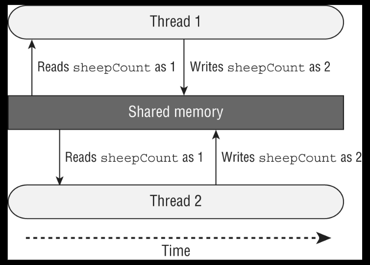
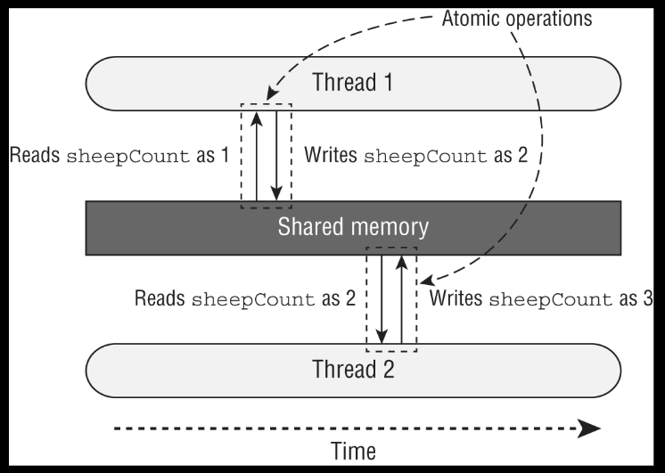
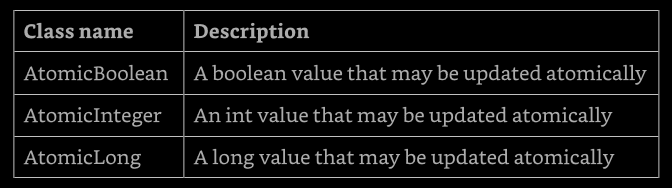
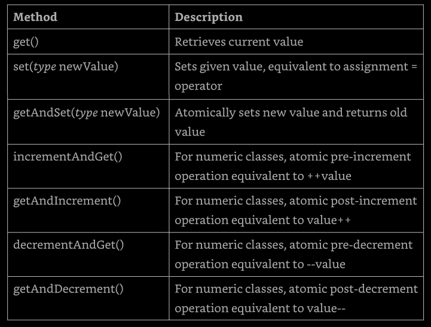
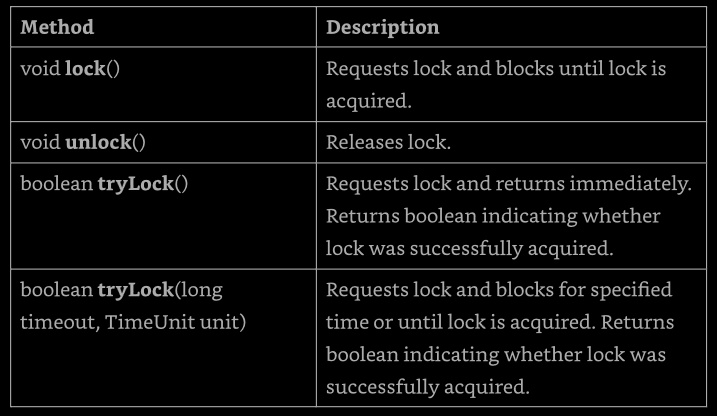
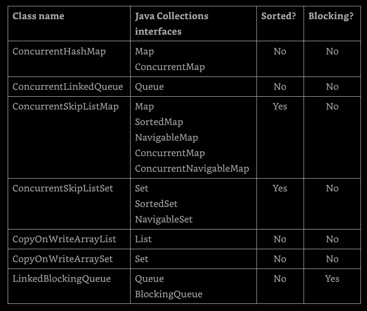
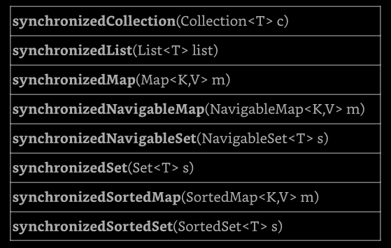
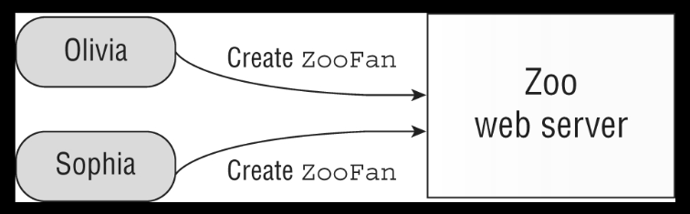

# Chapter 13: Concurrency

* Managing concurrent code execution
  - Create worker threads using `Runnable` and `Callable`, manage the thread lifecycle, 
      including automations provided by different `Executor` services and concurrent API
  - Develop thread-safe code, using different locking mechanisms and concurrent API
  - Process Java collection concurrently including the use of parallel stream.
* Working with Stream and Lambda expressions
  - Perform decomposition, concatenation, and reduction an grouping and partitioning 
      on sequential and parallel streams.

As we will see in Chapter 14, I/O, and Chapter 15, JDBC, computers are capable of 
reading and writing data to external resources. Unfortunately, as compared to CPU 
operations, these disk/network operation tend to be extremely slow. In fact, it is 
so slow that, if our computer's operating system were to stop and wait for every 
disk or network operation to finish, our computer would appear freeze constantly.

Luckily, all operation systems support what is known as _multithreaded processing_. 
The idea behind multithreaded processing is to allow an application or group of 
applications to execute multiple tasks at the same time. This allows tasks waiting 
for other resources to give way to other processing requests.

In this chapter, we will see the concept of threads and numerous way to manage 
threads using the Concurrency API. Threads and concurrency are challenging topics 
for many programmers to grasp, as problems with threads can be frustrating even 
for veteran developers. In practice, concurrency issues are among the most 
difficult problems to diagnose and resolve.


[Introducing Thread](#introducing-threads)

[Creating Threads with Concurrency API](#creating-threads-with-the-concurrency-api)

[Writing Thread-Safe Code](#writing-thread-safe-code)

[Using Concurrent Collections](#using-concurrent-collections)

[Identifying Threading Problems](#identifying-threading-problems)

[Working with Parallel Streams](#working-with-parallel-streams)


## Introducing Threads

We begin this chapter by reviewing common terminology associated with threads. A 
_thread_ is the smallest unit of execution that can be scheduled by the operation 
system. A _process__ is a group of associated threads that execute in the same 
shared environment. It follows, then, that a _single-threaded process_ is one that 
contains exactly on thread, whereas a _multithreaded process_ supports more than 
one thread.

By _shared environment_, we mean that the threads in the same process share the 
same memory space and can communicate directly with one another. Refer to Figure 13.1 
for an overview of thread and their shared environment within a process.

This figure shows a single process with three threads. It also shows how they are 
mapped to an arbitrary number of _n CPUs_ available within the system.


**Figure 13.1: Process model**

By _shared memory_ in Figure 13.1, we are generally referring to static variables 
as well as instance and local variables passed to a thread. Yes, we will finally see 
how static variables can be useful for performing complex, multithreaded tasks!. From 
Chapter %, Methods, we see that static methods and variables are defined on a single 
class object that all instances share. For example, if on thread updates the value of 
a static object, this information is immediately available for other threads within 
the process to read.


### Understanding Thread Concurrency

The property of executing multiple threads and process at the same time is referred 
to as _concurrency_. How does the system decide what to execute when there are more 
threads available than CPUs? Operating systems use a _thread schedule_ to determine 
which threads should be currently executing, as shown in Figure 13.1. For example, a 
thread schedules may employ a _round-robin scheduler_ in which each available thread 
receives an equal number of CPU cycles with which to execute, with threads visited 
in a circular order.

When a thread's alloted time is complete but the thread has not finished processing, 
a context switch occurs. A _context switch_ is the process of storing a thread's current 
state and later restoring the state of the thread to continue execution. Be aware that a 
cost is often associated with a context switch due to lost time and having to reload a 
thread's state. Intelligent thread schedulers do their best to minimize the number of 
context switches while keeping an application running smoothly.

Finally, a thread can interrupt or supersede another thread if it has a higher thread 
priority than the other thread. A _thread priority_ is a numeric value associated with 
a thread that is taken into consideration by the thread scheduler when determining 
which threads should currently be executing. In java, thread priorities are specified 
as integer values.


### Creating a Thread

One of the most common ways to define a task for a thread is by using the `Runnable` 
instance. `Runnable` is a functional interface that takes no arguments and returns no data.
```
@FunctionalInterface
public interface Runnable {
  void run();
}
```

With this, it's easy to create and start a thread. In fact, we can do so in one line of
code using the `Thread` class:
```
new Thread( () -> System.out.print("Hello") ).start();
System.out.println("Word");
```

The first line create a new `Thread` object and then starts it with the `start()` 
method. Does this code print "HelloWord" or "WordHello"? The answer is that we don't 
know. Depending on the thread priority/scheduler, either is possible. Remember that 
order of thread execution is no often guaranteed.

let's take a look at a more complex example:
```
Runnable printInventory = () -> System.out.println("Printing zoo inventory");
Runnable printRecords = () -> {
  for (int i = 0; i < 3; i++)
    System.out.println("Printing record: " + i)
};
```

Given these instances, what is the output of this block of code? 
```
1: main(String... args){
2:   System.out.println("begin");
3:   new Thread(printInventory).start();
4:   new Thread(printRecord).start();
5:   new Thread(printInventory).start();
6:   System.out.println("end")
7: }
```

The answer is that it is unknown until runtime. The following is just one possible output:
```
begin
Print record: 0
Printing zoo inventory 
end
Printing record: 1
Printing zoo inventory
Printing record: 2
```

This sample uses a total of four thread: the `main()` user thread and three addition 
thread created on lines 3, 4 and 5. Each thread created on these lines is executed as 
an asynchronous task. By _asynchronous_, we men that the thread executing the `main()` 
method does not wait for the results of each newly created thread before continuing. For 
example, lines 4 and 5 may be executed before the thread created on line 3 finishes. The 
opposite of this behavior is a _synchronous_ task in which the program waits (or blocks) 
on line 3 for the thread to finish executing before moving on the next line. The vast
majority of method call used in this book have been synchronous up until this chapter.

While the order of thread execution is indeterminate once the threads have been started, 
the order within a single thread is still linear. In particular, the `for() loop` is 
ordered. Also, "begin" always appears before "end" on the program above.

More generally, we can create a `Tread`and its associated task one of two ways in Java:
- Provide a `Runnable` object or lambda expression to the `Tread` constructor
- Create a class that extends `Thread` and overrides the `run()` method

Throughout this book, we prefer creating tasks with lambda expression. After all, 
it's a lot easier, especially when we get to the Concurrency API. Creating a class that 
extends `Tread` is relatively uncommon and should only be done under certain circumstances, 
such as if we need to overwrite other threads methods.

---
**Calling _run()_ Instead of _start()_**

Sometime we could see code that attempts to start a thread by calling `run()` instead 
of `start()`. Calling `run()` on a `Thread` or a `Runnable` _does not start a new thread_. 
While the following code snippets will compile, none will execute a task on a separate 
thread.
```
{
  System.out.println("begin");
  new Thread(printInventory).run();
  new Thread(printRecords).run();
  new Thread(printInventory).run();
  System.out.println("end");
}
```

Unlike the previous example, each line ot this code will wait until the `run()` method 
is complete before moving on the next line. Also unlike the previous program, the output 
for this code sample wil be the same every time it is executed.

---


### Distinguishing Thread Types

It might be a surprise that all Java applications, including all of the ones that we 
have presented in this book, are multithreaded because the include system threads. A 
_system thread_ is created by the JVM and runs in the background of the application. 
For example, garbage collection is managed by a system thread created by the JVM.

Alternatively, a _user defined thread_ is on created by the application developer to 
accomplish a specific task. The majority of the programs we've presented so far have 
contained only on user-defined thread, which calls the `main()` method. For simplicity, 
we commonly refer to programs that contain only a single user-defined thread as 
_single-threaded applications_.

System and user-defined threads can both be created as daemon threads. A _daemon thread_ 
is on that will no prevent the JVM from exiting when the program finishes. A Java application 
terminates when the only threads that are running are daemon threads. For example, if 
garbage collection is the only thread left running, the JVM will automatically shut down.

Let's take a look at an example. What this program outputs?
```
01: public class Zoo {
02:   public static void pause() {     // defines a thread task
03:     try {
04:       Thread.sleep(10_000);       // wait for 10 seconds
05:     } catch (InterruptedException e) {}
06:     System.out.println("Thread finished");
07:   }
08:   
09:   public static void main(String[] args) {
10:     var job = new Thread( () -> pause() );     // create tread
11:   
12:     job.start();      // start thread
13:     System.out.println("Main method finished");
14:   }
15: }
```

The program will output two statements roughly 10 seconds apart:
```
Main method finished!
--- 10 second wait ---
Thread finished!
```

That's right. Even though the `main()` method is done, the JVM will wait for the 
user thread to be done before ending the program. What if we change `job` to be a 
daemon thread by adding this to line 11?
```
11:     job.setDaemon(true);
```

The program will print the first statement and terminate without ever printing the 
second line.
```
Main method finished
```

We just need to remember that by default, user-defined threads are not daemons, and 
the program will wait for them to finish.


### Managing a Thread's Life Cycle

After a thread has been created, it is in one of six states, shown in Figure 13.2. 
We can query a thread's state by calling `getState()` on the thread object.


**Figure 13.2: Thread states**

Every thread is initialized with a `NEW` state. As soon as `start()` is called, 
the thread is moved to a `RUNNABLE` state. Does that mean it is actually running? Not 
exactly: it may be running, or it may no be. The `RUNNABLE` state just means the thread 
is able to be run. Once the work for the thread is completed or an uncaught exception 
is thrown, the thread state becomes `TERMINATED`, and no more work is performed.

While in a `RUNNABLE` state, the thread may transition to one of three states where it 
pauses its work: `BLOCKED`, `WAITING`, or `TIMED_WAITING`. This figure includes common 
transition between thread states, but there are other possibilities. For example, a 
thread that is interrupted by another thread will exit `TIMED_WAITING` and go straight 
back into `RUNNABLE`.

We cover some (but not all) of these transition in this chapter, Some thread-related 
methods -- such as `wait()`, `notify()`, and `join()` -- are beyond the scope of this 
book and are difficult to use. We should avoid them and use the Concurrency API as much 
as possible. It takes a large amount of skill (and some luck!) to use these methods.


### Polling with Sleep

Even though multithreaded programming allows us to execute multiple tasks at the 
same time, oe thread often needs to wait for the result of another thread to proceed. One 
solution is to use polling. _Polling_ is the the process of intermittently checking data 
at some fixed interval.

Let's say we have a thread that modifies a shared static counter value, and our `main()` 
thread is waiting for the thread to reach 1 million:
```
public class CheckResults {
  private static int counter = 0;
  public static void main(String[] args) {
    new Thread( () -> {
      for (int i = 0; i < 1_000_000; I++) counter++;
    }).start();
    while (counter < 1_000_000) {
      System.out.println("Not reached yet");
    }
    System.out.println("Reached: " + counter);
  }
}
```

How many times does this program print "Not reached yet"? The answer is, we don't 
know! It could output 0, 10, or a million times. Using a `while()` loop to check for 
data without some kind of delay is considered a bad coding practice as it ties up CPU 
resources for no reason.

We can improve this result by using the `Thread.sleep()` method to implement polling 
and sleep for 1000 milliseconds, aks 1 second:
```
public class CheckResultsWithSleep{
  private static int counter = 0;
  public static void main(String[] args) {
    new Thread( () -> {
      for (int i = 0; i < 1_000_000; i++) counter++;
    }).start();
    while (counter < 1_000_000) {
      System.out.println("Not reached yet");
      try {
        Thread.sleep(1_000);     // 1 second
      } catch (InterruptedExecution e) {
        System.out.println("Interrupted");
      }
    }
    System.out.println("Reached: " + counter);
  }
}
```

While one second may seem like a small amount, we have now freed the CPU to do other 
work instead of checking the counter variable infinitely within a loop. Notice that the 
`main()` tread alternated between `TIMED_WAITING` and `RUNNABLE` when `sleep()` is 
entered and exited, respectively.

How many times does the `while()` loop execute in this revised class? Still unknown! 
While polling does prevent the CPU from being overwhelmed with a potentially infinite 
loop, id does not guarantee when the loop will terminate. For example, the separate thread 
could be losing CPU time to a higher-priority process, result in multiple executions 
of the `while()` loop before it finishes.

Another issue to be concerned about is the shared `counter` variable. What if one thread 
is reading the `counter` variable while another thread is writing it? The thread reading 
the shared variable may end up with an invalid or unexpected value. We discuss these 
issues in detail in the upcoming section on writing thread-safe code.


### Interrupting a Thread

While our previous solution prevented the CPU from waiting endlessly on a `while()` loop, 
it did come at the cost of inserting one-second delays into our program. If the task takes 
2.1 seconds to run, the program will use full 3 seconds, wasting 0.9 seconds. 

One way to improve this program is to allow the thread to interrupt the `main()` thread 
when it's done:
```
public class CheckResultsWithSleepAndInterrupt {
  private static int counter = 0;
  public static void main(String[] args) {
    final var mainThread = Thread.currentTread();
    new Thread( () -> {
      for (int i = 0; i < 1_000_000; i++) counter++;
      mainThread.interrupt();     // new
    }).start();
    while (counter < 1_000_000) {
      System.out.println("Not reached yet");
      try {
        Thread.sleep(1_000);     // 1 second
      } catch (InterruptedExecution e) {
        System.out.println("Interrupted");
      }
    }
    System.out.println("Reached: " + counter);
  }
}
```

This improved version includes both `sleep()`, to avoid tying up the CPU, and 
`interrupt()`, so the thread's work ends without delaying the program. As before, 
our `main()` thread's state alternates between `TIMED_WAITING` and `RUNNABLE`. Calling 
`interrupt()`on a thread in the `TIMED_WAITING` or `WAITING` state causes the `main()` 
thread to become `RUNNABLE` again, triggering an `InterruptedException`. The thread may 
also move to a `BLOCKED` state if it needs to reacquire resources when it wakes up.

Calling `interrupt()` on a thread already in a `RUNNABLE` state doesn't change the 
state. In fact, it only changes the behavior if the thread is periodically checking 
the `Thread.isInterrupted()` value state.

[back to top](#chapter-13-concurrency)


## Creating Threads with the Concurrency API

Java includes the `java.util.concurrent` package, which we refer to as the 
Concurrency API, to handle the complicated work of managing threads for us. The 
Concurrency API includes the `ExecutionService` interface, which defines that create 
and manage threads.

We first obtain an instance of an `ExecutionService` interface, and then we send the 
service tasks to be processed. The framework includes numerous useful features, such 
as thread pooling and scheduling. It is recommended that we use this framework any 
time when we need to create and execute a separate task, even if we need only a 
single thread.

When writing multithreaded programs, it is often better to use the Concurrency API 
(or some other multithreaded SDK) rather than work with `Thread` objects directly. The 
libraries are much more robust, and it is easier to handle complex interactions.


### Introducing the Single-Thread Executor

Since `ExecutorService` is an interface, how do we can obtain an instance of it? 
The Concurrency API includes the `Executors` factory class that can be used to create 
instances of the `ExecutionService` object. Let's rewrite out earlier example with the 
two `Runnable` instances to using an `ExecutorService`.
```
{
  ExecutorService service = Executors.newSingleThreadExecutor();
  try {
    System.out.println("begin");
    service.execute(printInventory);
    service.execute(printRecords);
    service.execute(printInventory);
    System.out.println("end");
  } finally {
    service.shutdown();    // extremely necessary
  }
}
```

In this example, we use the `newSingleThreadExecutor()` method to create the service. 
Unlike our earlier example, in which we had four threads (one `main()` and three new 
thread), we have only two threads (one `main()` and one new thread). This means that 
the output, while still unpredictable, will have less variation than before. For example, 
the following is one possible output:
```
begin
Printing zoo inventory
Printing record: 0
Printing record: 1
end
Printing record: 2
Printing inventory
```

Noting that the `printRecords` loop is no longer interrupted by other `Runnable` tasks 
sent to the thread executor. With a single-thread executor, tasks are guaranteed to be 
executed sequentially. Notice that the `end` text is output while our thread executor 
tasks are still running. This is because the `main()` method is still an independent 
thread from the `ExecutorService`. 


### Shutting Down a Thread Executor

Once we have finished using a thread executor, it is important that we call the 
`shutdown()` method. A thread executor creates a `non-daemon` thread on the first task 
that is executed, so failing to call `shutdown()` will result in our application 
_never terminating_.

The shutdown process for a thread executor involves first rejecting any new tasks 
submitted to the thread executor while continuing to execute any previously submitted 
tasks. During this time, calling `isShutdown()` will return `true`, while `isTerminated()` 
will return `false`. If a new task is submitted to the thread executor while it is 
shutting down, a `RejectedExecutionException` will be thrown. Once all active task have 
been completed, `isShutdown()` and `isTerminated()` will both return `true`. Figure 13.3 
shows the life cycle of an `ExecutorService` object.


**Figure 13.3: ExecutorService life cycle**

We should be aware that `shutdown()` does not stop any tasks that have already 
been submitted to the thread executor. If we want to cancel all running and upcoming 
tasks, we have to call `shutdownNow()`, which _attempts to stop_ all running tasks and 
discards any that have not been started yet. It is not guaranteed to succeed because 
it is possible to create a thread that will never terminate, so any attempt to 
interrupt it may be ignored.


### Submitting Tasks

We can submit tasks to an `ExecutorService` instance multiple ways. The first method 
we were presented, `execute()`, is inherited from the `Executor` interface, which the 
`ExecutorService` interface extends. The `execute()` method takes a `Runnable` instance 
and completes the task asynchronously. Because the return type of the method is void, 
it does not tell us anything about the result of the task. It is considered a "fire and 
forget" method, as once it is submitted, the result are not directly available to the 
calling thread.

Fortunately, the writers of Java added `submit()` methods to the `ExecuteService` 
interface, which like `execute()`, can be used to complete tasks asynchronously. Unlike 
`execute()`, though, `submit()` return a `Future` instance that can be used to determine 
whether the task is complete. It can also be used to return a generic result object 
after the task has been completed.

Table 13.1 show the five methods including `execute()` and two `submit()` methods, 
that we need to known most. We will discuss `Future` and `Callable` in the next section.


**Table 13.1: ExecutorService methods**

In practice, using the `submit()` method is quite similar to using the `execute()`, 
except that the `submit()` return a `Future` instance that can be used to determine 
whether the task has completed execution.

---
**Submitting Tasks: _execute()_ vs _submit()_**

It might be clear that `execute()` and `submit()` methods are nearly identical when 
applied to `Runnable` expressions. The `submit()` method has the obvious advantage of 
doing the same thing `execute()` does, but with a return object that can be used to 
track the result. Because of this advantage and the fact that `execute()` does not 
support `Callable` expressions, we tend to prefer `submit()` over `execute()`, even 
if we don't store the `Future` reference.

Besides this, we need to be familiar with both `execute()` and `submit()`, since it 
may appear in many situations.

---


### Waiting for Results

How do we know when a task submitted to an `ExecutorService` is complete? As mentioned 
in the previous sections, the `submit()` method returns a `Future<V>` instance that can 
be used to determine this result.
```
Future<?> future = service.submit( () -> { System.out.println("Hello") } );
```

The `Future` type is actually an interface. For the exam, we don't need to know any 
of the classes that implement `Future`, just that a `Future` instance is returned by 
various API methods. Table 13.2 includes useful methods for determining the state 
of a task.

**Table 13.2: Future methods**


The following is an updated version of out earlier polling example `CheckResults` class, 
which uses a `Future` instance to wait for the results.
```
import java.util.concurrent.*;

public class CheckResults {
  private static int counter = 0;
  public static void main(String[] args) throws Exception {
    ExecutorService service = Executors.newSingleThreadExecutor();
    try {
      Future<?> result = service.submit( () -> {
        for (int i =0; i < 1_000_000; i++) counter++;
      });
      result.get(10, TimeUnit.SECONDS);     // returns null for Runnable
      System.out.println("Reached!");
    } catch (TimeoutException e) {
      System.out.println("Not reached in time");
    } finally {
      service.shutdown();
    }
  }
}
```

This example is similar to ut earlier polling implementation, but is does not use 
the `Tread` class directly. In part, this is the essence of the Concurrency API: to 
do complex things with threads without having to manage threads directly. It also 
waits at mos 10 seconds, throwing a `TimeoutException` on the call to `result.get()` 
if the task is not done.

What is the return value of this task? As `Future<V>` is a generic interface, the type 
`V` is determined by the return type of the `Runnable` method. Since the return type 
of `Runnable.run()` is void, the `get()` method always return null when working with 
`Runnable` expressions.

The `Future.get()` method can take an options value and enum type `TimeUnit` imported 
from the package `java.util.concurrent`. Table 13.3 presents the full list of `TimeUnit` 
values since numerous methods in the Concurrency API use this enum.

**Table 13.3: TimeUnit values**


### Introducing Callable

The `java.util.concurrent.Callable` functional interface is similar to `Runnable` 
except that its `call()` method return a value and can throw a checked exception. 
The following is the definition of the `Callable` interface:
```
@FunctionalInterface
public interface Callable<V> {
  V call() throws Exception;
}
```

The `Callable` interface is often preferable over `Runnable`, since it allows more 
details to be retrieved easily from the task after it is completed. That said, we 
use both interfaces throughout this chapter, as they are interchangeable in situations 
where the lambda does not throw an exception, and there is no return type. Luckily, 
the `ExecutorService` includes an overloaded version of the `submit()` method that 
takes a `Callable` object and return a generic `Future<T>` instance.

Unlike `Runnable`, in which the `get()` methods always return null, the `get()` 
methods on a `Future` instance return the matching generic type (which could also 
be a `null` value).

Let's take a look at an example using `Callable`:
```
var service = Executor.newSingleThreadExecutor();
try {
  Future<Integer> result = service.submit( () -> 30 + 11 );
  System.out.println(result.get());    // 41
} finally {
  service.shutdown();
}

```

We could rewrite this example using `Runnable`, some shared object, and an `interrupt()` 
or timed wait, but this implementation is a lot easier to code and understand. In essence, 
that's the spirit of the Concurrency API, give us the tools to write multithreaded code 
that is thread-safe, performant, and easy to follow.


### Waiting for All Tasks to Finish

After submitting a set of tasks to a thread executor, it is common to wait for the 
results. As we saw in the previous sections, one solution is to call `get()` on each 
`Future` object returned by the `submit()` methods. If we don't need the results of 
the tasks and are finished using our thread executor, there is a simpler approach.

First, we shut down the thread executor using the `shutdown()` method. Next, we use 
the `awaitTermination()` method available for all thread executors. The method waits 
the specified time to complete all tasks, returning sooner if all tasks finish or an 
`InterruptedExecution` is detected. We can see an example of this in the following 
code snippet:
```
ExecutionService service = Executors.newSingleThreadExecutor();
try {
  // add tasks to the thread executor
} finally {
  service.shutdown();
}
service.awaitTermination(1, TimeUnit.MINUTES);

// check whether all tasks are finished
if (service.isTerminated()) System.out.println("All finished!");
else System.out.println("At least one task is still running");
```

In this example, we submit a number of tasks to the thread executor and then shut 
down the thread executor and wait up to one minute for the results. Notice that we 
can call `isTerminated()` after the `awaitTermination()` method finishes to confirm 
that all tasks are finished.


### Scheduling Tasks

Often in Java, we need to schedule a task to happen at some future time. We might 
even need to schedule the task to happen repeatedly, at some set interval. For example, 
imagine that we want to check the supply of food for zoo animal once an hour and fill 
it as needed. `ScheduledExecutorService`, which is a sub-interface of `ExecutorService`, 
can be used for just such as task.

Like `ExecutorService`, we obtain an instance of `ScheduledExecutorService` using a 
factory method in the `Executors` class, as shown in the following snippet:
```
ScheduledExecutorService service = Executors.newSingleThreadScheduledExecutor();
```

We could store an instance of `ScheduledExecutorService` in an `ExecutorService` variable, 
although doing so would mean we'd have to cast the object to call any scheduling methods.

Refer to Table 13.4 for our summary of `ScheduledExecutorService` methods. Each of these 
methods return a `ScheduledFuture` object.

**Table 13.4: ScheduledExecutorService methods**


In practice, these methods are among the most convenient in the Concurrency API, 
as they perform relatively complex tasks with a single line of code. The `delay` and 
`period` parameters rely on the `TimeUnit` argument to determine the format of the 
value, such as seconds or milliseconds.

The first two `schedule()` methods in Table 13.4 take a `Callable` or `Runnable`, 
respectively to perform a task after some delay and return a `ScheduleFuture` instance. 
The `ScheduledFuture` instance is identical to the `Future` interface, except that it 
includes a `getDelay()` method that returns the remaining delay. The following uses the 
`schedule()` methods with `Callable` and `Runnable` tasks:
```
ScheduledExecutorService service = Executors.newSingleThreadScheduledExecutor();

Runnable task1 = () -> System.out.println("Hello zoo");
Callable<String> task2 = () -> "Monkey";

ScheduledFuture<?> r1 = service.schedule(task1, 10, TimeUnit.SECONDS);
ScheduledFuture<?> r2 = service.schedule(task2, 8, TimeUnit.MINUTES);
```

The first task is schedule 10 seconds in the future, whereas the second task is 
scheduled 8 minutes in the future. While these tasks are scheduled in the future, 
the actual execution may be delayed. For example, there may be no threads available 
to perform the tasks, at which point they will just wait in the queue. Also, if the 
`ScheduledExecutorService` is shut down by the time the scheduled task execution 
time is reached, then these tasks will be discarded.

Each of the `ScheduledExecutorService` methods is important and has real-world 
applications. For example, we can use the `schedule()` command to check on the state 
of cleaning a lion's cage. It can then send out notifications if it is not finished 
or even call `schedule()` to check again later.

The last two methods in Table 13.4 might be a little confusing, conceptually, they 
area similar as they both perform the same task repeatedly after an initial delay. The 
difference is related to the timing of the process and when the next task starts.

The `scheduleAtFixedRate()` method created a new task an submits it to the executor 
every period, regardless of whether the previous task finished. The following example 
executes a `Runnable` task every minute, following an initial five-minute delay:
```
service.scheduleAtFixedRate(command, 5, 1, TimeUnit.MINUTES);
```

the `scheduleAtFixedRate()` method is useful for tasks that need to be run at specific 
intervals, such as checking the health of the animals once a day. Even if it takes two 
hours to examine an animal on Monday, this doesn't mean that Tuesday's exam should 
start any later in the day.

Bad things can happen with `scheduleAtFixedRate()` if each task consistently takes 
longer to run than the execution interval. Imagine if our boss came by our desk every 
minute and dropped of a piece of paper. Now imagine that it took us five minutes to read 
each piece of paper. Before long, we would be drowning in piles of paper. This is how 
an executor feels. Given enough time, the program would submit more tasks to the 
executor service than could fit in memory, causing the program to crash.

On the other hand, the `scheduleWithFixedDelay()` method creates a new task only after 
the previous task has finished. For example, if a task runs as 12:00 and takes five 
minutes to finish, with a period between executions of two minutes, the nest task will 
start as 12:07.
```
service.scheduleWithFixedDelay(task1, 0, 2, TimeUnit.MINUTES);
```

The `scheduleWithFixedDelay()` method is useful for processes that we want to happen 
repeatedly but whose specific time in unimportant. For example, imagine that we have 
a soo cafeteria worker who periodically restocks the salad bar through the day. The 
process can take 20 minutes or more, since i requires the worker to haul a large number 
of items from the back room. Once the worker has filled the salad bar with fresh food, 
they don't need to check at some specific time, just after enough time has passed for 
it to become low on stock again.


### Increasing Concurrency with Pods

All of our examples up until now have been with a single-thread executor, which, 
while interesting, weren't particularly useful. We now present three additional factory 
methods in the `Executors` class that act on a pool of threads rather than on a single 
thread. A _thread pool_ is a group of pre-instantiated reusable threads that are 
available to perform a set of arbitrary tasks. Table 13.5 show them.

**Table 13.5: Executors factory methods**


As shown in Table 13.5, these methods return the same instance types, `ExecutorService` 
and `ScheduledExecutorService`, that we used earlier in this chapter. In other words, all 
of our previous examples are compatible with these new pooled-thread executors.

The difference between a single-treaded and a pooled-threaded executor is what happens 
when a task is already running. While a single-thread executor will wait for the thread 
to become available before running the next task, a pooled-thread executor can execute 
the next task concurrently. If the pol runs out of available threads, the task will be 
queued by the thread executor and wait to be completed.

[back to top](#chapter-13-concurrency)


## Writing Thread-Safe Code

_Thread-safety_ is the property of an object that guarantees safe execution by multiple 
threads at the same time. Since threads run in a shared environment and memory space, 
how do we prevent two threads from interfering with each other? We must organize access 
to data so that we don't end up with invalid or unexpected results.

In this part of the chapter, we will see how to use a variety of techniques to protect 
data, including atomic classes, synchronized blocks, the Lock Framework, and cyclic barriers.


### Understanding Thread-Safety

Imagine that our zoo has a program to count sheep, preferable on that won't pub the 
zoo worker to sleep!. Each zoo worker urns out to a field, adds a new sheep to the flock, 
count the total number of sheep, and runs back to us to report the results. We present 
the following code to represent this conceptually, choosing a thread pool size so that 
all tasks can be run concurrently:
```
01: import java.util.concurrent.*;
02: 
03: public class SheepManager {
04:   private int sheepCount = 0;
05:   private void incrementAndReport() {
06:     System.out.print( (++sheepCount) + " ");
07:   }
08:   public static void main(String[] args) {
09:     ExecutorService service = Executors.newFixedThreadPool(20);
10:     try {
11:       SheepManager manager = new SheepManager();
12:       for (int i = 0; i < 10; i++)
13:         service.submit( () -> manager.incrementAndReport() );
14:     } finally {
15:       service.shutdown();
16:     }
17:   }  // end main
18: }  // end class
```

What does this program output? We might thing it will output numbers from 1 to 10, 
in order, bu that is far from guaranteed. It may output in a different order. Worse 
yet, it may print some number twice and no print some number all all!. The following 
are possible output of this program:
```
12345678910
1987366245
1873265429
```

So, what went wrong? In this example, we use the pre-increment (++) operator to 
update the `sheepCount` variable. A problem occurs when two threads both execute 
the right side of the expression, reading the "old" value before either thread 
writes the "new" value of the variable. The two assignments become redundant, they 
both assign the same new value, with one thread overwriting the results of the 
other. Figure 13.4 demonstrates this problem with two threads, assuming that 
`sheepCount` has a starting value of 1.



**Figure 13.4: Lack of thread synchronization**

We can see in Figure 13.4 that both threads read and write the same values, causing 
one of the two `++sheepCount` operations to be lost. Therefore, the increment operator 
`++` is not thread-safe. As we will see later in this chapter, the unexpected result of 
two tasks executing an the same time is referred to as a _race condition_.

Conceptually, the idea here is that some zoo worker may run faster on their way to 
the field but more slowly on their way back and report late. Other worker may get to 
the field last but somehow be the first ones back to report the results.


### Accessing Data with _volatile_

The `volatile` keyword is used to guarantee that access to data within memory is 
consistent. For example, it is possible (albeit unlikely) that our `SheepManager` 
example using `++sheepCount` return an unexpected value due to invalid memory access 
while the code is executing a critical section. Conceptually, this corresponds to 
one of our zoo employees tripping on the way back from the field and someone asking 
them the current number of sheep while they are still trying to get up!

The `volatile` attribute ensures that only on thread is modifying a variable at 
one time and that data read among multiple threads is consistent. In this manner, we 
don't interrupt one of our zoo workers in the middle of running. So, does `volatile` 
provide thread-safety? Not exactly. Consider this replacement to our previous 
application:
```
04: private volatile int sheepCount = 0;
05: private void incrementAndReport() {
06:   System.out.print( (++sheepCount) + " "); 
07: }
```

Unfortunately, this code is not thread-safe and could still result in numbers 
been missed:
```
2617532948
```

The reason this code is not thread-safe is that `++sheepCount` is still two distinct 
operations. Put another way, if the increment operator represents the expression 
`sheepCount = sheepCount + 1`, then each read and write operation is thread-safe, but 
the combined operation is not. Referring back to out sheep example, we don't interrupt 
the employee while running, but we could still have multiple in the field at the same 
time. Because of this, **in practice, `volatile` is rarely used**.


### Protecting Data with Atomic Classes

In our previous `SheepManager` applications, the same values were printed twice, 
with the highest counter being 9 instead of 10. As we saw, the increment operator 
`++` is not thread-safe, even when `volatile' is used. It is not thread-safe because 
the operation is not atomic, carrying out two tasks, read and write, that can be 
interrupted by other threads.

_Atomic_ is the property of an operation to be carried out as a single unit of 
execution without any interference from another thread. A thread-safe atomic version 
of the increment operator would perform the read and write of the variable as a single 
operation, not allowing any other threads to access the variable during the operation. 
Figure 13.5 shows the result of making the `sheepCount` variable atomic.



**Figure 13.5: Thread synchronization using atomic operations**

In this case, any thread trying to access the `sheepCount` variable while an atomic 
operation is in process will have to wait until the atomic operation on the variable 
is complete. Conceptually, this is like setting a rule four our zoo worker that there 
can be only one employee in the field at a time. Although they may not each report 
their result in order.

Since accessing primitives and references is common in Java, the Concurrency API 
includes numerous useful classes in the `java.util.concurrent.atomic` package. Table 
13.6 list the most common class that we need to be familiar. As with many of the 
classes in the Concurrency API< these classes exist to make our life easier.

**Table 13.6: Atomic classes**



How dow we use atomic classes? Each class includes methods that are equivalent 
to many of the primitive built-in operations that we use on primitives, such as the 
assignment operator (=) and the increment operators (++). In Table 13.7 the most 
common methods from atomic classes are show. The `type` is determined by the class.

In the following example, an updated version of out `SheepManager` class with an 
`AtomicInteger` 
```
import java.util.concurrent.atomic.*;

private AtomicInteger sheepCount = new AtomicInteger(0);
private void incrementAndReport() {
  System.out.println(sheepCount.incrementAndGet() + " ");
}
```

**Table 13.7: Common atomic methods**



How does this implementation differ from out previous examples? When we runt this 
modification, we get varying output, such as the following:
```
2 3 1 4 5 6 7 8 9 10
1 4 3 2 5 6 7 8 9 10
1 4 3 5 6 2 7 8 10 9
```

Unlike out previous sample output, the number 1 through 10 will alway be printed, 
although the order is still not guaranteed (this will be address shortly). The key 
in this section is that using the atomic classes ensures that the data is consistent 
between workers and that no values are lost due to concurrent modifications.


### Improving Access with _synchronized_ Blocks

While atomic classes are great at protecting a single variable, they aren't particularly 
useful if we need to execute a series of commands or call a method. For example, we can't 
use them to update two atomic variables at the same time. How do we improve the results 
so that each worker is able to increment and report the results in order?

The mos common technique is to use a monitor to synchronize access. A _monitor_, also 
called a _lock_, is a structure that support _mutual exclusion_, which is the property 
that a most on thread is executing a particular segment of code at a given time.

In Java, any `Object` can be used as a monitor, along with the `synchronized` keyword, 
as shown in the following example:
```
var manager = new SheepManager();
synchronized(manager) {
  // work to be completed by on thread at a time
}
```

this example is referred to as a _synchronized block_. Each thread that arrives will 
first check if any threads are already running the block. If the lock is not available, 
the thread will transition to a `BLOCKED` state until it can "acquire the lock". If the 
lock is available (or the thread already holds the lock), the single thread will enter 
the block, preventing all other threads from entering. Once the thread finishes executing 
th block, it will release the lock, allowing on of the waiting thread to proceed.

---
To synchronize access across multiple threads, each thread must have access to the _same_ 
object. If each thread synchronizes on different objects, the code is not thread-safe.
---

Let's revisit our `SheepManager` example that used `++sheepCount` and see whether we can 
improve the results so that each worker increments and outputs the counter in order. Let's 
say that we replaced our `for()` loop with the following implementation:
```
12:   for (int i = 0; i < 10; i++) {
13:     synchronized(manager) {
14:       service.submit( () -> manager.incrementAndReport() );  
15:     }
16:   }
```

Dos this solution fix the problem? No, it does not! The problem here is that we've 
synchronized the _creation_ of the threads but not the _execution_ of the threads. In 
this example, the threads would be created one at a time, but the might all still execute 
and perform their work simultaneously, result in the same type of output that we saw 
earlier. We did say diagnosing and resolving thread problems is difficult in practice!

Now a corrected version of the `SheepManager` class that orders the workers.
```
01: import java.util.concurrent.*;
02: 
03: public class SheepManager {
04:   private int sheepCount = 0;
05:   private void incrementAndReport() {
06:     synchronized(this) {
07:       System.out.print( (++sheepCount) + " ");
08:     }
09:   }
10:   public static void main(String[] args) {
11:     ExecutorService service = Executors.newFixedThreadPool(20);
12:     try {
13:       var manager = new SheepManager();
14:       for (int i = 0; i < 10; i++)
15:         service.submit( () -> manager.incrementAndReport() );
16:     } finally {
17:       service.shutdown();
18:     }
19:   }
20: }
```

When this code executes, it will consistently output the following:
```
1 2 3 4 5 6 7 8 9 10
```

Although all threads are still created and executed at the same time, they each 
wait at the synchronized block for the worker to increment and report the result before 
entering. In this manner, each zoo worker waits for the previous zoo worker to come 
back before running out on the field. While it's random which zoo worker will run out 
next, it is guaranteed that there will be at most one on the field and that the result 
will be reported in order.

We could have synchronized on any object, as long as it was the same object. For 
example, the following code snipped would also work:
```
05:  private final Object herd = new Object();
06:  private void incrementAndReport() {
07:    synchronized(herd) {
08:      System.out.print( (++sheepCount) + "");
09:    }
10:  }
```

Although we didn't need to make the `heard` variable `final`, doing so ensures 
that it is not reassigned after threads start using it.


### Synchronizing on Methods

In the previous example, we established out monitor using `synchronized(this)` around 
the body of the methods. Java provided a more convenient compiler enhancement for doing 
so. We can add the `synchronized` modifier to any instance method to synchronize 
automatically on the object itself. For example, the following two method definitions 
are equivalent:
```
void sing(){
  synchronized(this) {
    System.out.print("La la la...");
  }
}

synchronized void sing() {
  System.out.print("La la la...")
}
```

The first uses a synchronized block, whereas the second uses the synchronized method 
modifier. Which to use is completely up to us. We can also apply the `synchronized` 
modifier to static methods. What object is used as the monitor when we synchronize on 
a static method? The class object, of course. For example, the following two methods 
are equivalent for static synchronization inside out `SheepManager` class:
```
static void dance() {
  synchronized(SheepManager.class) {
    System.out.print("Let's go dance")
  }
}

static synchronized void dance() {
  System.out.print("Let's go dance")
}
```

As before, the first uses a synchronized block, with the second example using the 
synchronized modifier. We can use static synchronization if we need to order thread 
access across all instances rather than a single instance.


### Understanding the _Lock Framework_

A synchronized block supports only a limited set of functionality. For example, 
what if we want to check whether a lock is available and, if it is not, perform some 
other task? Furthermore, if the lock is never available and we synchronize on it, we 
might wait forever.

The Concurrency API includes the `Lock` interface, which is conceptually similar to 
using the `synchronized` keyword but with a lot more bells and whistles. Instead of 
synchronizing on any `Object`, though, we can "lock" only on an object that implements
the `Lock` interface.

#### Applying a _ReentrantLock_

The `Lock` interface is pretty easy to use. When we need to protect a piece of code 
from multithreaded processing, create an instance of `Lock` that all threads have 
access to. Each thread then calls `lock()` before it enters the protected code and 
calls `unlock()` before it exits the protected code.

For contrast, the following shows two implementations, on with a synchronized block 
and one with a `Lock` instance. While longer, the `Lock` solution has a number of 
features not available to the synchronized block.
```
// implementation #1 with a synchronized block
Object object = new Object();
synchronized(object) {
  // protected code
}

// implementation #2 with a Lock
Lock lock = new ReentrantLock();
try {
  lock.lock();
  // protected code
} finally {
  lock.unlock();
}
```

these two implementations are conceptually equivalent. The `ReentrantLock` class is 
a simple monitor that implements the `Lock` interface and supports mutual exclusion. 
In other words, at most on thread is allowed to hold a lock at any given time.

---
While certainly not required, it is a good practice to use a `try/finally` block 
with `Lock` instances. Doing so ensures that any acquired lock is properly released.
---

The `ReentrantLock` class ensures that once a thread has called `lock()` and obtained 
the lock, all other threads that call `lock()` will wait until the first thread calls 
`unlock()`. Which thread gets the lock next depends on the parameters used to create 
the `Lock` object.

The `ReentrantLock` class includes a constructor that takes a single boolean and sets 
a "fairness" parameter. If the parameter is set to `true`, the lock will usually be 
granted to each thread in the order in which it was request. It is `false` by default 
when using the no-argument constructor. In practice, we should enable fairness only 
when ordering is absolutely required, as it could lead to a significant slowdown.

Besides always making sure to release a lock, we also need to be sure that we only 
release a lock that we have. If we attempt to release a lock that we don not have, 
we will get an exception at runtime.
```
Lock lock = new ReentrantLock();
lock.unlock();                    // IllegalMonitorStateException
```

The `Lock` interface includes four methods we should know for every day life, as 
listed in Table 13.8

**Table 13.8: Lock methods**




#### Attempting to Acquire a Lock

While the `ReentrantLock` class allows us to wait for a lock, it so far suffers 
from the same problem as a synchronized block. A thread could end up waiting forever 
to obtain a lock. Luckily, Table 13.8 includes two additional methods that made the 
`Lock` interface a lot safe to use than a synchronized block.

For convenience, we will use the following `printHello()` method for the code in this 
section:
```
public static void printHello(Lock lock) {
  try {
    lock.lock();
    System.out.println("Hello");
  } finally {
    lock.unlock();
  }
}
```

**tryLock()**

The `tryLock()` method will attempt to acquire a lock and immediately return a 
boolean result indicating whether the lock was obtained. Unlike the `lock()` method, 
it does not wait if another thread already holds the lock. It return immediately, 
regardless of whether a lock is available.

The following is a sample implementation using the `tryLock()` method:
```
Lock lock = new ReentrantLock();
new Thread( () -> printHello(lock) ).start();
if (lock.tryLock()) {
  try {
    System.out.println("Lock obtained, entering protected code");
  } finally {
    lock.unlock();
  }
} else {
  System.out.println("Unable to acquire lock, doing something else");
}
```

When we run this code, it could produce either the `if` or the `else` message, 
depending on the order of execution. It will always print "Hello", though, as the 
cal to `lock()` in `printHello()` will wait indefinitely for the lock to become 
available. A fun exercise is to insert some `Thread.sleep()` delays int this
snippet to encourage a particular message to be displayed.

Like `lock()`, the `tryLock()` method should be used with a `try/finally` block. 
Fortunately, we nee to release the lock only if it was successfully acquired. For 
this reason, it is common to use the output of `tryLock()` in an `if` statement, 
so that `unlock()` is called only when the lock is obtained.


**tryLock(long, TimeUnit)**

The `Lock` interface includes an overloaded version of `tryLock(long, TimeUnit)` 
that acts like a hybrid of `lock()` and `tryLock()`. Like the other two methods, if 
a lock is available, it will immediately return with it. If a lock is unavailable, 
though, it will wait up to the specified time limit for the lock.

The following code snippet uses the overloaded version of `tryLock(long, TimeUnit)`:
```
Lock lock = new ReentrantLock();
new Thread( () -> printHello(lock) ).start();
if (lock.tryLock(10, TimeUnit.SECONDS)) {
  try {
    System.out.println("Lock obtained, entering protected code");
  } finally {
    lock.unlock()
  }
} else {
  System.out.println("Unable to acquire lock, doing something else");
}
```

The code is the same as before, except this time, one of the threads waits up to 
10 seconds to acquire the lock.


#### Acquiring the Same Lock Twice

The `ReentrantLock` class maintains a counter of the number of times a lock has 
been successfully granted to a thread. To release the lock for other threads to use, 
`unlock()` must called the same number of times the lock was granted. The following 
code snippet contains an error:
```
Lock lock = new ReentrantLock();
if (lock.tryLock()) {
  try {
    lock.lock();
    System.out.println("Lock obtained, entering protected code");
  } finally {
    lock.unlock();
  }
}
```

The thread obtains the lock twice but releases it only once. We can verify this 
by spawning a new thread after this code runs that attempts to obtain a lock. The 
following prints false:
```
new Thread( () -> System.out.print(lock.tryLock()) ).start();    // false 
```

---
It is critical that we release a lock the same number of times it is acquired. For 
call with `tryLock()`, we need to call `unlock()` only if the method returned `true`.
---


#### Reviewing the _Lock_ Framework

To review, the `ReentrantLock` class supports the same features as a synchronized 
block while adding a number of improvements:
- Ability to request a lock without blocking.
- Ability to request a lock while blocking for a specific amount of time.
- A lock can be created with a fairness property, in which the lock is granted 
    to threads in the order in which it as requested.

---

Theres is also a more specialized `Lock` class, `ReentrantReadWriteLock` is a 
useful class. It includes separate locks for reading and writing data and is useful 
on data structures where reads are far more common that writes. For example, if we 
have a thousand threads reading data but only one thread writing data, this class 
can help us to maximize concurrent access.

---


### Orchestrating Tasks with a _CyclicBarrier_

We started the thread-safety topic by discussing protecting individual variables 
and then moved on to blocks of code and locks. We complete our discussion of thread-
safety by showing how to orchestrate complex tasks with many steps.

Our zoo workers are back, and this time they are cleaning pens. Imagine a lion pen 
that needs to be emptied, cleaned, and then refilled with the lions. To complete the 
task, we have assigned four zoo workers. Obviously, we don't want to start cleaning 
the cage while a lion is roaming in it, or we lose a zoo worker! Furthermore, we don't 
want to let the lions back into the pen while it still being cleaned.

We could have all of the work completed by a single worker, but this would be slow and 
ignore the fact that we have three zoo worker standing by to help. A better solution 
would be to have all four zoo employees work concurrently, pausing between the end of 
one set of tasks and the start of the next.

To coordinate these tasks, we can use the `CyclicBarrier` class:
```
import java.util.concurrent.*;

public class LionPenManager {
  private void removeLions() {
    System.out.println("Removing lions");
  }
  private void cleanPen() {
    System.out.println("Cleaning the pen");
  }
  private void addLions() {
    System.out.println("Adding lions");
  }
  public void performTask() {
    removeLions();
    cleanPen();
    addLions();
  }
  public static void main(String[] args) {
    var service = Executors.newFixedThreadPool(4);
    try {
      var manager = new LionPenManager();
      for (int i = 0; i < 4; i++)
        service.submit( () -> manager.performTask() );
    } finally {
      service.shutdown();
    }
  }
}
```

The following is sample output base on this implementation;
```
Removing lions
Removing lions
Cleaning the pen
Adding lions
Removing lions
Cleaning the pen
Adding lions
Removing lions
Cleaning the pen
Adding lions
Cleaning the pen
Adding lions
```

Although the results are ordered within a single thread, the output is entirely random 
among multiple workers. We see that some lions are still being removed while the cage 
is being cleaned, and other lions are added before the cleaning process is finished.

We can improve these results by using the `CyclicBarrier` class. The `CyclicBarrier` 
takes in its constructors a `limit` value, indicating the number of threads to wait 
for. As each thread finishes, it call the `await()` method on the cyclic barrier. Once 
the specified number of thread have each called `await()`, the barrier is released, 
and all threads can continue.

```
import java.util.concurrent.*;

public class LionPenManager {
  private void removeLions() {
    System.out.println("Removing lions");
  }
  private void cleanPen() {
    System.out.println("Cleaning the pen");
  }
  private void addLions() {
    System.out.println("Adding lions");
  }
  public void performTask(CyclicBarrier c1, CyclicBarrier c2) {
    try {
      removeLions();
      c1.await();
      cleanPen();
      c2.await();
      addLions();
    } catch (InterruptedException | BrokenBarrierException e) {
      // handle checked exceptions here
    }
  }
  public static void main(String[] args) {
    var service = Executors.newFixedThreadPool(4);
    try {
      var manager = new LionPenManager();
      var c1 = new CyclicBarrier(4);
      var c2 = new CyclicBarrier(4, () -> System.out.println("*** Pen Cleaned!"));
      for (int i = 0; i < 4; i++) {
        service.submit( () -> manager.performTask(c1, c2) );
      }
    } finally {
      service.shutdown();
    }
  }
}
```

The following is sample output based on this revised implementation of our 
`LionPenManager` class:
```
Removing lions
Removing lions
Removing lions
Removing lions
Cleaning the pen
Cleaning the pen
Cleaning the pen
Cleaning the pen
*** Pen Cleaned!
Adding lions
Adding lions
Adding lions
Adding lions
```

As we can see, all of the results are now organized. Removing the lions happens 
in one step, as does cleaning the pen and adding the lions back in. In this example, 
we used two different constructors for out `CyclicBarrier` objects, the latter of 
which executes a `Runnable` instance upon completion.

The `CyclicBarrier` class allows us to perform complex, multithread tasks while 
all threads stop and wait at logical barriers. This solution is superior to a single-
threaded solution, as the individual tasks, such as removing the lions, can be 
completed in parallel by all four zoo workers.

[back to top](#chapter-13-concurrency)


## Using Concurrent Collections

Besides managing threads, the Concurrency API includes interfaces and classes 
that help us coordinate access to collection shared by multiple tasks. By collections, 
we are referring to the Java Collections Framework that we studied in Chapter 9. In 
this section we will see many of the concurrent classes available to us when using 
the Concurrent API.


### Understanding Memory Consistency Errors

The purpose of the concurrent collection classes is to solve common memory 
consistency errors. A _memory consistency error_ occurs when two threads have 
inconsistent views of what should be the same data. Conceptually, we want writes 
on one thread to be available to another thread if it accesses the concurrent 
collection after the write has occurred.

When two threads try to modify the same nonconcurrent collection, the JVM may 
throw a `ConcurrentModificationException` at runtime. In fact, it can happen 
with a single thread. Take a look at the following code snippet:
```
11: var foodData = new HashMap<String, Integer>();
12: foodData.put("penguin", 1);
13: foodData.put("flamingo", 2);
14: for (String key : foodData.keySet() )
15:   foodData.remove(key);
```

This snippet will throw a `ConcurrentModificationException` during the second 
iteration of the loop, since the iterator on `keySet()` is not properly updated after 
the first element is removed. Changing the first line to use a `ConcurrentHashMap` 
will prevent the code from throwing an exception at runtime.
```
11: var foodData = new ConcurrentHashMap<String, Integer>();
```

Although we don't usually modify a loop variable, this example highlights the fact 
that the `ConcurrentHashMap` is ordering read/write access such that all access to 
the class is consistent. In this code snippet, the iterator created by `keySet()` 
is updated as soon as an object is removed from the `Map`

The concurrent classes wre created to help avoid common issues in which multiple 
threads are adding and removing objects from the same collections. At any given 
instance, all threads should have the same consistent view of the structure of 
the collection.


### Working with Concurrent Classes

We should use a concurrent collection class any time we have multiple threads 
modifying a collection outside a synchronized block or method, even if we don't 
expect a concurrency problem. Without the concurrent collections, multiple threads 
accessing a collection could result in an exception being thrown or, worse, 
corrupted data.

---

If the collection is immutable (and contains immutable objects), the concurrent 
collection are not necessary. Immutable objects can be accessed by any number of 
threads and do not require synchronization. By definition, they do not change, 
so there is no chance of a memory consistency error.

---

When passing around a concurrent collection, a caller may need to know the 
particular implementation class. That said, it is considered a good practice 
to pass around a non-concurrent interface reference when possible, similar to
hwo we instantiate a `Hashmap` but often pass around a `Map` reference:
```
Map<String, Integer> map = new ConcurrentHashMap<>();
```

Table 13.9 list the common concurrent classes with which we should be familiar.

**Table 13.9: Concurrent collection classes**




Most of the classes in Table 13.9 are just concurrent versions of their non-
concurrent counterpart classes, such as `ConcurrentHashMap` vs. `Map`, or 
`ConcurrentLinkedQueue` vs `Queue`. We don't need to know any class-specific 
concurrent methods. We just need to known the inherited methods, such as 
`get()` and `set()` for `List` instances.

The `Skip`  classes might sound strange, but they are just "sorted" versions of 
the associated concurrent collections. When we see a class with `Skip` in the name, 
we have to just think "sorted concurrent" collections, and the rest should follow 
naturally.

The `CopyOnWrite` classes behave a little differently than the other concurrent 
examples we have seen. These classes create a copy of the collection any time a 
reference is added, remove, or changed in the collection and then update the original 
collection reference to point to the copy. These classes are commonly used to 
ensure an iterator doesn't see modifications to the collection.

Let's take a look at how this works with an example:
```
List<Integer> favNumbers = new CopyOnWriteArrayList<>(List.of(4, 3, 42));
for (var n : favNumber) {
  System.out.println(n + " ");     // 4 3 42
  favNumbers.add(n+1);
}
System.out.println();
System.out.println("Size: " + favNumbers.size());     // Size: 6
```

Despite adding elements, the iterator is not modified, and the loop executes 
exactly three times. Alternatively, if we had used a regular `ArrayList`object, 
a `ConcurrentModificationException` would have been thrown at runtime. The `CopyOnWrite` 
classes can use a lot of memory, since a new collection structure is created any time 
the collection is modified. Therefore, they are commonly used in multithreaded 
environment situations where readds are far more common than writes.

A `CopyOnWrite` instance is similar to an immutable object, as a new underlying 
structure is created every time the collection is modified. Unlike a true immutable 
object, though, the reference to the object stays the same even while the underlying 
data is changed.

Finally, Table 13.9 includes `LinkedBlockingQueue`, which implements the concurrent 
`BlockingQueue` interface. This class is just like a regular `Queue`, except that 
it includes overloaded version of `offer(0` and `poll()` that take a timeout. These 
methods wait (or block) up to a specific amount of time to complete an operation


### Obtaining Synchronized Collections

Besides the concurrent collection classes that we have covered, the Concurrency API 
also includes methods for obtaining synchronized version of existing non-concurrent 
collection objects. These synchronized methods are defined in the `Collections` class. 
They operate on the inputted collection and return a reference that is the same type 
as the underlying collection. These methods as listed on Table 13.10.

**Table 13.10: Synchronized Collections methods**




If we are writing code to create a collection an it requires synchronization, 
we should use the class defined in Table 19.9. On the other hand, if we are passed 
a non-concurrent collection and need synchronization, we use the methods in 13.10.

[back to top](#chapter-13-concurrency)


## Identifying Threading Problems

Now that we know how to write thread-safe code, let's talk about what qualifies 
as a threading problem. A threading problem can occur in multithreaded applications 
when two or more threads interact in an unexpected an undesirable way. For example, 
two threads may block each other from accessing a particular segment of code.

The Concurrency API was created to help eliminate potential threading issues 
common to all developers. As we have seen, the Concurrency API created threads and 
manages complex thread interactions for us, often in just a few lines of code.

Although the Concurrency API reduces the potential for threading issues, it does 
not eliminate them. In practice, finding an identifying threading issues within an 
application is often on of the most difficult tasks a developer can undertake.


### Understanding Liveness

As we have seen in this chapter, many thread operations can be performed 
independently, but some require coordination. For example, synchronizing on a method 
requires all threads that call the method to wait for other threads to finish before 
continuing. We also saw earlier in the chapter that threads in a `CyclicBarrier` will 
each wait for the barrier limit to be reached before continuing.


What happened to th application while all of these threads are waiting? In many cases, 
the waiting is ephemeral, and the user has very little idea that any delay has occurred. 
In other cases, though, the waiting may be extremely long, perhaps infinite.

_Liveness_ is the ability of an application to be able to execute in a timely manner. 
Liveness problems, then, are those in which the application becomes unresponsive or is 
in some kind of "stuck" state. More precisely, liveness problems are often the result 
of a thread entering a `BLOCKING` or `WAITING` state forever, or repeatedly entering or 
exiting these states. There are three types of liveness issues with which we should be 
familiar: deadlock, starvation, and livelock.

#### Deadlock

_Deadlock_ occurs when two or more threads are blocked forever, each waiting on 
the other. We can illustrate this principle with the following example. Imagine that 
our zoo has two foxes: Foxy and Tails. Foxy likes to eat first and then drink wanter, 
while Tails kikes to drink water first and then eat. Furthermore, neither animal 
likes to share, and they will finish their meal only if the have exclusive 
access to both food an water.

The zookeeper places the food on one side of the environment and the water on the 
other side. Although our foxes are fast, it still takes them 100 milliseconds to run 
from one side of the environment to the other.

What happens if Foxy gets the food first and Tails gets the water first? The 
following application models this behavior:
```
import java.util.concurrent.*;

class Food {}
class Water {}
public record Fox(String name) {
  public void eatAndDrink(Food food, Water water) {
    synchronized(food) {
      System.out.println( name() + " Got Food");
      move();
      synchronized(water) {
        System.out.println( name() + " Got Water");
      }
    }
  }
  public void drinkAndEat(Food food, Water water) {
    synchronized(water) {
      System.out.println( name() + " Got Water");
      move();
      synchronized(food) {
        System.out.println( name() + " Got Food");
      }
    }
  }
  public void move() {
    try {
      Thead.sleep(100);
    } catch (InterruptedException e) {}
  }
  public static void main(String[] args) {
    // create participants and resources
    var foxy = new Fox("Foxy");
    var tails = new Fox("Tails");
    var food = new Food();
    var water = new Water();
    var service = Executors.newScheduledThreadPool(10);
    try {
      service.submit( () -> foxy.andAndDrink(food, water));
      service.submit( () -> tails.drinkAndEat(food, water)); 
    } finally {
      service.shutdown();
    }
  }
}
```

In this example, Foxy obtains the food and then moves to the other side of the 
environment to obtain the water. Unfortunately, Tails already drank the water and 
is waiting for the food to become available. The result is that our program 
outputs the following, and it hangs indefinitely:
```
Foxy God Food
Tails Got Water
```

This example is considered a deadlock because both participants are permanently 
blocked, waiting on resource that will never become available.


#### Starvation

_Starvation_ occurs when a single thread is perpetually denied access to a shared 
resource or lock. The thread is still active, but it is unable to complete its work 
as a result of other threads constantly taking the resource that it is trying to 
access. 

In our fox example, imagine that we have a pack o very hungry, very competitive 
foxes in out environment. Every time Foxy stands up to go get food, one of the other 
foxes sees her and rushes to eat before her. Foxy is free to roam around the enclosure, 
take a nap, and howl for a zookeeper but is never able to obtain access to the food. 
In this example, Foxy literally and figuratively experiences starvation. It's a 
good thing that this is just an example.


#### Livelock

_Livelock_ occurs when two or more threads are conceptually blocked forever, 
although they are each still active and trying to complete their task. Livelock 
is a special case of resource starvation in which two or more threads actively try 
to acquire a set of locks, are unable to do so, and restart part of the process.

Livelock is often a result of two threads trying to resolve a deadlock. Returning 
to our fox example, imagine that Foxy and Tails are both holding their food and water 
resources, respectively. They each realize that they cannot finish their meal in this 
state, so they both let go of their food and water, run to the opposite side of the 
environment, and pick up the other resource. Now Foxy has the water, Tails has the 
food, and neither is able to finish their meal!

If Foxy and Tails continue this process forever, it is referred to as _livelock_. 
Both Foxy and Tails are active, running back and forth across their area, but neither 
can finish their meal. Foxy and Tails are executing a form of failed deadlock recovery. 
Each fox notices that they are potentially entering a deadlock state and responds by 
releasing all of its locked resources. Unfortunately, the lock and unlock precess is 
cyclical, and the two foxes are conceptually deadlocked.

In practice, livelock is often a difficult issue to detect. Threads in a livelock 
state appear active and able to response to requests, even when the are stuck 
in an endless cycle.


### Managing Race Conditions

A _race condition_ is an undesirable result that occurs when two tasks that 
should be completed sequentially, are completed at the same time. We encountered 
examples of race conditions earlier in the chapter when we introduced synchronization.

While Figure 13.4 shows a classical thread-based example of a race condition, we now 
provide a more illustrative example. Imagine that two zoo patrons, Olivia  and Sophia, 
are signing up for an account on the zoo's new visitor website. Both of them want to 
use the same username, ZooFan, and each sends a request to create the account at 
the same time, as shown in Figure 13.6.



**Figure 13.6: Race condition on user creation**


What result does the web server return when both users attempt to create an 
account with the same username in Figure 13.6?

**Possible Outcomes for this Race Condition**
- Both users are able to create accounts with the username ZooFan.
- Neither user is able to create an account with the username ZooFan, and an error 
    message is returned to both users.
- One user is able to create an account with the username ZooFan, while the other 
    user receives an error message.

The first outcome is _really bat_, as it leads to users trying to log in with the 
same username. Whose data do they see when they log in? The second outcome causes 
both user to have to try again, which is frustrating but a least doesn't lead to 
corrupt or bad data.

The third outcome is often considered the best solution. Like the second situation, 
we preserve data integrity; but unlike the second situation, at least one user is able 
to move forward on the first request, avoiding additional race condition scenarios.

[back to top](#chapter-13-concurrency)


## Working with Parallel Streams

We conclude this chapter by combining what we learned in Chapter 10, Streams, with 
the concepts we learned about in this chapter. One of the most powerful features of 
the Stream API is built-in concurrency support.. Up until now, all of the streams we 
have worked with have been serial streams. A _serial stream_ is a stream in which 
the results are ordered, with only on entry being processed at a time.

A _parallel stream_ is capable of processing results concurrently, using multiple 
threads. For example, we can use a parallel stream and the `map()` operation to 
operate concurrently on the elements in the stream, vastly improving performance 
over processing a single element at a time.

Using a parallel stream can change not only the performance of our application but 
also the expected results. As we shall see, some operation also require special handling 
to be able to be processed in a parallel manner. The number of threads available in 
a parallel stream is proportional to the number of available CPUs in our computer.


### Creating Parallel Streams

The Stream API as designed to make creating parallel streams quite easy. We should 
be familiar with two way of creating a parallel stream.
```
Collection<Integer> collection = List.of(1, 2);

Stream<Integer> p1 = collection.stream().parallel();
Stream<Integer> p2 = collection.parallelStream();
```

The first way to create a parallel stream is from an existing stream. Isn't this 
cool? Any stream can be made parallel! The second way to create a parallel stream is 
from a Java Collection class. We use both of these methods throughout this section.

---

The Stream interface includes a method `isParallel()` that can be used to test 
whether the instance of a stream supports parallel processing. Some operations 
on stream preserve the parallel attribute, while other do not.
---

### Performing a Parallel Decomposition

A _parallel decomposition_ is the process of taking a task, breaking it into 
smaller pieces that can be performed concurrently, and then reassembling the result. 
The more concurrent a decomposition, the greater performance improvement of using 
parallel streams.

Let's try it out. First, let's define a reusable function that "does the work" just 
by waiting for five seconds.
```
private static int doWork(int input) {
  try {
    Tread.sleep(5000);
  } catch (InterruptedException e) {}
  return input;
}
```

We can pretend that in a real application, this work might involve calling a 
database or reading a file. Now let's use this method with a serial stream.
```
10: long start = System.currentTimeMillis();
11: List.of(1, 2, 3, 5, 5)
12:   .stream()
13:   .map( w -> doWork(w) )
14:   .forEach( s -> System.out.print(s + " ") );
15:
16: System.out.println();
17: var timeTaken = (System.currentTimeMillis() - start) / 1000;
18: System.out.println("Time: " + timeTaken + " seconds");
```

What is the output when executed as part of a `main()` method? Let's take a look:
```
1 2 3 4 5
Time: 25 seconds
```

As we expect, the results are ordered and predictable because we are using a serial 
stream. It also took around 25 seconds to process all five results, one at a time. 
What happens if we replace line 12 with on that use a `parallelStream()`? the 
following is some sample output:
```
3 2 1 5 4
Time: 5 seconds
```

As we can see, the results are no longer ordered or predictable. The `map()` and 
`forEach()` operations on a parallel stream are equivalent to submitting multiple 
`Runnable` lambda expression to a pooled thread executor and then waiting for 
the results.

What about the time required? In this case, out system had enough CPUs for all 
of the tasks to be run concurrently. If we ran this same code on a computed with 
fewer processors, it might output 10 seconds, 15 seconds, or some other value. The 
key is that we've written out code to take advantage of parallel processing when 
available, so our job is done.

---

**Ordering Result**

If our stream operation needs to guarantee ordering and we're not sure if it is 
serial or parallel, we can replace line 14 with one that uses `forEachOrdered()`:
```
14:   .forEachOrdered( s -> System.out.print(s + " ") );
```

This outputs the results in the order in which they are defined in the stream:
```
1 2 3 4 5
Time: 5 seconds
```

While we've lost some of the performance gains of using a parallel stream, our 
`map()` operation can still take advantage of the parallel stream.

---


### Processing Parallel Reductions

Besides potentially improving performance and modifying the order of operations, 
using parallel streams can impact how we write our application. A _parallel reduction_ 
is a reduction operation applied to a parallel stream. The results for parallel 
reductions can differ from what we expect when working with serial streams.

#### Performing Order-Based Tasks

Since order is not guaranteed with parallel streams, methods such as `findAny()` 
on parallel streams may result in unexpected behavior. Consider the following example:
```
System.out.print(
  List.of(1, 2, 3, 4, 5, 6)
    .parallelStream()
    .findAny()
    .get()
);
```

The JVM allocates a number of threads and returns the value of the first one to 
return a result, which could be 4, 2, and so on. While _neither_ the serial nor the 
parallel stream is guaranteed to return the first value, the serial stream often 
does. With a parallel stream, the results are likely to be more random.

What about operation that consider order, such as `findFirst()`, `limit()`, and 
`skip()`? Order is still preserved, but performance may _suffer_ on a parallel 
stream as a result of parallel processing task being forced to coordinate all of 
its threads in a synchronized-like fashion.

On the plu side, the results of ordered operations on a parallel stream will be 
consistent with a serial stream. For example, calling `skip(5).limit(2).findFirst()` 
will return the same result on ordered serial and parallel streams.

---
**Creating Unordered Streams**

All of the streams we have been working with are considered ordered by default. 
It is possible to create an unordered stream from an ordered stream, similar to 
how we create a parallel stream from a serial stream.
```
  List.of(1, 2, 3, 4, 5, 6).stream().unordered();
```

This method does not reorder the elements; it just tells the JVM that if an order-
based stream operation is applied, the order can be ignored. For example, calling 
`skip(5)` on an unordered stream will skip any 5 elements, not necessarily the 
first 5 required on an ordered stream.

For serial stream, using an unordered version has no effect. But on parallel 
streams, the results can greatly improve performance.
```
  List.of(1, 2, 3, 4, 5, 6).stream().unordered().parallel();
```

Even though unordered streams will not be on the exam, if we are developing 
application with parallel stream,s, we should know when to apply an unordered 
stream to improve performance.

---


#### Combining Result with _reduce()_

As we learned in Chapter 10, the stream operation `reduce()` combines a stream 
into a single object. Remembering that the first parameters to the `reduce()` method 
is called the _identity_, the second is called the _accumulator_, and the third is 
called the _combiner_. The following is the signature for the method:
```
<U> U reduce(
  U identity,
  BiFunction<U, ? super T, U> accumulator,
  BinaryOperator<U> combiner
)
```

We can concatenate a list of `char` values using the `reduce()` method, as shown in 
the following example:
```
System.out.println(
  List.of('w', 'o', 'l', 'f')
    .parallelStream()
    .reduce("", (s1, c) -> s1 + c, (s2, s3) -> s2 + s3)
);
wolf
```

The naming of the variables in this stream example is not accidental. We used `c` 
for `char`, whereas `s1`, `s2`, and `s3` are `String` values.

On parallel streams, the `reduce()` method works by applying the reduction to pairs 
of elements within the stream to create intermediate values and then combining those 
intermediate values to produce a final result. Put another way, in a serial stream, 
"wolf" is built one character at a time. In a parallel stream, the intermediate 
values "wo" and "lf" are created and then combined.

With parallel streams, we now have to be concerned about order. What if the elements 
of a string are combined in the wrong order to produce "wlfo" or "flwo"? The Stream 
API prevents this problem while still allowing streams to be processed in parallel, 
as long as we follow one simple rule: make sure that the accumulator and combiner 
produce the same result regardless of the order the are called in.

While the requirements for the input arguments to the `reduce()` methods hold `true` 
for both serial and parallel streams, and we may not have noticed any problems in serial 
streams because the result was always ordered. With parallel streams, though, order is 
no longer guaranteed, and any argument that violates these rules is mut more likely 
to produce side effects or unpredictable results.

Let's take a look at an example using a problematic accumulator. In particular, 
order matter when subtracting numbers; therefore, the following code can output 
different values depending on whether we use a serial or parallel stream. We can 
omit a _combiner_ parameter in these examples as the _accumulator_ can be used 
when the intermediate data type are the same.
```
System.out.println(
  List.of(1, 2, 3, 4, 5, 6)
    .parallelStream()
    .reduce(0, (a, b) -> (a - b))    // problematic accumulator
);
```

It may output -21, 3, or some other value.


We can see other problems if we use an _identity_ parameter that is not truly an 
identity value. For example , what we expect the following code to output?
```
System.out.println(
  List.of("w", "o", "l", "f")
    .parallelStream()
    .reduce("_", String::concat)
);
_w_o_l_f
```

On a serial stream, it prints "_wolf", but on a parallel stream, the result is 
"_w_o_l_f". As part of the parallel process, the identity is applied to multiple 
elements in the stream, resulting in very unexpected data.

---
**Selecting a _reduce()_ Method**

Although the one- and two-argument versions oss `reduce()` support parallel 
processing, it is recommended that we use the three-argument version of `reduce()` 
when working with parallel streams. Providing an explicit _combiner_ method allows 
the JVM to partition the operations in the stream more efficiently.

---


#### Combining Results with _collect()_

Like `reduce()`, the Stream API includes a three-argument version of `collect()` 
that takes _accumulator_ and _combiner_ operators along with a _supplier_ operator 
instead of an identity.
```
<R> R collect(
  Supplier<R> supplier,
  BiConsumer<R, ? super T> accumulator,
  BiConsumer<R, R> combiner
)
```

Also, like `reduce()`, the _accumulator_ and _combiner_ operations must be able to 
process result in any order. In this manner, the three-argument version of `collect()` 
can be performed as a parallel reduction, as shown in the following example:
```
Stream<String> stream Stream.of("w", "o", "l", "f").parallel();

SortedSet<String> set stream.collect(
  ConcurrentSkipListSet::new,
  Set::add,
  Set::addAll
);

System.out.println(set);    //[f,l,o,w]
```

Remembering that elements in a `ConcurrentSkipListSet` are sorted according 
to their natural ordering. We should use a concurrent collection to combine 
the results, ensuring that the results of concurrent threads do not cause a 
`ConcurrentModificationException`.

Performing parallel reduction with a collector requires additional considerations. 
For example, it the collection int which we are inserting is an ordered data set, 
such as a `List`, the elements in the resulting collection must be in the same order, 
regardless of whether we use a serial or parallel stream. This may reduce performance, 
though, as some operations cannot be completed in parallel.


#### Performing a Parallel Reduction on a Collector

While we covered the `Collector` interface in Chapter 10, we didn't go into detail 
about its properties. Every `Collector` instance defines a `characteristics()` method 
that returns a set of `Collector.Characteristics` attributes. When using a `Collector` 
to perform parallel reduction, a number of properties must hold `true`. Otherwise, 
the `collect()` operation will execute in a single-threaded fashion

**Requirements for Parallel Reduction with _collect()_**
- The stream is parallel.
- The parameters of the `collect()` operation has the `Characteristics.CONCURRENT 
    characteristic.
- Either the stream is unordered or the collector has the characteristic 
    `Characteristic.UNORDERED.

for example, while `Collectors.toSet()`  dos have he `UNORDERED` characteristic, it 
dos not have the `CONCURRENT` characteristic. Therefore, the following is not a 
parallel reduction even with a parallel stream:
```
parallelStream.collect(Collectors.toSet());     // not a parallel reduction
```

The `Collectors` class includes two sets of static methods for retrieving collectors, 
`toConcurrentMap()`, and `groupingByConcurrent()`, both of which are `UNORDERED` and 
`CONCURRENT`. These methods produce `Collector` instances capable of performing 
parallel reduction efficiently. Like their nonconcurrent counterparts, there are over-
loaded version that take additional arguments.

Here is a rewrite of an example from Chapter 10 to use a parallel stream and 
parallel reduction:
```
Stream<String> oMy = Stream.of("lions", "tigers", "bears").parallel();
ConcurrentMap<Integer, String> map = ohMy.Collect(
  Collectors.toConcurrentMap(
    String::length,
    k -> k,
    (s1, s2) -> s1 + "," + s2
  )
);
System.out.println(map);               // {5=lions,bears, 6=tigers}
System.out.println(map.getClass());    // java.util.concurrent.ConcurrentHashMap
```

We use a `ConcurrentMap` reference, although the actual class returned is likely 
`ConcurrentHashMap`. The particular class is not guaranteed; it will just be a class 
that implements the interface `ConcurrentMap`.

Finally, we can rewrite out `groupingBy()` example from Chapter 10 to use a parallel 
stream and parallel reduction.
```
var ohMy = Stream.of("lions", "tigers", "bears").parallel()
ConcurrentMap<Integer, List<String>> map = ohMy.Collect(
  Collectors.groupingByConcurrent(String::length)
);
System.out.println(map);     // {5=[lions,bears], 6=[tigers]}
```

As before, the returned object can be assigned to a `ConcurrentMap` reference.

---
**Avoiding Stateful Streams**

Side effects can appear in parallel streams if our lambda expression are stateful. 
A _stateful lambda expression_ in one whose result depends on any state that might 
change during the execution of a pipeline. For example, the following method that 
filters out even number is stateful;
```
public List<Integer> addValues(IntStream source) {
  var data = Collections.synchronizedList(new ArrayList<Integer>());
  source.filter(s -> s % 2 == 0)
    .forEach(i -> { data.add(i); });      // stateful, don't do this
  return data;
}
```

Let's say this method is executed with a serial stream:
```
var list = addValues(IntStream.range(1, 11));
System.out.print(list);                       // [2, 4, 6, 8, 10]
```

Great, the results are in the same order that they were entered. But what if 
someone else passes in a parallel stream?
```
var list = addValues(IntStream.range(1, 11).parallel());
System.out.print(list);                     // [6, 8, 10, 2, 4]
```

Our results no longer match our input order. The problem is that our lambda 
expression is stateful and modifies a list that is outside our stream. We can 
fix this solution by rewriting out stream operation to be stateless:
```
public List<Integer> addValuesBetter(IntStream source) {
  return source.filter(s -> s % 2 == 0)
    .boxed()
    .collect(Collectors.toList()
  );
}
```

This method process the stream and then collects all the results into a new list. 
It produces the same ordered result on both serial and parallel streams. It is strongly 
recommended that we avoid stateful operations when using parallel stream, to remove any 
potential data side effects. In fact, they should be avoided in serial streams since 
doing so limits the code's ability to someday take advantage of parallelization.

---

[back to top](#chapter-13-concurrency)


## Summary

In this chapter we were introduced to threads and outlined some of the key concurrency 
concepts we need to know to be a better software developer. We should known how to create 
and define the threads's work using a `Runnable` instance, ans well as how to pause and 
interrupt the thread. When working with the Concurrency API, we should also know how to 
create threads using `Callable` lambda expressions.

At this point, we should know how to concurrently execute tasks using `ExecutorService` 
like a pro. We should also know which `ExecutorService` instances are available, including 
scheduled and pooled services.

Thread-safety is about protecting data from being corrupted by multiple threads modifying 
it at the same time. Java offer many tools to keep data safe, including atomic classes, 
synchronized methods/blocks, the Lock Framework, and `CyclicBarrier`. The Concurrency API 
also includes numerous collection classes that handle multithreaded access for us. We need 
to be familiar with the concurrent collections, including the `CopyOnWrite` classes, which 
create a new underlying structure any time the underlying collection is modified.

When processing tasks concurrently, a variety of potential threading issues can arise. 
Deadlock, starvation, and livelock can result in programs that appear stuck, while race 
conditions can result in unpredictable data. For the exam, we need to know only the basic 
theory behind theses concepts. In professional software development, however, finding 
and resolving such problems is a valuable skill.

Finally, we discussed parallel streams and showed how to use them to perform parallel 
decompositions and reductions. Parallel streams can greatly improve the performance of 
our application. They can also cause unexpected results since the processing is no longer 
ordered. We need to remember to avoid stateful lambda expressions, specially when 
working with parallel streams.

[back to top](#chapter-13-concurrency)
