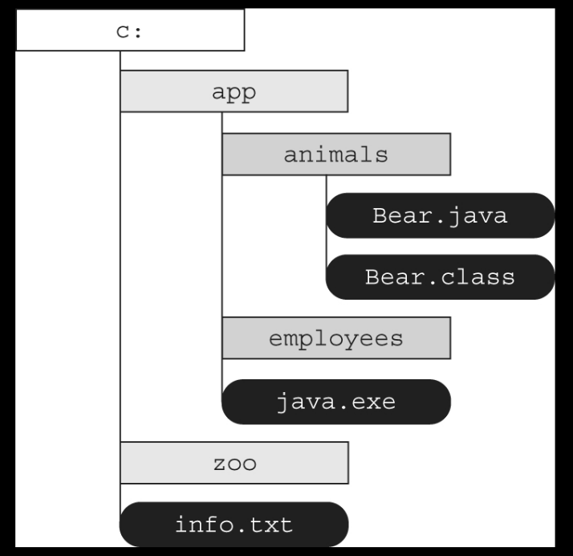
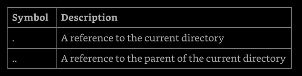

# Chapter 14: Input/Output

**Objective in this chapter:**
- Using Java I/O API
  - Read and write console and file data using I/O Stream
  - Serialize and de-serialize Java objects
  - Create, traverse, read, and write `Path` objects and their properties using 
    `java.nio.file` API


What can Java application do outside the scope of managing objects and attributes 
in memory? How can they save data so that information is not lost every time the program 
is terminated? They use files, of course! We can design code that writes the current state 
of an application to a file every time the application is closed and then reloads the data 
when the application is executed the next time. In this manner, information is preserved 
between program executions.

This chapter focuses on using I/O (input/output) and NIO.2 (non-blocking I/O) APIs to 
interact with files and I/O streams. The preferred approach for working with files and 
directories with newer software applications is  to uses  NIO.2  rather than  I/O  where 
possible. However, we'll see that the two relate, and both are in wide use.

We start by describe how files and directories are organized within a file system and 
show how to access them with the `File` class and `Path` interface. Then we show how to 
work with files and directories. Ws conclude this chapter with advanced topics like 
serializing data, discussing ways of reading user input at runtime using the `Console` 
class, and interacting with attributes.


## Referencing Files and Directories

We begin this chapter by reviewing what files and directories are within a file system. 
We also present the `File` class and `Path`interfaces along with how to create them.


### Conceptualizing the File System

Data is stored on persistent storage devices, such as hard disk drives and memory cards. 
A _file_ within the storage device holds data. Files are organized into hierarchies using 
directories. A _directory_ is a location that can contain files and other directories. 
When working with directories in Java, we often treat them like files. In fact, we use 
many of the same classes and interfaces to operate on files and directories. For example, 
a file and directory both can be renamed with the same Java method. We have to note that 
we often say _file_ to mean _file_ or _directory_ along this chapter.

To interact with files, we need to connect to fhe file system, The _file system_ is 
in charge of reading and writing data within a computer. Different operating systems 
use different file systems to manage their data. For example, Windows-based system use 
a different file system than Unix-based ones. We ust need to know how to issue command 
using the Java APIs. The JVM will automatically connect to the local file system, allowing 
us to perform the same operations across multiple platforms.

Next, the _root directory_ is the topmost directory in the file system, from which all 
files and directories inherit. In Windows, it is denoted with a drive letter such as C:\, 
while on linux, it is denoted with a single forward slash, /.

A _path_ is a representation of a file or directory within a file system. Each file 
system defines its own path separator character that is used between directory entries. 
The value to the left of a separator is the parent of the value to the right of the 
separator. For example, the path value `/user/home/zoo.txt` means that the file `zoo.txt` 
is inside the `home` directory, with the `home` directory inside the `user` directory.

In the Figure 14.1, a directory and file is is organized in a hierarchical manner.



**Figure 14.1: Directory and file hierarchy**

This diagram shows the root directory, `c:`, containing two directories, `app` and `zoo`, 
along with the file `info.txt`. Within the `app` directory, there are two more folders, 
`animals` and `employees`, along with the file `java.exe`. Finally, the `animals` 
directory contains two files, `Bear.java` and `Bear.class`.

We use both absolute and relative paths to fhe file or directory within the file system. 
The _absolute path_ of a file or directory is the full path from the root directory to 
the file or directory, including all subdirectories that contain the file or directory. 
Alternatively, the _relative path_ of a file or directory is th path from the current 
working directory to the file or directory. For example, the following is in absolute 
path to the `Bear.java` file:
```
C:\app\animals\Bear.java
```

The following is a relative path to the same file, assuming the user's current directory 
is set to `c:\app`:
```
animals\Bear.java
```

Determining whether a path is relative o absolute is file-system dependent. To match the 
exam, we adopt the following conventions:
- If a path starts with a forward slash (/), it is absolute, with / as the root directory, 
    such as /bird/parrot.png.
- If a path stars with a driver letter (c:), it is absolute, with the drive letter as the 
    roo directory, such as c;/bird/info.
- Otherwise, tis is a relative path, such as bird/parrot.png.


Absolute and relative path can contain path symbols. A _path symbol_ is one of a reserved 
series of character with special meaning in some file systems. The two most common path 
symbols are shown in Table 14.1.

**Table 14.1: File-system symbols**



Looking at Figure 14.2, suppose the current directory is /fish/shark/hammerhead. In this 
case, .../swim.txt is a valid relative path equivalent to /fish/shark/swim.txt. Likewise, 
./play.png refers to play.png in the current directory. The symbols can also be combined 
for greater effect. For example, ../../clownfish is a relative path equivalent to 
/fish/clownfish within the file system.

Sometimes, we'll see path symbols that are redundant or unnecessary. For example, the 
absolute path /fish/clownfish/../shark/./swim.txt can be simplified to /fish/shark/swim.txt. 
We see how to handle these redundancies later in the chapter when we cover `normalize()`.
