# Chapter 14: Input/Output

**Objective in this chapter:**
- Using Java I/O API
  - Read and write console and file data using I/O Stream
  - Serialize and de-serialize Java objects
  - Create, traverse, read, and write `Path` objects and their properties using 
    `java.nio.file` API


What can Java application do outside the scope of managing objects and attributes 
in memory? How can they save data so that information is not lost every time the program 
is terminated? They use files, of course! We can design code that writes the current state 
of an application to a file every time the application is closed and then reloads the data 
when the application is executed the next time. In this manner, information is preserved 
between program executions.

This chapter focuses on using I/O (input/output) and NIO.2 (non-blocking I/O) APIs to 
interact with files and I/O streams. The preferred approach for working with files and 
directories with newer software applications is  to uses  NIO.2  rather than  I/O  where 
possible. However, we'll see that the two relate, and both are in wide use.

We start by describe how files and directories are organized within a file system and 
show how to access them with the `File` class and `Path` interface. Then we show how to 
work with files and directories. Ws conclude this chapter with advanced topics like 
serializing data, discussing ways of reading user input at runtime using the `Console` 
class, and interacting with attributes.

[Referencing Files and Directories](#referencing-files-and-directories)

[Operating on File and Path](#operating-on-file-and-path)

[Introducing I/O Streams](#introducing-io-streams)

[Reading and Writing Files](#reading-and-writing-files)

[Serializing Data](#serializing-data)

[Interacting with Users](#interacting-with-users)

[Working with Advanced APIs](#working-with-advanced-apis)


## Referencing Files and Directories

We begin this chapter by reviewing what files and directories are within a file system. 
We also present the `File` class and `Path`interfaces along with how to create them.


### Conceptualizing the File System

Data is stored on persistent storage devices, such as hard disk drives and memory cards. 
A _file_ within the storage device holds data. Files are organized into hierarchies using 
directories. A _directory_ is a location that can contain files and other directories. 
When working with directories in Java, we often treat them like files. In fact, we use 
many of the same classes and interfaces to operate on files and directories. For example, 
a file and directory both can be renamed with the same Java method. We have to note that 
we often say _file_ to mean _file_ or _directory_ along this chapter.

To interact with files, we need to connect to fhe file system, The _file system_ is 
in charge of reading and writing data within a computer. Different operating systems 
use different file systems to manage their data. For example, Windows-based system use 
a different file system than Unix-based ones. We ust need to know how to issue command 
using the Java APIs. The JVM will automatically connect to the local file system, allowing 
us to perform the same operations across multiple platforms.

Next, the _root directory_ is the topmost directory in the file system, from which 
all files and directories inherit. In Windows, it is denoted with a drive letter such 
as C:\, while on linux, it is denoted with a single forward slash, /.

A _path_ is a representation of a file or directory within a file system. Each file 
system defines its own path separator character that is used between directory entries. 
The value to the left of a separator is the parent of the value to the right of the 
separator. For example, the path value `/user/home/zoo.txt` means that the file `zoo.txt` 
is inside the `home` directory, with the `home` directory inside the `user` directory.

In the Figure 14.1, a directory and file is is organized in a hierarchical manner.

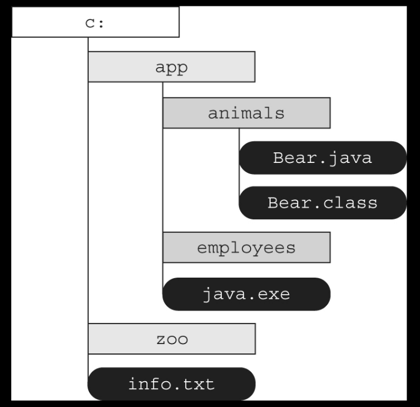

**Figure 14.1: Directory and file hierarchy**

This diagram shows the root directory, `c:`, containing two directories, `app` and `zoo`, 
along with the file `info.txt`. Within the `app` directory, there are two more folders, 
`animals` and `employees`, along with the file `java.exe`. Finally, the `animals` 
directory contains two files, `Bear.java` and `Bear.class`.

We use both absolute and relative paths to fhe file or directory within the file system. 
The _absolute path_ of a file or directory is the full path from the root directory to 
the file or directory, including all subdirectories that contain the file or directory. 
Alternatively, the _relative path_ of a file or directory is th path from the current 
working directory to the file or directory. For example, the following is in absolute 
path to the `Bear.java` file:
```
C:\app\animals\Bear.java
```

The following is a relative path to the same file, assuming the user's current directory 
is set to `c:\app`:
```
animals\Bear.java
```

Determining whether a path is relative o absolute is file-system dependent. To match the 
exam, we adopt the following conventions:
- If a path starts with a forward slash (/), it is absolute, with / as the root directory, 
    such as _/bird/parrot.png_.
- If a path stars with a driver letter (c:), it is absolute, with the drive letter as the 
    root directory, such as c:/bird/info.
- Otherwise, tis is a relative path, such as _bird/parrot.png_.


Absolute and relative path can contain path symbols. A _path symbol_ is one of a reserved 
series of character with special meaning in some file systems. The two most common path 
symbols are shown in Table 14.1.

**Table 14.1: File-system symbols**

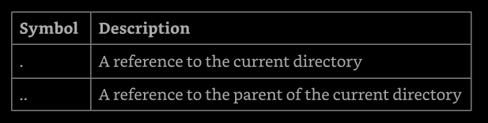

Looking at Figure 14.2, suppose the current directory is _/fish/shark/hammerhead_. In 
this case, _.../swim.txt_ is a valid relative path equivalent to _/fish/shark/swim.txt._ 
Likewise, _./play.png_ refers to _play.png_ in the current directory. The symbols can 
also be combined for greater effect. For example, _../../clownfish_ is a relative path 
equivalent to _/fish/clownfish_ within the file system.

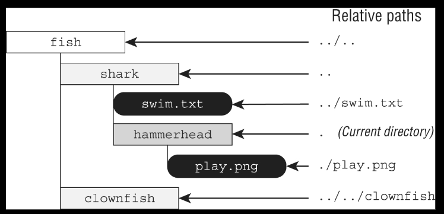

**Figure 14.2: Relative paths using path symbols**


Sometimes, we'll see path symbols that are redundant or unnecessary. For example, 
the absolute path _/fish/clownfish/../shark/./swim.txt_ can be simplified to 
_/fish/shark/swim.txt_. We see how to handle these redundancies later in the chapter 
when we cover `normalize()`.

A _symbolic link_ is a special file within a file system that server as a 
reference or pointer to another file or directory. Suppose we have a symbolic link 
from /zoo/user/favorite to /fish/shark. The `shark` folder and its elements can be 
accessed directly or via the symbolic link. For example, the following paths reference 
the same file:
```
/fish/shark/swim.txt
/zoo/user/favorite/swim.txt
```

In general, symbolic links are transparent to the user, as the operating system takes 
care of resolving the reference to the actual file. While the I/O APIs do not support 
symbolic links, NIO.2 includes full support for creating, detecting, and navigating 
symbolic links within the file system.


### Creating a _File_ or _Path_

In order to do anything useful, we first need an object that represents the path 
to a particular file or directory on the file system. Using legacy I/O, this is the 
`java.io.File` class, whereas with NIO.2, it is the `java.nio.file.Path` interface. 
The `File` class and `Path` interface cannot read or write data directly within a file, 
although they are passed as a reference to other classes, they are just references.


#### Creating a _File_

The `File` class is created by calling its constructor. This code shows three 
different constructors:
```
File zooFile1 = new File("/home/tiger/data/stripes.txt");
File zooFile2 = new File("/home/tiger", "data/stripes");

File parent = new File("/home/tiger");
File zooFile3 = new File(parent, "/data/stripes.txt");

System.out.println(zooFile.exists());
```

All three create a `File` object that points to the same location on disk. If we 
passed `null` as the parent to the final constructor, it would be ignored, and the 
method would behave the same way as the single `String` constructor. For fun, we 
also show how to tell if the file exists on the file system.


#### Creating a _Path_

Since `Path` is an interface, we can't create an instance directly. Java provides 
a number of class and methods that we can use to obtain `Path` objects. The simplest 
and most straightforward way to obtain a `Path` object is to use a static factory 
method defined on `Path` or `Paths`. All four of these examples point to the same 
reference on disk:
```
Path zooPath1 = Path.of("/home/tiger/data/stripes.txt");
Path zooPath2 = Path.of("/home", "tiger", "data", "stripes.txt");

Path zooPath3 = Paths.get("/home/tiger/data/stripes.txt");
path zooPath3 = Paths.get("/home", "tiger", "data", "stripes.txt");

System.out.println(Files.exists(zooPath1));
```

Both methods allow passing a varargs parameter to pass additional path elements. The 
values are combined and automatically separated by the operating system-dependent file 
separator. We also show the `Files` helper class, which can check if the file exists 
on the file system.

As we can see, there are two way of doing the same thing here. The `Path.of()` method 
was introduced in Java 11 as a static method on the interface. The `Paths` factory class 
als provides a `get()` methods to do the same thing. Both `Path.of()` and `Paths.get()` 
are used interchangeably in this chapter.

One thing to note is that both, the I/O and NIO.2 classes, can interact with a URI. 
A uniform resource identifier (URI) is a string of characters that identifies a resource. 
It begins with a schema that indicates the resource type, followed by a path value such 
as `file://` for local file systems and `http://`, `https://`, and `ftp://` for 
remote file system.

#### Switching between _File_ and _Path_

Since `File` and `Path` both reference locations on disk, it is helpful to be able to 
convert between them. Luckily, Java makes this easy by providing methods to do just that:
```
File file = new File("rabbit");
Path nowPath = file.toPath();
File backToFile = nowPath.toFile();
```

Many older libraries use `File`, making it convenient to be able to get a `File` from 
a `Path` and vice versa. When working with newer applications, we should rely on NIO.2's 
`Path` interface, as it contains more features. For example, only NIO.2 provides 
`FileSystem` support, as we are about to discuss.


#### Obtaining a _Path_ from the _FileSystems_ Class

NIO.2 makes extensive use of creating objects with factory classes. The `FileSystems` 
class create instances of the abstract `FileSystem` class. The later includes methods 
for working with the file system directly. Both `Paths.get()` and `Path.of()` are 
shortcuts for this `FileSystem` method. Let's rewrite our earlier examples one more 
time to see how to obtain a `Path` instance the long way:

```
Path zooPath = FileSystems.getDefault().getPath("/home/tiger/data/stripes.txt");
Path zooPath2 = FileSystems.getDefault().getPath("/home", "tiger", "data", "stripes.txt");
```

### Reviewing I/O and NIO.2 Relationship

The model for I/O is smaller, and we only need to understand the `File` class. In 
contrast, NIO.2 has more features and makes extensive use of the factory pattern. We 
need to become comfortable with this approach. Many of our interaction with NIO.2 will 
require two types: an abstract class or interface and a factory or helper class. Figure 
14.3 shows the relationships among the classes and interfaces we have used in this 
chapter so far

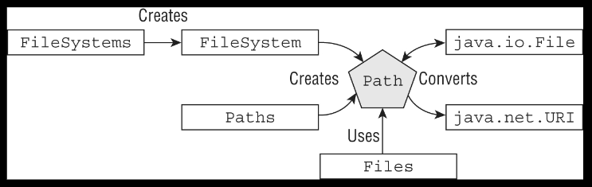

**Figure 14.3: I/O and NIO.2 class and interface relationship**

Keep an ey on whether the class name is singular or plural. Classes with plural names 
include methods to create o operate on class/interface instance with singular names.
We need to remember that, as a convenience (and sometime confusion), a `Path` can also 
be created from the the `Path` interface using the static factory `of()` method.

The `java.io.File` is the I/O class, while `Files` is an NIO.2 helper class. `Files` 
operates on `Path` instances, not `java.io.File` instances. This is confusing, but 
the are from completely different APIs.

Table 14.2 reviews the APIs we have covered for creating object of types `java.io.File` 
or `java.nio.file.Path`. When reading the table, is good to remember that static methods 
operate on the class/interface, while instance methods require an instance of an object.

**Table 14.2: Options for creating File and Path**

[options creating file path](file_and_path_creating_options.png)


Just a memory refresh.
```
File zooFile1 = new File("/home/tiger/data/stripes.txt");
File zooFile2 = new File("/home/tiger", "data/stripes");

Path zooPath1 = Path.of("/home/tiger/data/stripes.txt");
Path zooPath2 = Path.of("/home", "tiger", "data", "stripes.txt");

Path zooPath3 = Paths.get("/home/tiger/data/stripes.txt");
path zooPath3 = Paths.get("/home", "tiger", "data", "stripes.txt");
```

[back to top](#chapter-14-inputoutput)


## Operating on File and Path

Now that we know how to create `File` and `Path` objects, we can start using them 
to do useful things. In this section, we explore the functionality available to us 
that involves directories.


### Using Shared Functionality

Many operation can be done using both the I/O and NIO.2 libraries. We present 
many common APIs in table 14.3 and Table 14.4. Although these tables may seem like 
a lot of methods to learn, many of them are self-explanatory. We can ignore the 
varargs parameters for now. Those will be explained later in the chapter.

**Table 14.3: Common File and Path operations**

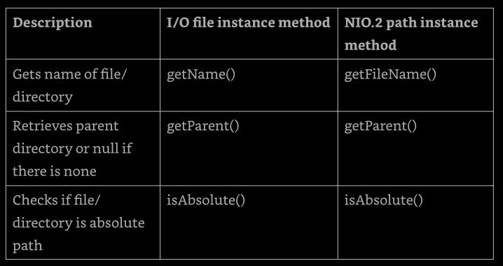


**Table 14.4: Common File and Path operations**

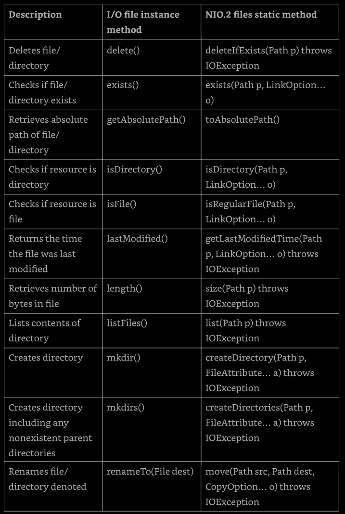


Now let's try to use some ot these APIs. The following is a sample program using only 
legacy I/O APIs. Given a file path, it outputs information about the file or directory, 
such as whether it exists, what files are contained within it, and so forth:
```
10: public static void io() {
11:   var file = new File("/home/users/user/data/zoo.txt");
12:   if (file.exists()) {
13:     System.out.println("Absolute path: " + file.getAbsolutePath());
14:     System.out.println("Is Directory: " + file.isDirectory());
15:     System.out.println("Parent Path: " + file.getParent());
16:     if (file.isFile()) {
17:       System.out.println("Size: " + file.length());
18:       System.out.println("Last Modified": file.lastModified());
19:     } else {
20:       for (File subfile : file.listFiles()) {
21:         System.out.println(" " + subfile.getName());
22:       }
23:     }
24:   }
15: }
```

If the path provided points to a valid file, the program outputs something similar 
to the following due to the `if` statement on line 16:
```
Absolute Path: /home/users/user/data/zoo.txt
Is Directory: false
Parent Path: /home/users/user/data
Size: 1238
Last Modified: 16506100000000
```

Finally, if the path is provided to a valid directory, such as `/home/users/user/data`, 
the program outputs something similar to the following, the `else` block:
```
Absolute Path: /home/users/user/data
Is Directory: true
Parent Path: /home/user/user
  employees.txt
  zoo.txt
  zoo-backup.txt
```

In these examples, we see that the output of an I/O-based program is completely 
dependent on the directories and files available at runtime in the underlying file 
system.

Sometimes we might see paths that look like files but are directories or vice versa. 
For example _/home/users/user/data/zoo.txt_ could be a file or a directory, even though 
it has a file extension. Don't assume it is either unless the clearly explicitly said.

Now, let's write that same program using only NIO.2 and see how it differs:
```
10: public static void nio() throws IOException {
11:   var path = Path.of("/home/users/user/data/zoo.txt");
12:   if (Files.exists(path)) {
13:     System.out.println("Absolute Path: " + path.toAbsolutePath());
14:     System.out.println("Is Directory: " + Files.isDirectory(path));
15:     System.out.println("Parent Path: " + path.getParent());
16:     if (Files.isRegularFile(path)) {
17:       System.out.println("Size: " + Files.size(path));
18:       System.out.println("Last Modified: "
19:           + Files.getLastModifiedTime(path));
20:     } else {
21:       try (Stream<Path> stream = Files.list(path)) {
22:         stream.forEach(
23:           p -> System.out.println(" " + p.getName())
24:         );
25:       }
26:     }
27:   }
28: }
```

Most of this example is equivalent and replaces the I/O method call in the previous 
tables with tbe NIO.2 versions. However, there are key differences. First, line 10 
declares a checked exception. More APIs in NIO.2 throw IOException than the I/O APIs 
did. In this case, `Files.size()`, `Files.getLastModifiedTime()`, and `Files.list()` 
thrown an `IOException`.

Second, lines 21 to 25 use a `Stream` and a lambda instead of a loop. Since streams 
use lazy evaluation, this means the method will load each path element as needed, rather 
than the entire directory at once.

---
**Closing the Stream**

Did you notice that in the last code sample, we put our `Stream object inside a 
_try-with-resources_? The NIO.2 stream-based methods open a connection to the file 
system **that must be properly closed**; otherwise, a resource leak could ensue. A 
resource leak within the file system means the path may be locked from modification 
long after the process that used it is completed.

If we assumed that a stream's terminated operation would automatically close the 
underlying file resources, we would be wrong. There was a lot of debate about this 
behavior when it was first presented; in short, requiring developers to close the 
stream won out.

On the plus side, not all streams need to be closed: only those that open resources, 
like the ones found in NIO.2. For instance, we didn't need to close any of the streams 
we worked with in Chapter 10, "Streams".

Finally, the exam doesn't always properly close NIO.2 resources. To match the exam, 
this book sometimes skip close NIO.2 resources in review and practice questions. In 
a real world, we need always use _try-with-resources_ statements with these NIO.2 
methods in our own code.

---

For the remainder of this section, we only discuss the NIO.2 methods, because they 
are more important. There is also more to known about them, and the are more likely 
to come up on the exam.


### Handling Methods that Declare _IOException_

Many of the methods presented in this chapter declare `IOException`. Common causes 
of a method throwing this exception include the following:
- Loss of communication to the underlying file system.
- File or directory exists but cannot be accessed or modified.
- File exists but cannot be overwritten.
- File or directory is required but does not exist

Methods that access or changes files and directories, such as those in the `Files` 
class, often declare `IOException`. There are exceptions to this rule, as we will see. 
For example, the method `Files.exists()` does not declare `IOException`.  If it did 
throw an exception whe the file did not exist, it would never be able to return `false`. 
As a rule of thumb, if a NIO.2 method declares an IOException, it _usually_ requires 
the paths it operates on to exist.


### Providing NIO.2 Optional Parameters

Many of the NIO.2 methods in this chapter include a varargs that takes an optional 
list of values. Table 14.5 presents the arguments we should be familiar.

**Table 14.5: Common NIO.2 method arguments**

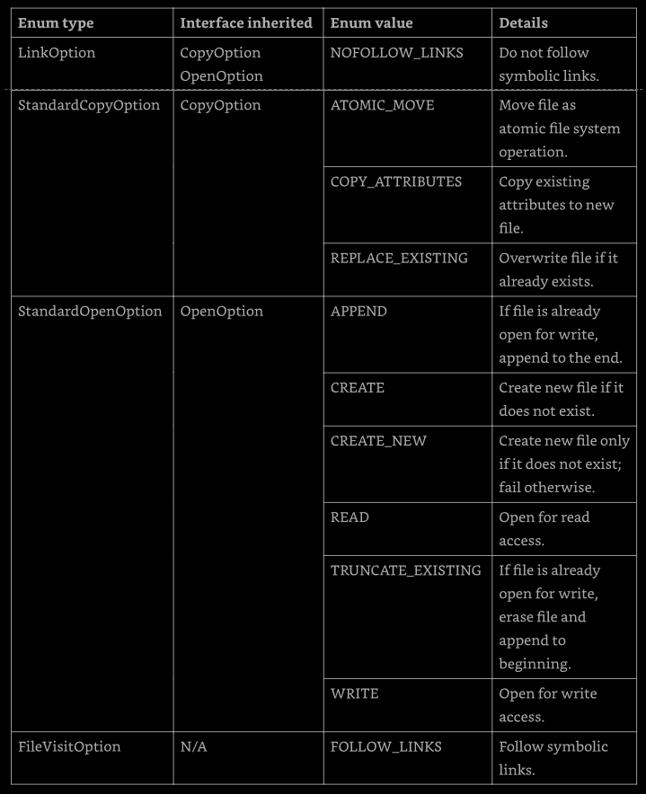

With the exceptions of `Files.copy()` and `Files.move()`, we won't discuss these 
varargs parameters each time we present a method. Their behavior should be straight-
forward, though. For example, can you figure out the following call to `File.exists()` 
with the `LinkOption` does in the following code snippet?
```
Path path = Paths.get("schedule.xml");
boolean exists = Files.exists(path, LinkOption.NOFOLLOW_LINKS);
```

This `Files.exists()`  simply checks whether a file exists. But if the parameter 
is a symbolic link, the methods checks whether the target of the symbolic link exists, 
instead. Providing `LinkOption.NOFOLLOW_LINKS` means the default behavior will be over-
ridden, adn the method will check whether the symbolic link itself exists.

Note that some of the enums in table 14.5 inherit an interface. That means some 
methods accept a variety of enum types. For example, the `Files.move()` method takes 
a `CopyOption` vararg so it can take enums of different types, and more options can 
be added over time.
```
void copy(Path source, Path target) throws IOException {
  Files.move(
    source,
    target,
    LinkOption.NOFOLLOW_LINKS,
    StandardCopyOption.ATOMIC_MOVE
  );
}
```

### Interacting with NIO.2 Paths

Just like `String` values, `Path` instances are immutable. In the following example, 
the `Path` operation on the second file is lost since `p`  is immutable.
```
Path p = Path.of("whale");
p.resolve("krill");
System.out.println(p);    // whale
```

Many of the methods available in the `Path` interface transform the path value 
in some way and return a new `Path` object, allowing the methods to be chained. We 
demonstrate chaining in the following example, the details of which we discuss in 
this section of the chapter:
```
Path.of("/zoo/../home").getParent().normalize().toAbsolutePath();
```

#### Viewing the Path

The `Path` interface contains three methods to retrieve basic information about 
the path representation. The `toString()` method returns a `String` representation 
of the entire path. In fact, it is the only method in the `Path` interface to return 
a `String`. Many of the other methods in the `Path` interface return `Path` interfaces.

The `getNameCount()` and `getName()` methods are often used together to retrieve the 
number of elements in the path and a reference to each element, respectively. These 
two methods do not include the root directory as part of the path.
```
Path path = Paths.get("/land/hippo/harry.happy");
System.out.println("The Path Name is: " + path);
for (int i = 0; i < path.getNameCount(); i++) {
  System.out.println("  Element " + i + " is: " + path.getName(i));
}
```

The code prints the following:
```
The Path name is: /land/hippo/harry.happy
  Element 0 is: land
  Element 1 is: hippo
  Element 2 is: harry.happy
```

Even though this is an absolute path, the root element is not included in the 
list of names. As we said, these methods do not consider the root part of the path.
```
var p = Path.of("/");
System.out.println(p.getNameCount());    // 0
System.out.println(p.getName(0));        // IllegalArgumentException
```

Notice that if we try to call `getName()` with an invalid index, it will thrown 
an exception at runtime.


#### Creating Part of the Path

The `Path` interface includes the `subpath()` method to select portions of a path. 
It takes two parameters: an inclusive `beginIndex` and an exclusive `endIndex`. This 
should sound familiar as it is how String's `substring()` method works, as we saw 
in Chapter $, "Core APIs".

The following code snippet shows how `subpath()` works. We also print the elements 
of the `Path` using `getName()` so that we can see how the indices are used.
```
var p = Paths.get("/mammal/omnivore/raccoon.image");
System.out.println("Path is: " + p);
for (int i = 0; i < p.getNameCount(); i++) {
  System.out.println("  Element " + i + " is: " + p.getName(i));
}
System.out.println()
System.out.println("subpath(0, 3): " + p.subpath(0, 3));
System.out.println("subpath(1, 2): " + p.subpath(1, 2));
System.out.println("subpath(1, 3): " + p.subpath(1, 3));
```

The output of this code snippet is the following:
```
Path is: /mammal/omnivore/raccoon.image
  Element 0 is: mammal
  Element 1 is: omnivore
  Element 2 is: raccoon.image

subpath(0, 3): mammal/omnivore/raccoon.image
subpath(1, 2): omnivore
subpath(1, 3): omnivore/raccoon.image
```

Like `getNameCount()` and `getName()`, `subpath()` is zero-based index and does 
not include the root. Als like `getName()`, `subpath()` throws an exception if 
invalid indices are provided.
```
var q = p.subpath(0, 4);    // IllegalArgumentException
var x = p.subpath(1, 1);    // IllegalArgumentException
```

The first example throws an exception at runtime, since the maximum index value 
allowed is 3. The second example throws an exception since the `start` and the `end` 
indexes are the same, leading to an empty path value.


#### Accessing Path Elements

The `Path` interface contains numerous methods for retrieving particular elements 
of a `Path`, returned as `Path` objects themselves. the `getFileName()` method returns 
the `Path` element of the current file or directory, while `getParent()` returns  the 
full path of the containing directory. The `getParent()` method returns `null` if 
operated on the root path or at the top of a relative path. The `getRoot()` method 
returns the root element of the file within the file system, or null if the path is 
a relative path.

Consider the following method, which prints various `Path` elements:
```
public void printPathInformation(Path path) {
  System.out.println("Filename is: " + path.getFileName());
  System.out.println("  Root is: " + path.getRoot());
  Path currentParent = path;
  while ( (currentParent == currentParent.getParent()) != null )
    System.out.println("  Current parent is: " + currentParent);
  System.out.println()
}
```

The while loop in the `printPathInformation()` method continues until `getParent()` 
returns `null`. We apply this method to the following three paths:
```
printPathInformation(Path.of("zoo"));
printPathInformation(Path.of("/zoo/armadillo/shells.txt"))
printPathInformation(Pat.of("./armadillo/../shells.txt"));
```

This sample application produces the following output:
```
Filename is: zoo
  Root is: null

Filename is: shells.txt
  Root is: /
  Current parent is: /zoo/armadillo
  Current parent is: /zoo
  Current parent is: /

Filename is: shells.txt
  Root is: null
  Current parent is: ./armadillo/..
  Current parent is: ./armadillo
  Current parent is: .
```

Reviewing the sample output, we can see the difference in the behavior of `getRoo()` 
on absolute and relative paths. As we can see in the first and last examples, the 
`getParent()` method does not traverse relative paths outside the current working 
directory.

We also see that these methods do no resolve the path symbols and treat them as 
a distinct part of the path. While most of the methods in this part of the chapter 
treat path symbols as part of the path, we present on shortly that cleans up path 
symbols.


#### Resolving Paths (concatenating paths)

Suppose we want to concatenate paths in a manner similar to how we concatenate 
strings. The `resolve()` method provides overloaded version that let us pass either 
a `Path` or `String` parameter. The object on which the `resolve()` method is invoked 
becomes the basis of the new `Path` object, with the input argument being appended 
onto the `Path`. Let's see what happens if we apply `resolve()` to an absolute 
path and a relative path.
```
Path path1 = Path.of("/cats/../panther");
Path path2 = Path.of("food");
System.out.println(path1.resolve(path2));
```

The code snippet generate the following output:
```
/cat/../panther/food
```

Like the other methods we've seen, `resolve()` does not clean up path symbols. 
In this example, the input argument to the `resolve()` method was a relative path, 
but what if it had been an absolute path?
```
Path path3 = Path.of("/turkey/food");
System.out.println(path.resolve("/tiger/cage"));
```

Since the input parameter is an absolute path, the output would be the following: 
```
/tiger/cage
```

For the exam, we should be cognizant of mixing absolute and relative paths with 
the `resolve()` method. If an absolute path is provided a input to the method, that 
is the value returned. Simply put, we cannot combine two absolute paths using 
`resolve()`.


#### Relativizing a Path

The `Path` interface includes a `relativize()` method for constructing the relative 
path from on `Path` to another, often using path symbols. What do you thing the following 
examples will print?
```
var path1 = Path.of("fish.txt");
var path2 = Path.of("friendly/birds.txt")
System.out.println(path1.relativize(path2));
System.out.println(path2.relativize(path1));
```

The examples print the following:
```
../friendly/birds.txt
../../fish.txt
```

The idea is this: if we are pointed at a path in the file system, what steps would 
be necessary to take to reach the other path? For example, to get to `fish.txt` from 
`friendly/birds.txt`, we need to go up two levels (the file itself counts as one level) 
and ten select `fish.txt`.

If both path values are relative, the `relativize()` method computes the paths as 
if they are in the same current working directory. Alternatively, if both path values 
are absolute, the method computes the relative path from one absolute location to 
another, regardless of the current working directory. The following example demonstrates 
this property when run on a Windows computer:
```
Path path3 = Paths.get("E:\\habitat");
Path oath4 = Paths.get("E:\\sanctuary\\raven\\poe.txt");
System.out.println(path3.relativize(path4));
System.out.println(path4.relativize(path3));
```

This code snippet produces the following output:
```
..\sanctuary\raven\poe.txt
..\..\..\habitat
```

The `relativize()` method requires both paths to be absolute or relative and 
throws an exception if the types are mixed.
```
Path path5 = Paths.get("/primate/chimpanzee");
Path path6 = Paths.get("bananas.txt");
path5.relativize(path6);                // IllegalArgumentException
```

On Windows-based systems, it also requires that if absolute path are used, both 
paths must have the same root directory or drive letter.


#### Normalizing a Path

So far, we've presented a number of examples that included path symbols that were 
unnecessary. Luckily, Java provides the `normalize()` method to eliminate unnecessary 
redundancies in a path.

Remembering that the path symbol `..` refers to the parent directory, while the path 
symbol `.` refers to the current directory, We can apply `normalize()` to some of our 
previous paths.
```
var p1 = Path.of("./armadillo/../shells.txt");
System.out.println(p1.normalize());             // shells.txt

var p2 = Path.of("/cats/../panther/food");
System.out.println(p2.normalize());             // /panther/food

var p3 = Path.of("../../fish.txt");
System.out.println(p3.normalize());             // ../../fish.txt
```

The first two examples apply the path symbols to remove the redundancies, but what 
about the last one? That is as simplified as it can be. The `normalize()` method does 
not remove all of the path symbols, only the ones that can be reduced.

The `normalize()` method also allows us to compare equivalent paths. Consider the 
following example:
```
var p1 = Paths.get("/pony/../weather.txt");
var p2 = Paths.get("/weather.txt");
System.out.println(p1.equals(p2))                            // false
System.out.println(p1.normalize().equals(p2.normalize()));   // true
```

The `equals()` method returns `true` if two paths represent the same value. In the 
first comparison, the path values are different. In the second comparison, the path 
values have both reduced to the same normalized value, `/weather.txt`. This is the 
primary function of the `normalize()` method: to allow us to better compare different 
paths.


#### Retrieving the Real File System Path

While working with theoretical path is useful, sometimes we want to verify that 
the path exists within the file system using `toRealPath()`. This method is similar 
to `normalize()` in that it eliminates any redundant path symbols. It also similar 
to `toAbsolutePath()`, in that it will join the path with the current working 
directory if the path is relative.

Unlike those two methods, though, `toRealPath()` will throw an exception if the 
path does not exist. In addition, it will follow symbolic links, with an optional 
`LinkOption` varargs parameter to ignore them.

Let's say that we have a file system in which we have a symbolic link from `/zebra` 
to `/horse`. What do you think the following will print, given a current working 
directory of `/horse/scheduled`?
```
System.out.println(Paths.get("/zebra/food.txt").toRealPath());
System.out.println(Paths.get(".././food.txt"));
```

The output of both lines is the following:
```
/horse/food.txt
```

In this example, the absolute and relative paths both resolve to the same absolute 
file, as the symbolic kink points to a real file within the file system. We can also 
use the `toRealPath()` method to gain access tot the current working directory as 
a `Path` object.
```
System.out.println(Paths.get(".").toRealPath());
```


### Reviewing NIO.2 Path APIs

Table 14.6 list the methods covered in this section.

**Table 14.6: Path APIs**

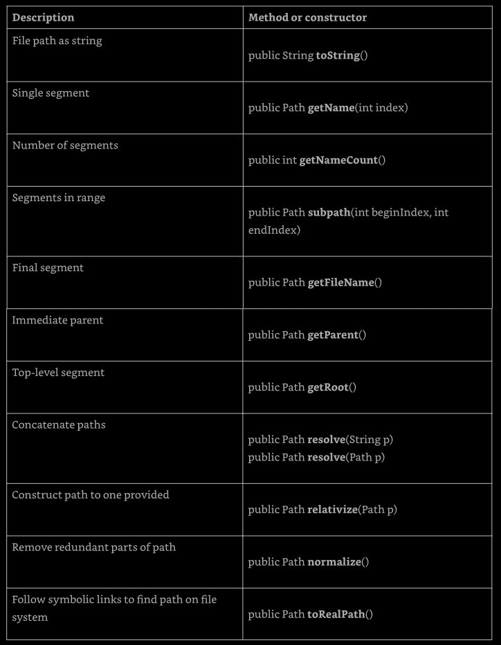


### Creating, Moving, and Deleting Files and Directories

Since creating, moving, and deleting have some nuances, we flesh them out in this 
section.


#### Making Directories

To create a directory, we use `Files` methods:
```
public static Path createDirectory(Path dir, 
  FileAttribute<?>... attrs) throws IOException

public static Path createDirectories(Path dir,
  FileAttribute<?>... attrs) throws IOException
```

The `createDirectory()` methods will create a directory and throw an exception 
if it already exists or fi the paths leading up to the directory do not exist. The 
`createDirectories()` method creates the target directory along with any nonexistent 
parent directories leading up to the path. If all of the directories already exist, 
`createDirectories()` will simply complete without doing anything. This is useful in 
situations where we want to unsure a directory exists and create if if it does not.

Both of these methods also accept an optional list of `FileAttribute<?>` values 
to apply to the newly create directory or directories. We discuss file attributes 
toward the end of the chapter.

The following shows how to create directories:
```
Files.createDirectory(Path.of("/bison/field"));
Files.createDirectories(Path.of("/bison/filed/pasture/green"));
```

The first example create a new directory, `field`, in the directory `/bison`, 
assuming `/bison` exists; otherwise, an exception is thrown. Contrast this, the 
second example, which creates the directory `green` along with any of the following 
parent directories fi the do not already exist, including `bison`, `field`, and 
`pasture`.


#### Copying Files

The `Files` class provides a method for copying files and directories within the 
file system.
```
public static Path copy(Path source, Path target,
  CopyOption... options) throws IOException
```

The method copies a file or directory from on location to another using `Path` 
objects. The following shows an example of copying a file and a directory:
```
Files.copy(Paths.get("/panda/bamboo.txt"), 
  Paths.get("/panda-save/bamboo.txt"));

Files.copy(Paths.get("/turtle"), Paths.get("/turtleCopy"));
```

When directories are copied, the copy is shallow. A _shallow copy_ means that 
the files and subdirectories within the directory are not copied. A _deep copy_ means 
that the entire tree is copied, including all of its content and subdirectories. A 
deep copy typically requires _recursion_, where a method calls itself.
```
public void copyPath(Path source, Path target) {
  try {
    Files.copy(source, target)
    if (Files.isDirectory(source)) {
      try (Stream<Path> s = Files.list(source)) {
        s.forEach( p -> copyPath(p, target.resolve(p.getFileName() )) )
      }
    }
  } catch (IOException) {
    // handle exception
  }
}
```

The method first copies the path, whether a file or a directory. If it is a directory, 
only a shallow copy ins performed. Next, it check whether the path is a directory and, 
if it is, performs a recursive copy of each of its elements. What if the method comes 
across a symbolic link? Don't worry: the JVM will not follow symbolic links when 
using the `list()` method.


#### Copying and Replacing Files

By default, if the target already exists, the `copy()` method will thrown an exception. 
We can change this behavior bby providing `StandardCopyOption` enum value REPLACE_
EXISTING t the method. The following method call will overwrite the `movie.txt` file 
if it already exists.
```
Files.copy(Paths.get("book.txt"), Paths.get("movie.txt"), 
  StandardCopyOption.REPLACE_EXISTING);
```

Without the REPLACE_EXISTING option, this method will throw an exception if the 
file already exist.


#### Copying Files with I/O Streams

The `Files` class includes two `copy()` methods that operate with I/O streams.
```
public static long copy(InputStream in, Path target, 
  CopyOption... options) throws IOException

public static long copy(Path source, OutputStream out)
  throws IOException
```

This first method reads the contents of an I/O stream and writes the output to 
a file. The second method reads the contents of a file and writes the output to 
an I/O stream. These methods are quite convenient if we need to quickly rear/write 
data from/to disk.

The following are examples of each `copy()` method:
```
try (var is = new FileInputStream("source-data.txt")) {
  // write I/O stream data to a file
  Files.copy(is, Paths.get("/mammals/wolf.txt"));
}

Files.copy(Paths.get("/fish/clown.xsl"), System.out);
```

While we used `FileInputStream` in the first example, the I/O stream could have 
been any valid I/O stream including website connections, in-memory stream resources, 
and so forth. The second example prints the contends of a file directory to the 
`System.out` stream.


#### Copy Files into a Directory

It is important to understand how the `copy()` method operates on both files and 
directories. For example, let's say we have a file, `food.txt`, and a directory, 
`/enclosure`. Both the file and directory exist. What do you think is the result 
of executing the following process?
```
var file = Paths.get("food.txt");
var directory = Paths.get("/enclosure");
Files.copy(file, directory);
```

If you said it would create a new file at `/enclosure/food.txt`, you're way off. 
It throws an exception. The command tries to create a new file named `/enclosure`. 
Since the path `/enclosure` already exists, an exception is thrown at runtime.

On the other hand, if the directory did not exist, the process would create a new 
file with the contents of `food.txt`, but the file would be called `/enclosure`. 
To remember, we said files may no need to have extensions, and in this example, it 
matters.

This behavior applies to both the `copy()` and `move()` methods, the latter of 
which we cover next. The correct way to copy the file into the directory is to 
do the following:
```
var file = Paths.get("food.txt");
var directory = Paths.get("/enclosure/food.txt");
Files.copy(file, directory);
```


#### Moving or Renaming Paths with _move()_

The `Files` class provides a useful method for moving or renaming files and 
directories.
```
public static Path move(Path source, Path target, 
  CopyOption... options) throws IOException
```

The following sample code uses the `move()` method:
```
Files.move(Path.of("C:\\zoo"), Path.of("C:\\zoo-new"));

Files.move(path.of("C:\\user\\addresses.txt"), Path.of("C:\\zoo-new\addresses2.txt"));
```

The first example renames the `zoo` directory to a `zoo-new` directory, keeping 
all of the original contents from the source directory. The second example moves the 
`addresses.txt` file from the directory `user` to the directory `zoo-new` and renames 
it `addresses2.txt`.


#### Similarities between _move()_ and _copy()_

Like `copy()`, `move()` requires REPLACE_EXISTING to overwrite the target if it exists; 
otherwise, it will thrown an exception. Also lik `copy()`, `move()` will not put a file 
in a directory if the source is a file and the target is a directory. Instead, it will 
create a new file with the name of the directory.


**Performing an Atomic Move**

Another enum value that we need to know when working with the `move()` method 
is the `StandardCopyOption` value ATOMIC_MOVE.
```
Files.move(Path.of("mouse.txt"), Path.of("gerbil.txt"), 
  StandardCopyOption.ATOMIC_MOVE);
```

The principle of an atomic move is similar to the one that we saw in Chapter 13, 
"Concurrency".  An atomic move is on in which a file is moved within the file system 
as a single indivisible operation. Put another way, any process monitoring the file 
system never sees an incomplete or particularly written file. If the file system 
does not support this feature, an `AtomicMoveNotSupportedException` will be thrown.

Note that while ATOMIC_MOVE is available as a member of the `StandardCopyOption` 
type, it will likely throw an exception if passed to a `copy()` method.


#### Deleting a File with _delete()_ and _deleteIfExists()_

The `Files` class includes two methods that delete a file or empty directory 
within the file system.
```
public static void delete(Path path) throws IOException

public static boolean deleteIfExists(Path path) throws IOException
```

To delete a directory, is must be empty. Both of these methods throw an exception 
if operated on a nonempty directory. In addition, if the path is a symbolic link, 
the symbolic link will be deleted, not the path that the symbolic link points to.

The methods differ on how they handle a path that does not exist. The `delete()` 
method throws an exception if the path does not exist, while the `deleteIfExists()` 
method return `true` if the delete was successful or `false` otherwise. Similar 
to `createDirectories()`, `deleteIfExists()` is useful in situations where we 
want to ensure that a path does not exists and delete it if it does.

Here we provide sample code that performs `delete()` operations:
```
Files.delete(Paths.get(/vulture/feathers.txt));
Files.deleteIfExists(Paths.get("/pigeon"));
```

The first example deletes the `feather.txt` file in the `vulture` directory, and 
it throws a `NoSuchFileException` if the file or directory does not exist. The second 
example deletes the `pigeon` directory, assuming it is empty. If the `pigeon` directory 
does not exist, the second line will not thrown an exception.


### Comparing Files with _isSameFile()_ and _mismatch()_

Since a path may include path symbols and symbolic links within a file system, 
the `equals()` method can't be relied on to know if two `Path` instances refer to 
the same file. Luckily, there is the `isSameFile()` method. This method takes two 
`Path` objects as input, resolves all path symbols, and follows symbolic links. 
Despite the name, the method can also be used to continue whether two `Path` objects 
refer to the same directory.

While most uses of `isSameFile()` will trigger an exception if the paths do not 
exist, there is a special case in which it does not. If the two path objects are 
equal in terms of `equals()`, the method will just return true without checking 
whether the file exists.

Assume that the file system exists, as shown in Figure 14.4, with a symbolic link 
from `/animals/snake` to `/animals/cobra`.

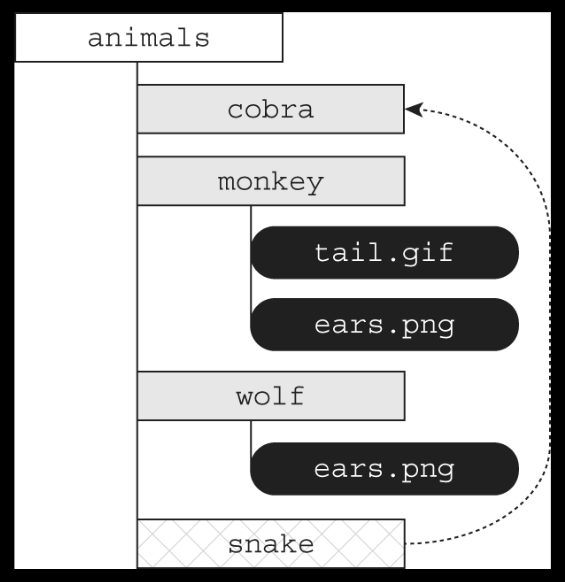

**Figure 14: Comparing file uniqueness**


Given the structure defined in Figure 14.4, what does the following output?
```
System.out.println(Files.isSameFile(
  Path.of("/animals/cobra"),
  Path.of("/animals/snake")
));

System.out.println(Files.isSameFile(
  Path.of("/animals/monkey/ears.png"),
  Path.of("/animals/wolf/ears.png")
));
```

Since `snake` is a symbolic link to `cobra`, the first example outputs `true`. In 
the second example, the paths refer to different files, so `false` is printed.

Sometimes we want to compare the contents of the file rather than whether it is 
physically the same file. For example,  we could have two files with the same text 
"hello world". The `mismatch()` method was introduced in Java 12 to help us out here. 
It takes two `Path` objects as input. The method return -1 if the files are same; 
otherwise, it return the index of the first position in the file that differs.
```
System.out.println(Files.mismatch(
  Path.of("/animals/monkey.txt"),
  Path.of("/animals/wolf.txt")
));
```

Suppose `monkey.txt` contains the name "Harold" and `wolf.txt` contains the name 
"Howler". The previous code print 1 in that case because the second position is 
different, and we use zero-based indexing in Java. Given those values, what do you 
thin this code prints?
```
System.out.println(Files.mismatch(
  Path.of("/animals/wolf.txt"),
  Path.of("/animals/monkey.txt")
));
```

The answer is the same as the previous example. The code prints 1 again. The 
`mismatch()` method is symmetric and return the same result regardless of the 
order of the parameters.

[back to top](#chapter-14-inputoutput)


## Introducing I/O Streams

Now that we have the basics out of the way, let's move on to I/O streams, which 
are far more interesting. In this section, we will see how to use I/O streams to read 
and write data. The "I/O" refers to the nature of how data is accessed, either by reading 
the data from a resource (input) or by writing the data to a resource (output).

When we refer to _I/O streams_ in this chapter, we are referring to the ones found 
in the `java.io` API. If we just say _streams_, it means the ones from Chapter 10.


### Understanding I/O Stream Fundamentals

The contents of a file may be accessed or written via an I/O stream, which is a 
list of data elements presented sequentially. An I/O stream can be conceptually though 
of as a long, nearly never-ending stream of water with data presented on wave at a time.

We demonstrate this principle in Figure 14.5. The I/O stream is so large that once we 
start reading it, we have no idea where the beginning or the end is.  We just have a 
pointes to our current position in the I/O stream and read data one block at a time.

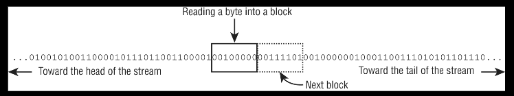

**Figure 14.5: Visual representation of an I/O stream**

Each type of I/O stream segments data into a wave or block in a particular way. 
For example, some I/O stream classes read or write data as individual bytes. Other 
I/O stream classes read or write individual characters or string of characters. On top 
of that, some I/O stream classes read or write larger groups of bytes or characters at 
a time, specifically those with the word "Buffered" in their name.

---

Although the `java.io API` is full of I/O streams that handle characters, string, 
groups of bytes, and so on, nearly all are built on top of reading or writing an 
individual byte or an array of bytes at a time. Higher-level I/O streams exist for 
convenience as well as performance.

---

Although I/O streams are commonly used with file I/O, they are more generally used 
to handle the reading/writing of any sequential data source. For example, we might 
construct a Java application that submits data toa website using an output stream 
and read the result via an input stream.

---
**I/O Streams Can Be Big**

When writing code where we don't know what the I/O stream size will be at runtime, 
it may be helpful to visualize an I/O stream as being so large that all of the data 
contained in it could not possibly fit into memory. For example, a 1 TB file could 
not be stored entirely in memory by most computer systems. The file can still be 
read and written by a program with very little memory, since the I/O stream allows 
the application to focus on only a small portion of the overall I/O stream at any 
given time.

---


### Learning I/O Stream Nomenclature

The `java.io API` provides numerous classes for creating, accessing, and manipulating 
I/O streams, so many that it tends to be overwhelming. We review the major differences 
between each I/O stream class and show how to distinguish between them.


#### Storing Data as Bytes

Data is stored in a file system (and memory) as a 0 or 1, called a _bit_. Since it's 
really hard for humans to read/write data that is just 0s and 1s, they are grouped into 
a set of 8 bits, called a _byte_.

What about the Java byte primitive type? As we learn later, when we use I/O streams, 
values are often read or written using byte values and arrays.

#### Byte Stream vs. Character Streams

The `java.io API` defines two sets of I/O streams classes for reading and writing 
I/O streams: byte I/O streams and character I/O streams. We use both types of I/O 
streams throughout this chapter.

**Differences between Byte and Character I/O streams**
- Byte I/O streams read/write binary data (0s and 1s) and have class names that 
    end in "InputStream" or "OutputStream".
- Character I/O streams read/write text data and have class names that end in 
    "Reader" or "Writer".

The API frequently includes similar classes for both byte and character I/O streams, 
such as `FileInputStream` and `FileReader`. The difference between the two classes is 
based on how the byte are read or written.

It is important to remember that even though character I/O streams do not contain 
the word "Stream" in their class name, the are still I/O streams. The use of "Reader/
Writer" in the name is just to distinguish them from byte streams.

The byte I/O streams are primarily used to work with binary data, such as an image 
or executable file, while character I/O streams are used to work with text files. For 
example, we can use a "Writer" class to output a `String` value to a file without 
necessarily having to worry about he underlying character encoding of the file.

The _character encoding_ determines how characters are encoded and stored in bytes 
in an I/O stream and later read back or decoded as characters. Although this may sound 
simple, java supports wide variety of character encodings, ranging from ones that may 
use one byte for Latin characters, UTF-8 and ASCII for example, to using two or more 
bytes per character, such as UTF-16.

---
**Character Encoding in Java

In Java, the character encoding can be specified using the `Charset` class by 
passing a name value to the static `Charset.forName()` method, such as in the 
following examples
```
Charset usAsciiCharset = Charset.forName("US-ASCII");
Charset utf8Charset = Charset.forName("UTF-8");
Charset uft16Charset = Charset.forName("UTF-16");
```

Java supports numerous character encodings, each specified by a different standard 
name value.

---


#### Input vs Output Streams

Most `InputStream` classes have a corresponding `OutputStream` class, and vice 
versa. For example, the `FileOutputStream` class writes data that can be read by a 
`FileInputStream`. When we understand the features of a particular Input or Output 
stream class, we should naturally know what its complementary class does.

It follows, then, that most Reader classes have a corresponding Writer class. For 
example, the `FileWriter` class writes data that can be ready be a `FileReader`. There 
are exceptions to this rule. For example, `PrintWriter` has no accompanying "PrintReader" 
class. Likewise, the `PrintStream` is an OutputStream that has no corresponding "Input
Stream" class. It also does not have "Output" in its names. We discuss theses classes 
later in this chapter.


#### Low-Level vs. High-Level Streams

Another way that we can familiarize ourself with the `java.io API` is by segmenting 
I/O streams into low-level and high-level streams.

A _low-level stream_ connects directly with the source of the data, such as a file, 
an array, or a String. Low-level I/O streams process the raw data or resource and 
are accessed in a direct and unfiltered manner. For example, `FileInputStream` is 
a class that reads file data one byte at a time.

Alternatively, a _high-level stream_ is built on top of another I/O stream using 
wrapping. _Wrapping_ is the process by which an instance is passed to the constructor 
of another class, and operation on the result instance are filtered an applied to the 
original instance. For example, take a look a the `FileReader` and `BufferedReader` 
object in the following sample code:
```
try (var br = new BufferedReader(new FileReader("zoo-data.txt"))) {
  System.out.println(br.readLine());
}
```

In this example, `FileReader` is the low-level I/O stream, whereas `BufferedReader` is 
the high-level I/O stream that takes a `FileReader` as input. Many operations on the 
high-level I/O stream pass through as operations to the underlying low-level I/O stream, 
such as `read()` or `close()`. Other operation override or add new functionality to the 
low-level I/O stream methods. The high-level I/O stream may add new methods, such as 
`readline()`, as well as performance enhancements for reading and filtering the 
low-level data.

High-level I/O streams can also take other high-level I/O streams as input. For example, 
although the following code might seem a little odd at first, the style of wrapping an 
I/O stream is quite common in practice:
```
try (var ois = new ObjectInputStream(
      new BufferedInputStream(
        new FileInputStream("zoo-data.txt")
      )
    )) {
  System.out.println(ois.readObject());
}
```

In this example, the low-level `FileInputStream` interacts directly with the file, 
which is wrapped by a high-level `BufferedInputStream`  to improve performance. Finally, 
the entire object is wrapped by another high-level `ObjectInputStream`, which allows 
us to interpret the data as a Java object.

For the exam, the only low-level stream classes we need to be familiar with as the ones 
that operate on file. The rest of the non-abstract stream classes are all high-level streams.


#### Stream Base Classes

The `java.io` library defines four abstract classes that are the parents of all I/O 
stream classes defined within the API: InputStream, OutputStream, Reader, and Writer.

The constructors of high-level I/O streams often take a reference to the abstract class. 
For Example, `BufferWriter` takes a `Writer` object as input, which allows it to take 
any subclass of `Writer`.

We have to pay attention with mixing and matching I/O stream classes that are not 
compatible with each other. For example, take a look at each of the following examples 
and see whether you can determine why they do not compile:
```
new BufferedInputStream(new FileReader("z.txt"));         // does not compile
new BufferedWriter(new FileOutputStream("z.txt"));        // does not compile
new ObjectInputStream(new FileOutputStream("z.txt"));     // does not compile
new BufferedInputStream(new InputStream());               // does not compile
```

The first two examples do not compile becaus they mix Reader/Writer classes with 
InputStream/OutputStream classes, respectively. The third example does not compile 
because we are mixing an OutputStream with an InputStream. Although it is possible 
to read data from an InputStream and write it to an OutputStream, wrapping the I/O 
stream is not the way to do so. As we will see later in this chapter, the data must 
be copied over. Finally, the last example does not compile because InputStream is 
an abstract class, and therefore we cannot create an instance of it.


#### Decoding I/O Class Name

The name of the I/O class ofter gives us context clues to what the class does. For 
example, without need to look it up, it should be clear that `FileReader` is a class 
that reads data from a file as character or strings. Furthermore, `ObjectOutputStream` 
sounds like a class that writes object data to a byte stream. Table 14.7 lists the 
abstract base classes that all I/O streams inherit from.

**Table 14.7: The java.io abstract stream base classes**

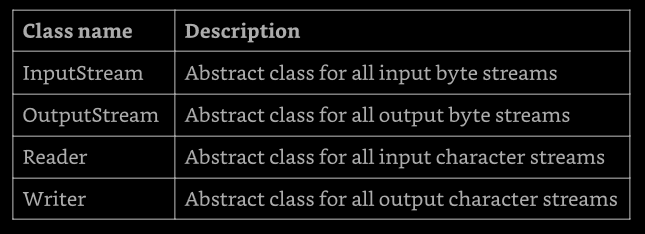


The Table 14.8 list the concrete I/O streams that we should be familiar with for 
our daily life as developer. Note that most of the information about each I/O stream, 
such as whether it is an input or an output stream or whether it access data using 
bytes or character, can be decoded by the name alone.

**Table 14.8: The java.io concrete I/O stream classes**

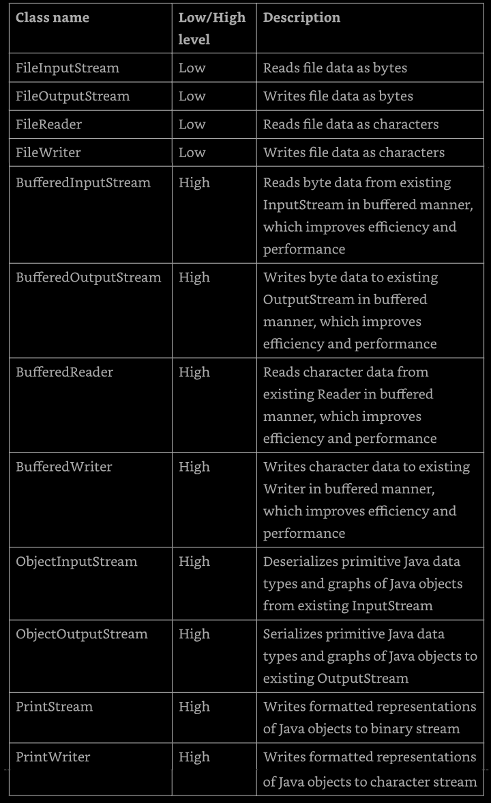


Keep Tables 14.7 and 14.8 handy as we learn more about I/O streams in this chapter. 
We discuss these in more detail, including examples of each.

[back to top](#chapter-14-inputoutput)


## Reading and Writing Files

There are a number of ways to read and write from a file. We show them in this 
section by copying one file to another.

### Using I/O Streams

I/O streams are all about reading/writing data, so it shouldn't be a surprise 
that them most important methods are `read()` and `write()`. Both `InputStream` and 
`Reader` declare a `read()` method to read byte data from an I/O stream. Likewise, 
`OutputStream` and `Writer` both define a `write()` method to write a byte to the 
stream.

The following `copyStream()` methods show an example of reading all of the values 
of an `InputStream` and `Reader`and writing them to an `OutputStream` and `Writer`, 
respectively. In both examples, -1 is used to indicate the end of the stream.
```
void copyStream(InputStream in, OutputStream out) throws IOException {
  int b;
  while ( (b = in.read()) != -1 ) {
    out.write(b);
  } 
}

void copyStream(Reader in, Writer out) throws IOException {
  int b;
  while ( (b = in.read()) != -1 ) {
    out.write(b);
  }
}
```

Since earlier was said we are reading and writing bytes, why do the methods use 
`int` instead of `byte`? Remember, the `byte` data type has a range of 256 characters. 
They needed an extra value to indicate the end of an I/O stream. The authors of Java 
decided to use a larger data type, `int`, so that special values like -1 would indicate 
the end of an I/O stream. The output stream classes use `int` as well, to be consistent 
with the input stream classes.

Reading and writing on byte at a time isn't a particularly efficient way of doing this. 
Luckily, there are overloaded methods for reading an writing multiple bytes at a time. 
The `offset` and `length` values are applied to the array itself. For example, an offset 
of 3 and length of 5 indicates that the stream should read up to five bytes/characters 
of data and put them into the array starting with position 3. Let's look at an example:
```
10: void copyStream(InputStream in, OutputStream out) throws IOException {
11:   int batchSize = 1024;
12:   var buffer = new byte[batchSize];
13:   int lengthRead;
14:   while ( (lengthRead = in.read(buffer. 0, batchSize)) > 0 ) {
15:     out.write(buffer, 0, lengthRead);
17:     out.flush();
16:   }
18: }
```

Instead of reading the data one byte at a time, we read and write up to 1024 bytes 
at a time on line 14. The return value `lengthRead` is critical for determining whether 
we are at the end of the stream and knowing how many bytes we should write into our 
output stream.

Unless out file happens to be a multiple of 2014 bytes, the last iteration of the while 
loop will write some value less than 1014 bytes. For example, if the buffer size is 
1024 bytes and the file size is 1054 bytes, the last read will be only 30 bytes. If 
we ignored this return value and instead wrote 1024 bytes, 994 bytes from the previous 
loop would be written to the end of the file.

We also added a `flush()` method on line 16 to reduce the amount of data lost if 
the application terminates unexpectedly. When data is written to an output stream, 
the underlying operating system does not guarantee that the data will make it to the 
file system immediately. The `flush()` method request that all accumulated data be 
written immediately to disk. It is not without cost, though. Each time it is used, it 
may cause a noticeable delay in the application, especially for large files. Unless 
the data that we are writing is extremely critical, the `flush()` method should be 
used only intermittently. For example, it should not necessarily be called after 
every write, as it is in this example.

Equivalent methods exist on `Reader` and `Writer`, but they use `char` rather 
than `byte`, making the equivalent `copyStream()` method very similar. The previous 
example makes reading and writing a file look like a lot to think about. That's 
because it only uses low-level I/O streams. Let's try again using high-level streams.
```
26: public void copyTextFile(File src, File dest) throws IOException {
27:   try (
28:       var reader = new BufferedReader(new FileReader(src));
29:       var writer = new BufferedWriter(new FileWriter(dest));
30:     ) {
31:     String line = null;
32:     while ( (line = reader.readLine()) != null ) {
33:       writer.write(line);
34:       writer.newLine();
35:     }
36:   }
37: }
```

The key is to choose the most useful high-level classes. In this case, we are 
dealing with a `File`, so we want to use a `FileReader` and `FileWriter`. Both classes 
have constructors that can take either a `String` representing the location of a `File` 
directly.

If the source file does not exist, a `FileNotFoundException`, which inherits 
`IOException`, will be thrown. If the destination file already exists, this implementation 
will overwrite it. We can pass an optional boolean second parameter fo `FileWriter` for an 
append flag if we want to change this behavior.

We also chose to use a `BufferReader` and `BufferWriter` so we can read a whole line 
at a time. This gives us the benefits of reading batches of characters on line 32 without 
having to write custom logic. Line 33 writes out the whole line of data at once. Since 
reading a line strips the line breaks, we add those back on line 34. Lines 28 and 29 
demonstrate chaining constructors. The try-with-resource constructor takes care of 
closing all objects in the chain.

Now imagine that we wanted byte data instead of characters. We would need to 
choose different high-level classes: `BufferedInputStream`, `BufferedOutputStream`, 
`FileInputStream`, and `FileOutputStream`. We would call `readAllBytes()` instead 
of `readLine()` and store the result in a `byte[]` instead of a `String`. Finally, 
we wouldn't need to handle new lines since the data is binary.

We can do a little better than `BufferedOutputStream` and `BufferedWriter` by using 
a `PrintStream` and `PrintWriter`. These class contain four key methods. The `print()` 
and `println()` methods print data with and without a new line, respectively. There 
are also the `format()` and `printf()` methods, which we describe in the section 
on user interactions.
```
public void copyTexFile(File src, File dest) throws IOException {
  try (
    var reader = new BufferedReader(new FileReader(src));
    var writer = new PrintWriter(new FileWriter(dest));
  ) {
    String line = null;
    while ( (line = reader.readLine()) != null )
      writer.println(line);
  }
}
```

While we used a `String`, there are numerous overloaded version of `println()`, 
which take everything from primitives and `String` values to objects. Under the 
covers, these methods often just perform `String.valueOf()`.

The print stream classes have the distinction of being the only I/O stream classes 
we cover that do no have corresponding input stream classes. And unlike `OutputStream` 
classes, `PrintStream` does not have "Output" in its name.

Unlike the majority of the other I/O streams we've covered, the methods in the print 
stream classes do not throw any checked exceptions. If the did, we would be required 
to catch a checked exception any time we called `System.out.print()`! Yes, we've been 
regularly using a `PrintStream` throughout this book. Both, `System.out` and `System.err` 
are `PrintStream` objects. Likewise, `System.in`, often useful for reading user input, 
is an `InputStream`.

The line separator is `\n` or `\r\n`, depending on the operating system. The `println()` 
method takes cre of this for us. If we need to get the character directly, either of the 
following will return it for us:
```
System.getProperty("line.separator");
System.lineSeparator();
```


### Enhancing with _Files_

The NIO.2 APIs provide even easier ways to read and write a file using the `Files` 
class. Let's start by looking at three ways of copying a file by reading in the data 
and writing it back:
```
private void copyPathAsString(Path input, Path output) throws IOException {
  String string = Files.readString(input);
  Files.writeString(output, string);
}

private void copyPathAsBytes(Path input, Path output) throws IOException {
  byte[] bytes = Files.readAllBytes(input);
  Files.write(output, bytes);
}

private void copyPathAsLines(Path input, Path output) throws IOException {
  List<String> lines = Files.readAllLines(input);
  Files.write(output, lines);
}
```

That's pretty concise! We can read a `Path` as a `String`, a `byte` array, or a 
`List`. We have to be aware that the entire file is read at once for all three of 
these, thereby storing all of the contents of the file in memory at the same time. 
It the file is significantly large, we may trigger an `OutOfMemoryError` when trying 
to lead all of it into memory. Luckily, there is an alternative. This time, we print 
out the file as we read it.
```
private void readLazily(Path path) throws IOException {
  try (Stream<String> s = Files.lines(path)) {
    s.forEach(System.out::println);
  }
}
```

Now the contents of the file are read and processed lazily, which means that only 
a small portion of the file is stored in memory at any given time. Taking things one 
step further, we can leverage other stream methods for a more powerful example.
```
try (var s = Files.lines(path)) {
  s.filter( f -> f.startsWith("WARN:"))
    .map( f -> f.substring(5))
    .forEach(System.out::println);
}
```

This sample code searches a log for lines that start with WARN:, outputting the 
text that follows. Assuming that the input file `sharks.log` is as follows:
```
INFO:Server starting
DEBUG:Processes available = 10
WARN:No database could be detected
DEBUG:Processes available reset to 0
WARN:Performing manual recovery
INFO:Server successfully started
```

Then the sample output would be the following:
```
No database could be detected
Performing manual recovery
```

As we can see, we have the ability to manipulate files in complex ways, often 
with only a few short expressions.

---
**_Files.readAllLines()_ vs _Files.lines()_**

For the exam, we need to know the difference between `readAllLines()` and `lines()`. 
Both of these examples compile and run:
```
Files.readAllLines(Paths.get("birds.txt")).forEach(System.out::println);
Files.lines(Paths.get("birds.txt")).forEach(System.out::println);
```

The first line reads the entire file into memory and performs a print operation 
on the result, while the second line lazily processes each line and prints it as 
it is read. The advantage of the second code snippet is that it does not require 
the entire file to be stored in memory at any time.

We should also be aware of when they are mixing incompatible types on the exam.
Do you see why the following does not compile?
```
Files.readAllLines(Paths.get("birds.txt"))
  .filter( s -> s.length() > 2)
  .forEach(System.out::println);
```

The `readAllLines()` method returns a `List`, not a `Stream`, so the `filter()` 
method is not available.

---


### Combining with _newBufferedReader()_ and _newBufferedWriter()_

Sometimes we need to mix I/O streams and NIO.2. Conveniently, `Files` includes 
two convenience methods for getting I/O streams.
```
private void copyPath(Path input, Path output) throws IOException {
  try (
    var reader = Files.newBufferedReader(input);
    var writer = Files.newBufferedWriter(output);
  ) {
    String line = null;
    while ( (line = reader.readLine()) != null ) {
      writer.write(line);
      writer.newLine();
    }
  }
}
```

We can wrap I/O stream constructors to produce the same effect, although it's 
a lot easier to use the factory method. The first method, `newBufferedReader()`, 
reads the file specified ant the `Path` location using a `BufferedReader` object.


### Reviewing Common Read and Write Methods

Table 14.9 reviews the public common I/O stream methods we should know for 
reading and writing files. We also include `close()` and `flush()` since they 
are used when performing these actions. Table 14.10 does the same for common 
public NIO.2 read and write methods.

**Table 14.9: Common I/O read and write methods**

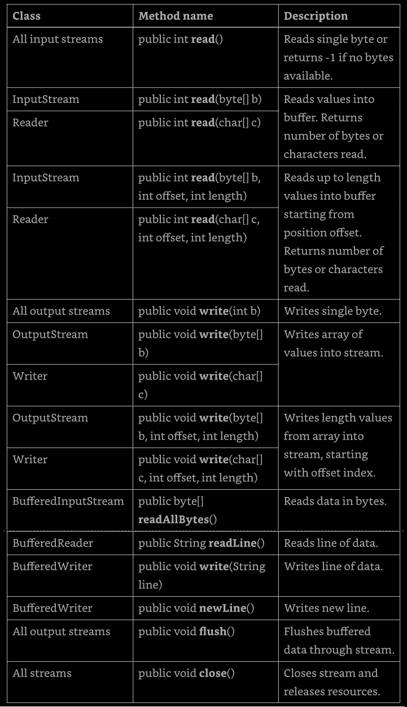


**Table 14.10: Common NIO.2 read and write methods**

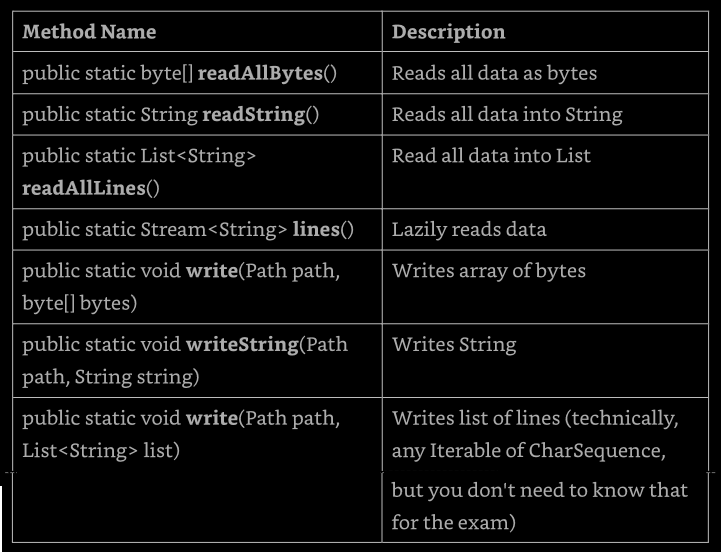

[back to top](#chapter-14-inputoutput)


## Serializing Data

Throughout this book we have been managing out data model using classes, so it 
makes sense that we would want to save these objects between program executions. 
Data about our zoo animal's health wouldn't be particularly useful if it hat to 
be entered every time the program runs.

We can certainly use the I/O stream classes we've learned about so far to store 
text and binary data, but we still have to figure out how to put the data in the 
I/O stream and then decode it later. There are various file formats like XML and 
CSV we can standardize to, but we often have to build the translation ourself.

Alternatively, we can use serialization to solve the problem of how to convert 
objects to/from an I/O stream. _Serialization_ is the process of converting an 
in-memory object to a byte stream. Likewise, _deserialization_ is the process of 
converting from a byte stream into an object. Serialization often involves writing 
an object to a stored or transmittable format, while deserialization is the 
reciprocal process.

Figure 14.6 shows a visual representation of serializing and deserializing a 
`Giraffe` object to and from a `giraffe.txt` file.

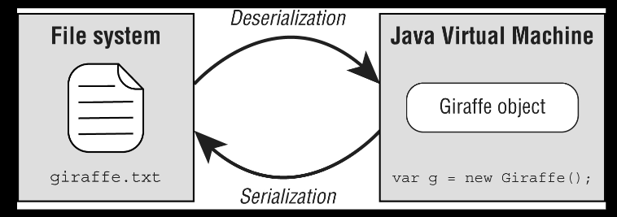

**Figure 14.6: Serialization process**

Int this section, we will see how Java provides built-in mechanism for serializing 
and deserializing I/O streams of objects directly to and from disk, respectively.


### Applying the _Serializable_ Interface

To serialize an object using the I/O API, the object must implement the 
`java.io.Serializable` interface. The `Serializable` interface is a marker 
interface, which means it does not have any methods. Any class can implement the 
`Serializable` interface since there are no required methods to implement.

Since `Serializable` is a marker interface with no abstract members, why not just 
apply it to ever class? Generally speaking, we should only mark data-oriented classes 
as serializable. Process-oriented classes, such as the I/O streams discussed in this 
chapter or the `Thread` instance we learned about in Chapter 13, are often poor 
candidates for serialization, as the internal state of those classes tends to 
be ephemeral or short-lived.

The purpose of using the `Serializable` interface is to inform any process 
attempting to serialize the object that we have taken the proper steps to make 
the object serializable. All Java primitives and many ot the built-in Java classes 
that we have worked with throughout this book are `Serializable`. For example, 
this class can be serialized:

```
import java.io.Serializable;

public class Gorilla implements Serializable {
  private static final long serialVersionUID = 1L;
  private String name;
  private int age;
  private Boolean friendly;
  private transient String favoriteFood;

  // constructors / getters / setters / toString() omitted
}
```

In this example, the `Gorilla` class contains three instance members (name, age, 
friendly) that will be save to an I/O stream if the class is serialized. Note that 
since `Serializable` is not part of the `java.lang` package, it must be imported 
or referenced with the package name.

What about the `favoriteFood` field that is marked `transient`? Any field that is 
marked `transient` will not be saved to an I/O stream when the class is serialized. 
We discuss that in more detail next.

---
**Maintaining a _serialVersionUID_**

It's a good practice to declare a static `serialVersionUID` variable in every 
class that implements `Serializable`. The version is stored with each object as 
part of serialization. Then, every time the class structure changes, this value 
is updated or incremented.

Perhaps out `Gorilla` class receives a new instance member `Double banana`, or 
maybe the `age` field is renamed. The idea is a class could have been serialized 
with an older version of the class and deserialized with a newer version of the 
class.

The `serialVersionUID` helps inform the JVM that the stored data may not match 
the new class definition. If an older version of the class is encountered during 
deserialization, a `java.io.InvalidClassException` may be thrown. Alternatively, 
some APIs support converting data between versions.

---

### Making Data _transient_

The `transient` modifier can be used for sensitive data of the class, like a 
password. There are other objects it does not make sense to serialize, like the 
state of an in-memory `Thread`. If the object is part of a serializable object, 
we just mark it `transient` to ignore these select instance member.

What happens to data marked `transient` on deserialization? It reverts to its 
default Java values, such as 0.0 for `double`, or `null` for an object. We see 
examples of this shortly when we preset the object stream classes.

Making `static` fields `transient` has little effect on serialization. Other 
than the `serialVersionUID`, only the instance members of a class are serialized.


### Ensuring that a Class is Serializable

Since `Serializable` is a marker interface, we might think there are no rules to 
using it. Not quite. Any process attempting to serialize an object will throw a 
`NotSerializableException` if the class does not implement the `Serializable` 
interface properly.

**How to Make a Class Serializable**
- The class must be marked `Serializable`
- Every instance member of the class must be serializable, marked `transient`, 
    or have a `null` value at the time of serialization.

We need to be careful with the second rule. For a class to be serializable, we 
must apply the second rule recursively. Do you see why the following `Cat` class 
is not serializable?

```
public class Cat implements Serializable {
  private Tail tail = new Tail();
}

public class Tail implements Serializable {
  private int Fur fur = new Fur();
}

public class Fur {}
```

`Cat` contains an instance of `Tail`, and both of those classes are marked 
`Serializable`, so no problems there. Unfortunately, `Tail` contains an instance 
of `Fur` that is not marked `Serializable`.

Either of the following changes fixes the problem and allow `Cat` to be serialized:
```
public class Tail implements Serializable {
  private transient Fur fur = new Fur();
}

public class Fur implements Serializable {}
```

We could also make our `tail` or `fur` instance members `null`, although this 
would make `Cat` serializable only for particular instances, rather than to all
instances.

**Serializing Records**
A record follows the same rules as other types of classes with respect to 
whether it can be serialized: they need to implement the `Serializable` interface.


### Storing Data with _ObjectOutputStream_ and _ObjectInputStream_

The `ObjectInputStream` class is used to deserialize an object, while the 
`ObjectOutputStream` is used to serialize an object. The are high-level streams 
that operate on existing I/O streams. While both of these classes contain a number 
of methods for built-in data type like primitives, the two methods we need to know 
for the exam are the one related to working with objects.

```
// ObjectInputStream
public Object readObject() throws IOException, ClassNotFoundException {}

// ObjectOutputStream
public void writeObject(Object obj) throws IOException {}
```

Note the parameters, return types and exception thrown. We now provide a sample 
method that serialize a list of `Gorilla` objects to a file.

```
void saveToFile(List<Gorilla> gorillas, File dataFile) throws IOException {
  try (
    var out = new ObjectOutputStream(new BufferedOutputStream(
      new FileOutputStream(dataFile)
    ));
  ) {
    for (Gorilla gorilla : gorillas)
      out.writeObject(gorilla);
  }
}
```

Pretty easy, right? Notice that we start with a file stream, wrap it in a buffered 
I/O stream to improve performance, and then wrap that with an object stream. Serializing 
the data is as simple as passing it to `writeObject()`.

Once the data is stored in a file, we can deserialize it by using the following method:
```
List<Gorilla> readFromFile(File dataFile) throws IOException, ClassNotFoundException {
  var gorillas = new ArrayList<Gorilla>();
  try (
    var in = new ObjectInputStream(new BufferedInputStream(
      new FileInputStream(dataFile)
    ));
  ) {
    while (true) {
      var object = in.readObject();
      if (object instanceof Gorilla g) {
        gorillas.add(g);
      }
    }
  } catch (EOFException e) {
    // file end reached. load completed
  }
  return gorillas;
}
```

Not as simple as our save method. When calling `readObject()`, `null` and `-1` do 
not have any special meaning, as someone might have serialized objects with those 
values. Unlike our earlier techniques for reading methods from an input stream, we 
need to use an infinite loop to process the data, which throws an `EOFException` 
when the end of the I/O stream is reached.

If our program happens to know the number of object in the I/O stream, we can call 
`readObject()` a fixed number of times, rather than using an infinite loop.

Since the return type of `readObject()` is `Object`, we need to check the type 
before obtaining access to our Gorilla properties. Notice that `readObject()` 
declares a _checked_ `ClassNotFoundException` since the class might not be available 
od deserialization.

The following code snipped shows how to call the serialization methods:
```
var gorillas = new ArrayList<Gorilla>();
gorillas.add(new Gorilla("Grodd", 5, false));
gorillas.add(new Gorilla("Ishmael", 8, true));
File dataFile = new File("gorillas.data");

saveToFile(gorillas, dataFile);
var gorillasFromDist = readFromFile(dataFile);
System.out.print(gorillasFromDisk);
```

Assuming that the `toString()` method was properly overridden in the `Gorilla` 
class, this prints the following at runtime.
```
[[name=Grood, age=5, friendly=false],
[name=Ishmael, age=8, friendly=true]]
```

`ObjectInputStream` inherits an `available()` method from `InputStream` that we 
might think can be used to check for the end of the I/O stream rather than throwing 
an `EOFException`. Unfortunately, this only tell us the number of blocks tht can be 
read without blocking another thread. In other words, it can return 0 even if there 
area more bytes to be read.


### Understanding the Deserialization Creation Process

For the exam, we need to understand how a deserialized object is created. When 
we deserialize an object, _the constructor ot the serialized class, along with_  
_any instance initializer, is not called when the object is created_. Java will 
call the no-arg constructor of the first non-serializable parent class it can 
find in the class hierarchy. In our `Gorilla` example, this would just be the 
no-arg constructor of `Object`.

As we stated earlier, any static or transient fields are ignored. Values that are 
not provided will be given their default Java value, such as `null` for `String`, 
or `0` for `int` values.

Let's take a look at a new `Chimpanzee` class. this time we do list the constructors 
to illustrate that none of them is used on deserialization.
```
import java.io.Serializable;

public class Chimpanzee implements Serializable {
  public static final long serialVersionUID = 2L;
  private transient String name;
  private transient int age = 10;
  private static char type = 'C';
  { this.age = 14; }                     // static initializer

  public Chimpanzee() {
    this.name = "Unknown";
    this.age = 12;
    this.type = 'Q';
  }

  public Chimpanzee(String name, int age, char type) {
    this.name = name;
    this.age = age;
    this.type = type
  }

  // getter / setters / toString()  omitted
}
```

Assuming we rewrite our previous serialization and deserialization methods to 
process a `Chimpanzee` object instead of a `Gorilla` object, what do you think 
the following print?
```
var chimpanzees = new ArrayList<Chimpanzee>();
chimpanzees.add(new Chimpanzee("Ham", 2 'A'));
chimpanzees.add(new Chimpanzee("Enos", 4, 'B'));

File dataFile = new File("chimpanzee.data");
saveToFile(chimpanzees, dataFile);

var chimpanzeesFromDisk = readFromFile(dataFile);
System.out.println(chimpanzeeFromDisk);
```

None of the instance members are serialized to a file. The `name` and `age` variables 
are both marked `transient`, while the `type` variable is `static`.

Upon deserialization, none of the constructor in `Chimpanzee` is called. Even the 
no-arg constructor that sets the values [name=Unknown,age=12,type=Q] is ignored. The 
instance initializer that set `age` to 14 is also not executed.

In this case, the `name` variable is initialized to `null` since that's the default 
value for String in Java. Likewise, the `age` variable is inherited to `0`. The program 
print the following, assuming the `toString()` method is implemented:
```
[
  [name=null,age=0,type=B],
  [name=null,age=0,type=B]
]
```

What about the `type` variable? Since it's `static` , it will display whatever 
value was set last. If the data is serialized and deserialization within the same 
execution, it will display `B`, since that was the last `Chimpanzee` we created. 
On the other hand, if the program performs the deserialization and print on startup, 
it will print `C`, since that is the value the class is initialized with.

For the exam, we need to understand that the constructor and any instance 
initialization defined in the serialized class are ignored during the deserialization 
process. Java only calls the constructor of the first non-serializable parent 
class in the class hierarchy.

Finally, let's add a subclass:
```
public class BabyChimpanzee extends Chimpanzee {
  private static final long serialVersionUID = 3L;

  private String mother = "Mom";

  public BabyChimpanzee(String name, char type) {
    super(name, 0, type);
  }

  // getter / setter / toString() omitted
}
```

Notice that this subclass is serializable because the superclass has implemented 
`Serializable`. We now have an addition instance variable. The code to serialize 
and deserialize remains the same. We can even still cast to `Chimpanzee` because 
this is a subclass.

[back to top](#chapter-14-inputoutput)


## Interacting with Users

Java includes numerous classes for interacting with the user. For example, we 
might want to write an application that asks a user to log in and then print a 
success message. This section contains numerous technique for handling and 
responding to user input.


### Printing Data to the User

Java includes two `PrintStream` instances fro providing information to the user: 
`System.out` and `System.err`. The syntax for calling and using `System.err` is 
the same as `System.out` but is used to report errors to the user in a separate 
I/O stream from the regular output information.
```
try (var in = new FileInputStream("zoo.txt")) {
  System.out.println("Found file!");
} catch (FileNotFoundException e) {
  System.err.println("File not found!");
}
```

How do they differ in practice? In part, that depends on what is executing the 
program. For example, if we are running from a command prompt, they will likely 
print text in the same format. On the other hand, if we are working in an integrated 
development environment (IDE), they might print the `System.err` text in a different 
color. Finally, if the code is being run on a server, the `System.err` stream 
might write to a different log file.

---
**Using Logging APIs

While `System.out` and System.err` are incredibly useful fro debugging stand-alone 
os simple applications, they are rarely used in professional software development. 
Most application rely on a logging service or API.

While many logging APIS are available, they tend to share a number o similar 
attributes. First we create a static logging object in each class. Then we log a 
message with an appropriate logging level: `debug()`, `info()`, `warn()`, or `error()`. 
The `debug()` and `info()` methods are useful as they allow developer to log things 
that aren't errors but may be useful.

---

### Reading Input as an I/O Stream

The `System.in` return an `InputStream` and is used to retrieve text input from 
the user. It is commonly wrapped with a `BufferedReader` via an `InputStreamReader` 
to use the `readline()` method.
```
var reader = new BufferedReader(new InputStreamReader(System.in));
String userInput = reader.readLine();
System.out.println("You entered: " + userInput);
```

When executed, this application first fetches text from the user until the user 
press the Enter key. It then outputs the text the user entered to the screen.


### Closing System Streams

You might noticed that we never created or closed `System.out`, `System.err`, and 
`System.in` when we used them. In fact, these are the only I/O streams in the entire 
chapter that we did no use a try-with-resource block on.

Because these are static objects, the `System` streams are shared by the entire 
application. The JVM created and opens them for us. They can be used in a try-with-
resources statement o by calling `close()`, although _closing them is not recommended_. 
Closing the `System` streams makes them permanently unavailable for all threads in 
the remainder of the program.

What do you think the following code snipped prints?
```
try (var out = System.out) {}
System.out.println("Hello");
```

Noting is printing here. The methods of `PrintStream` do not throw any checked 
exceptions and rely on the `checkError()` to report errors, so they fail silently.
What about this example?
```
try (var err = System.err) {}
System.err.println("Hello");
```

This one also prints nothing. Like `System.out`, `System.err` is a `PrintStream`. 
Even if it did throw an exception, we'd have a hard time seeing it since our I/O 
stream for reporting error is closed! Closing `System.err` is a particularly bad 
idea, since the stack traces from all exceptions will be hidden.

Finally, what do you think this code snippet does?
```
var reader = new BufferedReader(new InputStreamReader(System.in));
try (reader) {}
String data = reader.readLine();    // IOException
```

It prints an exception at runtime. Unlike the `PrintStream` class, most `InputStream`
implementations will thrown an exception if we try to operate on a closed I/O stream.


### Acquiring Input with _Console_

The `java.io.Console` class is specially designed to handle user interactions. After 
all, `System.in` and `System.out` are just raw streams, whereas `Console` is a class 
with numerous methods centered around user input.

The `Console` class is a singleton because it is accessible only from a factory 
method and only one instance of it is created by the JVM. For example, if we come 
across code such as the following, it does not compile, since the constructors 
are all private:
```
Console c = new Console();     // does not compile
```

The following snippet shows how to obtain a `Console` and use it to retrieve user input:
```
Console console = System.console();
if (console != null) {
  String userInput = console.readLine();
  console.writer().println("You entered: " + userInput);
} else {
  System.err.println("Console not available");
}
```

The `Console` object may not be available, depending on where the code is being 
called. It it is not available, `System.console()` return `null`. It is imperative 
that we check tor a `null` value before attempting to use a `Console` object.

The program first retrieves an instance of the `Console` and verifies tht it is 
available, outputting a message to `System.err` if it is not. If it is available, 
the program retrieves a line of input from the user and prints the result. This 
example is equivalent to our earlier example of reading user input with `System.in` 
and `System.out`.


### Obtaining Underlying I/O Streams

The `Console` class includes access to two streams for reading and writing data.
```
public Reader reader()
public PrintWriter writer()
```

Accessing these classes is analogous to calling `System.in` and `System.out` 
directly, although they use character streams rather than byte streams. In this 
manner, they are more appropriate for handling text data.


#### Formatting Console Data

In Chapter 4, we learned about the `format()` method on `String`; and in 
Chapter 11, "Exceptions and Localization", we worked with formatting using locales. 
Conveniently, each print stream class includes a `format()` method, which includes 
an overloaded version that takes a `Locale` to combine both ot these:
```
// PrintStream
public PrintStream format(String format, Object... args)
public PrintStream format(Locale loc, String format, Object... args)

// PrintWriter
public PrintWriter format(String format, Object... args)
public PrintWriter format(Locale loc, String format, Object... args)
```

For convenience Java includes `printf()` methods, which function identically to 
the `format()` methods. The only thing we need to known about these methods is 
that the are interchangeable with `format()`.

Let's take a look at using multiple methods to print information for the user:
```
Console console = System.console();
if (console == null) {
  throw new RuntimeException("Console not available");
} else {
  console.writer().println("Welcome to Our Zoo");
  console.format("It has %d animals and employs %d people", 291, 25);
  console.writer().println();
  console.printf("The zoo spans %5.1f acres", 128.91);
}
```

Assuming the `Console` is available at runtime, it prints the following:
```
Welcome to Our Zoo!
It has 391 animals and employs 25 people
The zoo spans 128.9 acres
```

---
**Using Console with Locale**

Unlike print stream classes, `Console` does not include an overloaded `format()` 
method that takes a `Locale` instance. Instead, `Console` relies on the system locale. 
Of course, we could always use a specific `Locale` by retrieving the`Writer` object and 
passing our own `Locale` instance, such as the following example:
```
Console console = System.console();
console.writer().format(new Locale("fr", "CA"), "Hello World");
```

---

#### Reading Console Data

The `Console` class includes four methods for retrieving regular text data from 
the user.
```
public String readLine()
public String readLine(String fmt, Object... args)

public char[] readPassword()
public char[] readPassword(String fmt, Object... args)
```

Like using `System.in` with a `BufferedReader`, the `Console.readline()` method 
read input until the user presses the Enter key. The overloaded version of `readLine()` 
displays a formatted message prompt prior to requesting input.

The `readPassword()` methods are similar to the `readLine()` method, with two important 
differences:
- The text the user types is not echoed back and displayed on the screen as they 
    are typing
- The data is returned as a `char[]` instead of `String`.

The first feature improves security by not showing the password on the screen if 
someone happen to be sitting next the user. The second feature involve preventing 
password from entering the `String` pool.


### Reviewing Console Methods

The last code sample we present aks the user a series of questions and prints result 
based on this information using many of various methods we learned in this section.

```
Console console = System.console();
if (console == null) {
  throw new RuntimeException("Console not available");
} else {
  String name = console.readLine("Please, enter your name: ");
  console.writer().format("Hi %s", name);
  console.writer().println();

  console.format("What is your address? ");
  String address = console.readLine();

  char[] password = console.readPassword(
    "Enter a password between %d and %d characters: ", 5, 10);
  char[] verify = console.readPassword("Enter the password again: ");
  console.printf( "Passwords " + 
      (Arrays.equals(password, verify) ? "match" : "do not match") );
}
```

Assuming the `Console` is available, the output should resemble the following:
```
Please, enter your name: Max
Hi Max
What is your address? Spoonerville
Enter a password between 5 and 10 characters:
Enter the password again:
Passwords match
```

[back to top](#chapter-14-inputoutput)


## Working with Advanced APIs

Files, paths, I/O streams: we've worked a lot in this chapter. In this final 
section, we cover some advance features of I/O streams and NIO.2 that can be quite 
useful in practice, and have been known to appear on the exam from time to tome.


### Manipulating Input Streams

All input stream classes include the following methods to manipulate the order 
in which data ie read from an I/O stream:
```
// InputStream and Reader
public boolean markSupported()
public void mark(int readLimit)
public void reset() throws IOException
public long skip(long n) throws IOException
```

The `mark()` and `reset()` methods return an I/O stream to an earlier position. 
Before calling either of these methods, we should call the `markSupported()` method, 
which return `true` if `mark()` is supported. The `skip()` method is pretty simple, 
it basically read data from the I/O stream and discards the contents.

Not all input streams classes support `mark()` and `reset()`. Make sure to call 
`markSupported()` on the I/O stream before calling these methods, or an exception 
will be thrown at runtime.


### Marking Data

Assume that we have an `InputStream` instance whose next values are LION. Consider 
the following code snippet:
```
public void readData(InputStream is) throws IOException {
  System.out.print( (char)is.read() );       // L
  if (is.markSupported()) {
    is.mark(100);                           // marks up to 100 bytes
    System.out.print( (char)is.read() );    // I
    System.out.print( (char)is.read() );    // O
    is.reset();                             // resets stream to position before I
  }
  System.out.print( (char)is.read() );      // I
  System.out.print( (char)is.read() );      // O
  System.out.print( (char)is.read() );      // N 
}
```

The code snippet will output LIOION if `mark()` is supported and LION otherwise. 
It's a good practice to organize ou `read()` operation so that the I/O stream ends 
up at the same position regardless of whether `mark()` is supported.

What about the value of 100 bytes that we passed to the `mark()` method? This value 
is called the `readLimit`. It instructs the I/O stream that we expect to call `reset()` 
after at most 100 bytes. If out program calls `reset()  after reading more than 100 
bytes from calling `mark(100)`, it may throw an exception, depending on the I/O 
stream class.

In actuality, `mark()` and `reset()` are not putting the data back into the I/O stream 
but are storing the data in a temporary buffer in memory to be read again. Therefore, we 
should no call the `mark()`operation with to large values, as this could take up a lot  
of memory.

### Skipping Data

Assume that we have an `InputStream` instance whose next values area TIGERS. 
Consider the following code snippet:
```
System.out.print( (char)is.read() );     // T
is.skip(2);                              // skips I and G
is.read();                               // reads E but doesn't output it
System.out.print( (char)is.read() );     // R
System.out.print( (char)is.read() );     // S
```

This code prints RST at runtime. We skipped two characters, I and G. We also read 
E but didn't use it anywhere, so it behaved like calling `skip(1)`.

The return parameter of `skip()` tels us how many values were skipped. For example, if 
we are near the end of the I/O stream and call `skip(1000)`, the return value might be 
20, indicating that the end ot the I/O stream was reached after 20 values were skipped. 
Using the return value of `skip()` is important if we need to keep track of where we 
are in an I/O stream and how many bytes have been processed.


### Reviewing Manipulation APIs

Table 14.11 reviews these APIs related to manipulating I/O input streams. While 
we many not have used these in practice, we need to know that they exists.

**Table 14.11: Common I/O stream method**

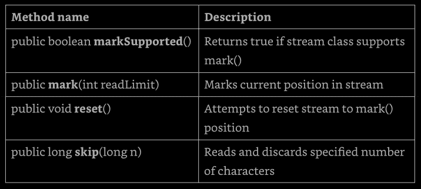


### Discovering File Attributes

We begin out discussion by presenting the basic methods for reading tile attributes. 
These methods are usable within any file system, although they may have limited meaning 
in some file systems.


#### Checking for Symbolic Links

Earlier, we saw that the `Files` class has methods called `isDirectory()` and 
`isRegularFile()`, which are similar to the `isDirectory()` and `isFile()` methods 
on `File`. While the `File` object can't tell us if a reference is a symbolic link, 
the `isSymbolicLink()` method on `Files` can.

It is possible for `isDirectory()` or `isRegularFile()` to return `true` for a symbolic 
link, as long as the link resolves to a directory or regular file, respectively. Let's 
take a look at some sample code:
```
System.out.print(Files.isDirectory(Paths.get("/canine/fur.jpg")));
System.out.print(Files.isSymbolicLink(Paths.get("/canine/coyote")));
System.out.print(Files.isRegularFile(Paths.get("/canine/types.txt")));
```

The first example prints `true` if `fur.jpg` is a directory or a symbolic link to 
a directory and `false` otherwise. The second example prints `true` if `/canine/coyote` 
is a symbolic link, regardless of whether the file or directory it points to exists. 
The third example prints `true` if `types.txt` points to a regular file or symbolic 
link that points to a regular file.


#### Checking File Accessibility

In many file systems, it is possible to set a boolean attribute to a file tht marks 
it hidden, readable, or executable. The `Files` class includes methods that expose this 
information: `isHidden()`, `isReadable()`, `isWriteable()`, and `isExecutable()`.

A hidden file can't normally be viewed when listing the contends of a directory. 
The readable, writeable, and executable flags are important in file systems where 
the filename can be viewed, but the user may not have permission to open the file's 
contents, modify the file, or run the file as a program, respectively.

Here we present an example of each method:
```
System.out.println(Files.isHidden(Paths.get("/walrus.txt")));
System.out.println(Files.isReadable(Paths.get("/seal/baby.png")));
System.uot.println(Files.isWriteable(Paths.get("/dolphin.txt")));
System.out.println(Files.isExecutable(Paths.get("whale.png")));
``` 

If the `walrus.txt` file exists and is hidden within the file system, the first 
example prints `true`. The second example prints `true` it the `baby.png` file exists 
and its contents are readable. The third example prints `true` if the `dolphin.txt` 
file can be modified. Finally, the last example prints `true` if the file can be executed 
within the operating system. Not that the file extension does not necessarily determine 
whether a file is executable. For example, an image file that ends in `.png` could be 
marked executable in sole file systems.

With the exception of the `isHidden()` methods, these methods do not declare any checked 
exceptions and return `false` if the file does not exists.


### Improving Attribute Access

Up until now, we have been accessing individual file attributes with multiple method 
calls. While this is functionally correct, there is often a cost each time one of these 
methods is called. Put simply, it is far more efficient to ask the file system for all 
of the attributes at once rather than performing multiple round trips to the file system. 
Furthermore, some attributes are file system-specific and cannot be easily generalized 
for all file systems.

NIO.2 address both of these concerns by allowing us to construct views for various 
file systems with a single method call. A _view_ is a group of related attributes for 
a particular file system type. Thats not to say that the earlier attribute methods that 
we just finished discussing do no have their uses. If we need to read only one attribute 
of a file or directory, request a view is unnecessary.


#### Understanding Attribute and View Types

NIO.2 includes two methods for working with attributes in a single method call: 
a read-only attributes method and a updatable view method. For each method, we need to 
provide a file system type object, which tells the NIO.2 method which type of view we 
are requesting. By updatable view, we mean that we can both read and write attributes 
with the same object.

Table 14.12 lists the commonly used attributes and view types.

**Table 14.13: The attributes and view types**
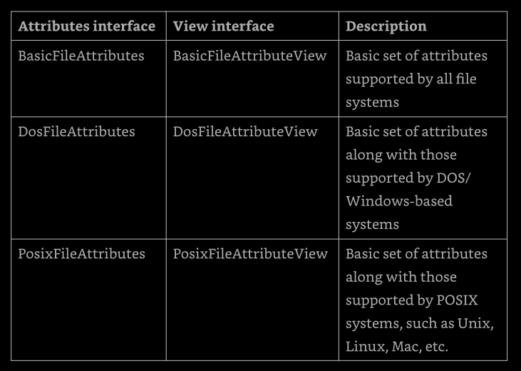


#### Retrieving Attributes

The `Files` class includes the following method to tread attributes of a class in 
a read-only capacity:
```
public static <A extends BasicFileAttributes> A readAttributes(
  Path, path,
  Class<A> type,
  LinkOption... options
) throws IOException
```

Applying it requires specifying the `Path` and `BasicFileAttribute.class` parameters.
```
var path = Paths.get("/turtles/sea.txt");
BasicFileAttributes data = Files.readAttribute(path, BasicFileAttribute.class);

System.out.println("Is a directory? " + data.isDirectory());
System.out.println("Is a regular file? " + dat.isRegularFile());
System.out.println("Is a symbolic link? " + data.isSymbolicLink());
System.out.println("Size (in bytes): " + data.size());
System.out.println("Last modified: " + data.lastModifiedTime());
```

The `BasicFileAttributes` class includes many values with the same name as the 
attribute methods in the `Files` class. The advantage of using this method, though, 
is that all of the attributes are retrieved at once for some operating systems.


#### Modifying Attributes

The following `Files` method returns an updatable view:
```
public static <V extends FileAttributeView> V getFileAttributeView(
  Path path,
  Class<V> type,
  LinkOption... options
)
```

We can use the updatable view to increment a file's last modified date/time value 
by 10.000 milliseconds, or 10 seconds.
```
// Read file attributes
var path = Paths.get("/turtles/sea.txt");
BasicFileAttributeView view = 
    Files.getFileAttributeView(path, BasicFileAttributesView.class);
BasicFileAttributes attributes = view.readAttributes();

// Modify file last modified time
FileTime lastModifiedTime = 
    FileTime.fromMillis(attributes.lastModifiedTime().toMillis() + 10_000);
view.setTimes(lastModifiedTime, null, null);
```

After the updatable view is retrieved, we need to call `readAttributes()` on the 
view to obtain the file metadata. From there, we create a new `FileTime` value and 
set it using the `setTimes()` method.
```
// BasicFileAttributeView instance method
public void setTimes(
  FileTime lastModifiedTime, 
  FileTime lastAccessTime, 
  FileTime createdTime
)
```

This method allows us to pass `null` for any date/time value that we do not want 
to modify. In our sample code, only the last modified date/time is changed.

Not all file attributes can be modified with a view. For example, we cannot set 
a property that changes a file into a directory. Likewise, we cannot change the 
size of the object without modifying its contents.


### Traversing a Directory Tree

While the `Files.list()` method is useful, it traverses the contents of only a single 
directory. What it we want to visit all fof the paths within a directory tree? Before 
we proceed, we need to review some basic concept about file systems. Remember that a 
directory is organized in a hierarchical manner. For example, a directory can contain 
files and other directories, which can in turn contain other files and directories. 
Every record in a file system has exactly on parent, with the exception of the root 
directory, which sits atop everything.

A file system is commonly visualized as a tree with a single root node and many branches 
and leaves. In this model, a directory is a branch or internal node, and a file is leaf 
node.

A common task in a file system is to iterate over the descendants of a path, either 
recording information about them or, more commonly, filtering them for a specific set 
of files. For example, we may want to search a folder and print a list of all of the 
`.java` files. Furthermore, file systems store file records in a hierarchical manner. 
Generally speaking, if we want to search for a file, we have to start with a parent 
directory, read its child elements, then read their children, and so on.

_Traversing a directory_, also referred to as walking a directory tree, is the process 
by which we start with a parent directory and iterate over all of its descendants until 
some condition is met or there are no more elements over which to iterate. For example, 
if we're searching for a single file, we can end the search when the file is found or 
we've  checked all files and come up empty. The starting path is usually a specific 
directory; after all, it would be time-consuming to search the entire file system on 
every request.

---
**Don't use _DirectoryStream_ and _FileVisitor_**

While browsing the NIO.2 Javados, we will come across methods that use `DirectoryStream` 
and `FileVisitor` classes to traverse a directory. These methods predate the existence 
of the Stream API and were even required knowledge for older Java certifications exams.

However, the  newer Stream API based methods are superior and accomplish the same thing, 
often with much less code.

---

#### Selecting a Search Strategy

Two common strategies are associated with walking a directory tree: a _deep-first_ 
and a _breadth-first_ search. A _depth-first search_ traverses the structure from the 
root to an arbitrary leaf and then navigates back up toward the root, traversing fully 
any paths it skipped along the way. The _search depth_ is the distance from the root 
to current node. To prevent endless searching, Java includes a search depth that is to 
limit how many levels (or hops) from the root the search is allowed to go.

Alternatively, a _breadth-first search_ starts at the root and process all elements 
of each particular depth before proceeding to the next depth level. The results are 
ordered by depth, with all nodes at depth 1 read before all nodes at depth 2, and so 
on. While a breadth-first search tends to be balanced and predictable, it also requires 
more memory since a list of visited node must be maintained.

Commonly, we don't have to understand the details of each search strategy that Java 
employs; we just need to be aware that the NIO.2 Stream API methods use depth-first 
searching with a depth limit, which can be optionally changed.


#### Walking a Directory

That's enough background information; let's get to more Stream API methods. The 
`Files` class includes two methods for walking the directory tree using a depth-
first search.
```
public static Stream<Path> walk(Path start, FileVisitOption... options)
    throws IOException

public static Stream<Path> walk(Path start, int maxDepth, FileVisitOption... options)
    throws IOException
```

Like our other stream methods, `walk()` uses lazy evaluation and evaluates a `Path` 
only as it gets to it. This means that even if the directory tree includes hundreds 
or thousands of files, the memory required to process a directory tre is low. The first 
`walk()` method relies on a default maximum depth of `Integer.MAX_VALUE`, while the 
overloaded version allows the user to set a maximum depth. this is useful in cases 
where the file system might be large and we know the information we are looking 
for is near the root.

Rather than just printing the contends of a directory tree, we can again do something 
more interesting. The following `getPathSize()` methods walks a directory tree and 
returns the total size of all the files in the directory:
```
private long getSize(Path p) {
  try {
    return Files.size(p);
  } catch (IOException e) {
    throw new UncheckedIOException(e);
  }
}

public long getPathSize(Path source) throws IOException {
  try (vars s = Files.walk(source)) {
    return s.parallel()
        .filter( p -> !Files.isDirectory(p))
        .mapToLong(this::getSize)
        .sum();
  }
}
```

The `getSize()` helper method is needed because `Files.size()` declares `IOException`, 
and we'd rather not put a try/catch block inside a lambda expression. Instead, we wrap 
it in the unchecked exception class `UncheckedIOException`. We can print the data using 
the `format()` method:
```
var size = getPathSize(Path.of("/fox/data"));
System.out.format("Total Size: %.2f megabytes", (size / 1_000_000) * 1.0);
```

Depending on the directory we run this on, it will print something like this:
```
Total Size: 15.30 megabytes
```


#### Applying a Depth Limit

Let's say our directory tree is quite deep, so we apply a depth limit by changing 
one line of code in our `getPathSize()` method.
```
try (var s = Files.walk(source, 5)) {
  // omitted
}
```

This new version checks for files only within 5 steps of the starting node. A depth 
value of 0 indicates the current directory path itself. Since the method calculates 
values on on files, we'd have to set a depth limit of at least 1 to get a nonzero 
result when this method is applied to a directory tree.


#### Avoiding Circular Paths

Many of our earlier NIO.2 methods traverse symbolic links by default, with a 
`NOFOLLOW_LINKS` used to disable this behavior. The `walk()` method is different in 
that id does _not_ follow symbolic links by default and requires the `FOLLOW_LINKS` 
option to be enabled. We can alter our `getPathSize()` method to enable following 
symbolic links by adding the `FileVisitOption`.
```
try (var s = Files.walk(source, FileVisitOption.FOLLOW_LINKS)) {
  // omitted
}
```
When traversing a directory tree, our program need to be careful of symbolic links, 
if enabled. For example, if our process comes across a symbolic link that points to 
the root directory of the file system, every file in the system will be searched!

Worse yet, a symbolic link could lead to a cycle in which a path is visited repeatedly. 
A _cycle_ is an infinite circular dependency in which an entry in a directory tree 
points to one of its ancestor directories. Let's say we had a directory tree as shown 
in Figure 14.7 with the symbolic link `/birds/robin/allBirds` that points to `/birds`.

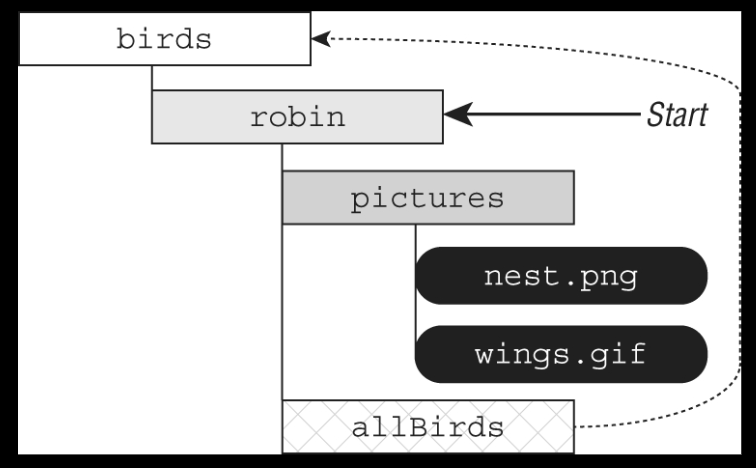

**Figure 14.7: File system with cycle**

What happens if we try to traverse this tree and follow all symbolic links, starting 
with `/birds/robin`? Table 14.13 shows the paths visited after walking a depth of 3. 
For simplicity, we walk the tree in a breadth-first ordering, _although a cycle occurs_ 
_regardless of the search strategy used_.

**Table 14.13: Walking a directory with a cycle using breadth-first search**

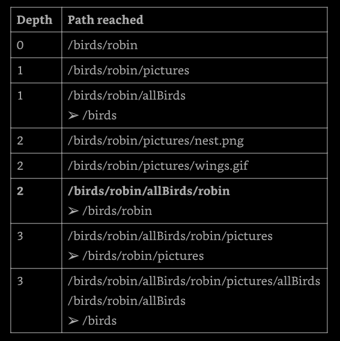


After  walking  a  distance  of 1  from  the start,  we hit the  symbolic link 
`/birds/robin/allBirds` and go back to  the top of the directory tree `/birds`. 
That's okay because we haven't visited `/birds` yet, so there's non cycle yet!

Unfortunately, at  depth 2,  we  encounter a  cycle.  We've already visited the 
`/birds/robin` directory on our first step, and we're encountering it again. If 
the process continues, we'll be doomed to visit the directory over and over again.

We have to be aware when the `FOLLOW_LINKS` options is used, the `walk()` method 
will track all of the paths it has visited, throwing a `FileSystemLoopException`
if a path is visited twice.


### Searching a Directory

In the previous example, we applied a filter to the `Stream<Path>` object to 
filter the results, although there is a more convenient method.
```
public static Stream<Path> find(
  Path start, 
  int maxDepth,
  BiPredicate<Path, BasicAttributes> matcher,
  FileVisitOption... options
) throws IOException
```

The `find()` methods behaves in a similar manner as the `walk()` method, except that 
it takes a `BiPredicate` to filter the data. It also requires a depth limit to be set. 
Like `walk()`, `find()`, also supports the `FOLLOW_LINK` option.

The two parameters of the `BiPredicate` are a `Path` object and a `BasicFileAttributes` 
object, which we saw earlier in the chapter. In this manner, Java automatically retrieves 
the basic file information for us, allowing us to write complex lambda expressions that 
have direct access to this object. We illustrate this with the following example:
```
Path path = Paths.get("/bigcats");
long minSize = 1_000;
try (var s = Files.find(
    path, 
    10, 
    (p, a) -> a.isRegularFile() && p.toString().endsWith(".java") && a.size() > minSize 
  )
) {
  s.forEach(System.out::println);
}
```

This example searches a directory tree and prints all `.java` files with a size of 
at least 1,000 bytes, using a depth limit of 10. While we could have accomplished this 
using the `walk()` method along with a call to `readAttributes()`, this implementation 
is a lot shorter and more convenient than those would have been. We also don't have to 
worry about any methods within the lambda expression declaring a checked exception, 
as we saw in the `getPathSize()` example.


## Reviewing of Key APIs

The key APIs that we need to know are listed in table 14.14. We know that some of 
the classes look similar. We need to know this table well for the exam.

**Table 14.14: Key APIs**

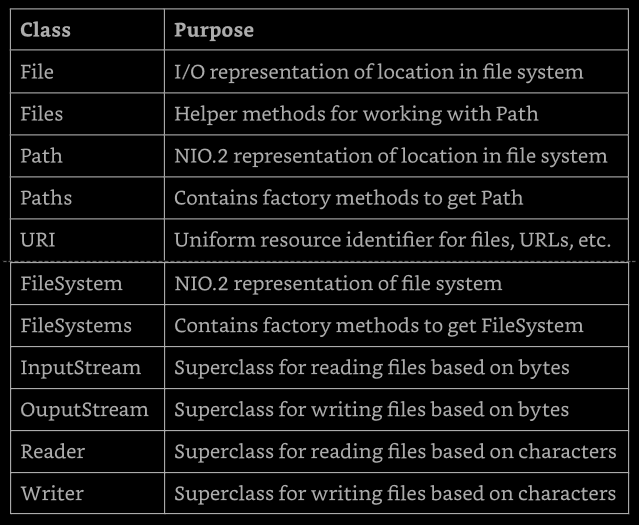


Additionally, Figure 14.8 shows all of the I/O stream classes that we need to 
be familiar, with the exception of the filter streams. `FilterInputStream` and 
`FilterOutputStream` are high-level superclasses that filter or transform data. 
They are rarely used directly.

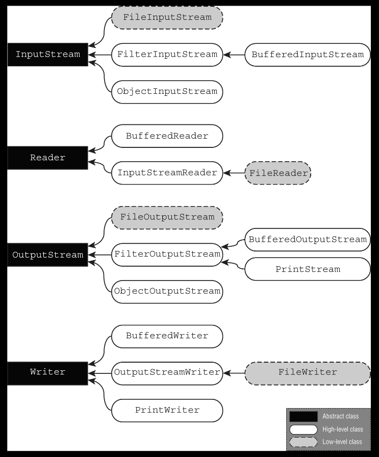


The `InputStreamReader` and `OutputStreamWriter` are incredibly convenient 
and are also unique in that they are the only I/O stream class to have both 
InputStream/OutputStream and Reader/Writer in their name.

[back to top](#chapter-14-inputoutput)


## Summary

This chapter is all about reading and writing data. We started by showing how to 
create `File` from I/O and `Path` from NIO.2. We then covered the functionality that 
works with both I/O and NIO.2 before getting into NIO.2-specific APIs. We should be 
familiar with how to combine or resolve `Path` objects with other `Path` objects. 
Additionally, NIO.2 includes Stream API methods that can be used to process files and 
directories. We discussed methods for listings a directory, walking a directory tree, 
searching a directory tree, and reading the lines of a file.

We spent time reviewing various methods available in the `Files` helper class. As 
discussed, the name of the function often tells us exactly what it does. We explained 
that most of theses methods are capable of throwing an IOException, and many take optional 
varargs enum values.

We then introduced I/O streams and explained how they are used to read or write large 
quantities of data. While there are a lot of I/O streams, they differ on some key points:
* Byte vs. character streams
* Input vs. output streams
* Low-level vs. high-level streams

Often, the name of the I/O stream can tell us a lot about what it does. We visited 
many of the I/O stream classes that we need to know in increasing order of complexity. 
A common practice is to start with a low-level resource or file stream and wrap it in a 
buffered I/O stream to improve performance. We can also apply a high-level stream to 
manipulate the data, such as an object or print stream. We described what it means to 
be serializable in Java, and we showed how to use the object stream classes to persist 
objects directly ot and from disk.

We explained how to read input data from the user using both the system stream objects 
and the `Console` class. The `Console` class has many useful features, such as built-in 
support for passwords and formatting.

We also discussed how NIO.2 provides methods for reading and writing file metadata. 
NIO.2 includes two methods for retrieving all of the file system attributes for a path 
in a single call without numerous round trips to the operating system. One method requires 
a read-only attribute type, while the second method requires an updatable view type. It 
also allows NIO.2 to support operating system-specific file attributes.


### Understanding files and directories

Files are records that store data within a persistent storage device, such as a hard 
disk drive, that is available after the application has finished executing. Files are 
organized within a file system in directories, which in turn may contain other directories. 
the root directory is the topmost directory in a file system.


### Be able to use _File_ and _Path_

An I/O File instance is created by calling the constructor. It contains a number of 
instance methods for creating and manipulating a file or directory. An NIO.2 Path 
instance is an immutable object that is commonly created from the factory method 
`Paths.get()` or `Paths.of()`. It can also be created from `FileSystem`, `java.net.URI`, 
or `java.io.File` instances. The Path interface includes many instance methods for 
reading and manipulating the abstract path value.


### Distinguish between types of I/O streams

I/O streams are categorized by byte/character, input/output, and low-level/high-level. 
Byte streams operate on binary data and have names that end with Stream, while character 
streams operate on text data and have names that end in Reader or Writer. The InputStream 
and Reader classes are the topmost abstract classes that receive data, while the 
OutputStream and Writer classes are the topmost abstract classes that send data. A low-
level stream is one that operates directly on the underlying resource, such as a file or 
network connection. A high-level stream operates on a low-level or other high-level 
stream to filter data, convert data, or improve performance.


### Understanding how to use Java serialization

A class is considered serializable if it implements the `java.io.Serializable` 
interface and contains instance members that are either serializable or marked transient. 
All Java primitives and the String class are serializable. The `ObjectINputStream` and 
`ObjectOutputStream` classes can be used to read and write a Serializable object from 
and to an I/O stream, respectively.


### Be able to interact with the user

Be able to interact with the user using the system streams (System.out, System.in and 
System.err) as well as the Console class. The Console class includes special methods for 
formatting data and retrieving complex input such as passwords.


### Manage file attributes

The NIO.2 Files class includes many methods for reading single file attributes, such 
as its size or whether it is  directory, a symbolic link, hidden, etc. NIO.2 also supports 
reading all of the attributes in a single call. All attribute type is used to support 
operating system-specific views. Finally, NIO.2 supports updatable views for modifying 
selected attributes.


[back to top](#chapter-14-inputoutput)
