# Chapter 15: JDBC

## Objectives

### Accessing Databases using JDBC

* Create connections, create and execute basic and prepared queries 
 - callable statements
 - process queries results
 - control transaction using JDBC API


JDBC stands for Java Database Connectivity. This chapter introduces to the basics 
of accessing databases from Java. We cover the key interfaces for how to connect, perform 
queries, process the results, and work with transactions.

[Introducing Relational Database and SQL](#introducing-relational-databases-and-sql)

[Connecting to a Database](#connecting-to-a-database)

[Working with PreparedStatement](#working-with-preparedstatement)

[Getting Data from a ResultSet](#getting-data-from-a-resultset)

[Calling a CallableStatement](#calling-a-callablestatement)

[Controlling Data with Transactions](#controlling-data-with-transactions)

[Closing Database Resources](#closing-database-resources)


## Introducing Relational Databases and SQL

A _relational database_ is a database tha is organized into _tables_, which consist 
of rows and columns of data. We can think of a tables as a spreadsheet. There are two 
main ways to access a relational database from Java:
* _Java Database Connectivity (JDBC)_: Access data as rows and columns. JDBC is the API 
    covered in this chapter
* _Java Persistence API (JPA)_: Access data through Java objects using a concept called 
  _object-relational mapping (ORM)_. The idea is that we don't have to write as much code, 
  and we get our data in  Java  objects.  JPA  is  not on the exam, and therefore is not 
  covered in this chapter.

A relational database is accessed through _Structured Query Language (SQL)_. SQL is a 
programming language used to interact with database records. JDBC works by sending a SQL 
command to the database and then processing the response.

In addition to relational databases, there is another type of database called a _NoSQL_ 
_database_. These databases store their data in a format other than tables, such as key/
value, document stores, and graph-based databases. NoSQL is out of scope for the exam also.

In the following sections we introduce a small relational database that we will be 
using for the examples in this chapter and present the SQL to access it. We also cover 
some vocabulary that are necessary for working with databases. The instructions to 
download and set up the database fot the example in this chapter are here: 
[selikoff.net/ocp17](https://www.selikoff.net/2022/01/22/ocp-17-book-bonus-creating-a-hsql-database-in-java-17/)


### Identifying the Structure of a Relational Database

Our sample database hat two table. One has a row for each species that is in our 
zoo. The other has a row for each animal. These two relate to each other because an 
animal belongs to a species. These relationships are wy this type of database is called 
relational database. Figure 15.1 shows the structure of out database.

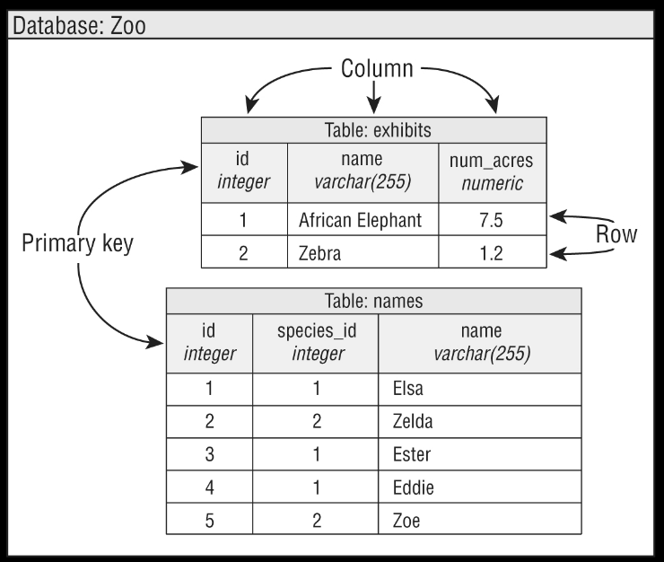

**Figure 15.1: Tables in relational database**

As we can see, we have two tables. One is name `exhibits` and the other is named 
`names`. Each table has a _primary key_, which gives us a unique way to reference each 
row. After all, two animal might have the same name, but they can't have the same `ID`. 
In out example, it so happens that the primary key is only one column. In some cases, 
it is a combination of columns, called _compound key_.


## Writing Basic SQL Statements

The most basic SQL commands are resumed to four types of statements for working with 
data in tables. They are referred to as CRUD (create, read, update, delete). The SQL 
keyword don't match the acronym, so we need to pay attention to the SQL keyword for 
each in Table 15.1.

**Table 15.1: The CRUD operation**

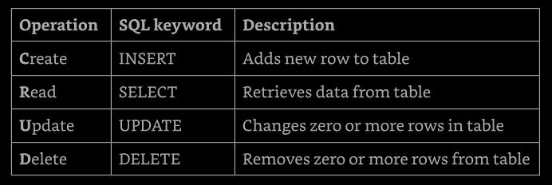


Unlike Java, SQL keywords are case insensitive. This means `select`, `SELECT`, and 
`Select` are all equivalent. Like Java primitive types, SQL has a number of data types. 
Most are self-explanatory, like `INTEGER`. There's also `DECIMAL`, which functions a lot 
like a `double` in Java. The one that needs to note is `VARCHAR`, standing for "variable 
character", which is like a `String` in Java. The _variable_ part means that the database 
should use only as much space as it needs to store the value.


## Introducing the Interfaces of JDBC

There are five key interfaces of JDBC that we need to know. They are declared in the 
JDK. The are just like all of the other interfaces and classes that we've seen in this 
book. For example, in Chapter 9, "Collection and Generics", we worked with the interface 
`List` and the concrete class `ArrayList`.

With JDBC, the concrete classes come from the JDBC driver. Each database has a different 
JAR file with theses classes. For example, PostgreSQL's JAR is called sometimes like 
`postgresql-9.4-1201.jdbc4.jar`. MySQL's JAR is called sometimes like `mysql-connector-java-5.1.36.jar`. 
The exact name depends on the vendor and version of the driver JAR.

This driver JAR contains an implementation of these key interfaces along with a number 
of other interfaces. The key is that the provided implementations know how to communicate 
with a database. There are also different types of drivers; luckily, we don't need to use 
all of them in the same project.

Figure 15.2 shows the five key interfaces that we need to know the most. It also shows 
that the implementation is provided by an imaginary `Foo` driver JAR. They cleverly stick 
the name `Foo` for all classes.

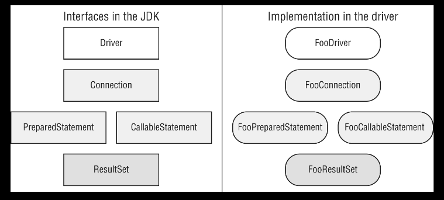

**Figure 15.2: Key JDBC interfaces**

Notice that we didn't mention what the implementing classes are called in any real 
database. The main point is that we shouldn't know. With JDBC, we use only the interfaces 
in our code and never the implementation classes directly. In fact, they might no even 
be public classes.

What do these five interfaces do? On a very high level, we have the following:
- Driver: Establishes a connection to the database
- Connection: Sends commands to a database
- PreparedStatement: Executes SQL query
- CallableStatement: Executes commands stored in the database
- ResultSet: Reads the results of a query

All database interfaces are in the package `java.sql` so, sometimes the imports 
are omitted.

In this next example, we show what JDBC code looks like, end to end. If you are 
new to JDBC, just notice that three of the five interfaces are in the code. If 
you are experienced, notice that here we uses the `DriverManager` class instead 
of the `DataSource` interface.

```
import java.sql.*;

public class MyFirstDatabaseConnection{
  public static void main(String[] args) throws SQLException {
    String url = "jdbc:hsqldb:file:zoo";
    try (
      Connection conn = DriverManager.getConnection(url);
      PreparedStatement ps = conn.prepareStatement("SELECT name FROM exhibits");
      ResultSet rs = ps.executeQuery()
    ) {
      while (rs.next())
        System.out.println(rs.getString(1));
    }
  }
}
```

If the URL were using out imaginary Foo driver, `DriverManager` would return an 
instance of FooConnection. Calling `preparedStatement()` would then return an instance 
of FooPreparedStatement, and  calling  `executeQuery()`  would  return  an instance of 
FooResultSet. Since the URL uses `hsqldb` instead, it returns the implementation that 
HyperSQL has provided for these interfaces. We don't need to know their names. In the 
rest of the chapter, we explain how to use all five of the interfaces and go into more 
detail about what they do. By the end of the chapter, writing code like this will be 
easy.

---
**Compiling with Modules**

Almost all packages on the exam are in the `java.base` module. As we saw in Chapter 
12, Module, this module is included automatically when we run our application as a module.

In contrast, the JDBC classes are all in the module `java.sql`. They are also in the 
package `java.sql`. The names are the same, so they should be easy to remember. When 
working with SQL, we need the `java.sql` module and `import java.sql.*`.

Is recommended separating the studies for JDBC and modules. We can use the `classpath` 
when working with JDBC and reserve our practice with module path for when we are studying 
modules.

That said, to use JDBC code with modules, remember to update the `module-info` file to 
include the following:
```
    requires java.sql;
```

---

[back to top](#chapter-15-jdbc)


## Connecting to a Database

The first step in doing anything with a database is connecting to it. First we 
will see how to build the JDBC URL. Then we will use it to get a `Connection` to 
the database.


### Building a JDBC URL

To access a website we need to know it URL. To access our e-mail, we need to know 
our username and password. JDBC is no different. To access a database, we need to know 
this information about it.

Unlike web URLs, JDBC URLs have a variety of formats. the have three parts in common, 
as shown in Figure 15.3. The first piece is always the name. It is the protocol `jdbc`. 
The second part is the _subprotocol_, which is the name of the database or, been more 
precise, the _database vendor name_, such as `hsqldb`, `mysql`, or `postgres`. The third 
part is the _subname_, which  is  a  database-specific  format. Colons (:) separate the 
three parts.

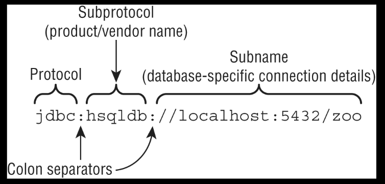

**Figure 15.3: The JDBC URL format**


The subname typically contains information about the database such as its location 
and/or name. The syntax varies. We need to know about the three main parts. We don't 
need to memorize the subname formats. We've already seen one such URL: 
```
jdbc:hsqldb:file:zoo
```

Notice the three parts. It starts with `jdbc`, and then comes the subprotocol `hsqldb`. 
It ends with the subname, which tells us we are using the `file` system. And finally, 
the location is then the database name: `zoo`. Other examples of sub-names are shown here:
```
jdbc:postgresql://localhost/zoo
jdbc:oracle:thin:@123.123.123.123:1521:zoo
jdbc:mysql://localhost:3306
jdbc:mysql://localhost:3306/zoo?profileSQL=true
```

We can see that each of these JDBC URLs begins with `jdbc`, followed by a colon, 
followed by the vendor/product name. After that, the URLs vary. Notice how all of 
them include the location of the database: `localhost`, `123.123.123.123:1521`, and 
`localhost:3306`. Also notice that the `port` is optional when using the default 
location.


### Getting a Database _Connection_

There are two main ways to get a `Connection`: `DriverManager` and `DataSource`. 
`DriverManager` is the on covered on the exam, but is not used in professional projects. 
A `DataSource` has more features than `DriverManager`. For example, it can pool connections 
or store the database connection information outside the application.

The `DriverManager` class is in the JDK, as it is an API that comes with Java. It uses 
the factory pattern, which means that you call a static method to get a `Connection` rather 
than calling a constructor. As we saw in Chapter 11, "Exceptions and Localization", the 
factory pattern means that e can get any implementation of the interface when calling the 
method. The good news i that the method has an easy-to-remember nat: `getConnection()`. To 
get a `Connection` from hte HyperSQL database, we write the following:
 
 ```
import java.sql.*;

public class TestConnect {
  public static void main(String[] args) throws SQLException {
    try (
      Connection conn = DriverManager.getConnection("jdbc:hsqldb:file:zoo")
    ) {
      System.out.println(conn);
    }
  }
}
 ```

 As in Chapter 11, we use a try-with-resources statement to ensure that database 
 resources are closed. We cover closing database resources in more detail later in the 
 chapter. We also throw the checked `SQLException`, which means something went wrong. 
 Fro example, we might have forgotten the set the location of the database driver in 
 our classpath.

 Assuming the program runs successfully, it print something like this:
 ```
org.hsqldb.jdbc.JDBCConnection@3dfc5fb8
 ```

 The details to the output aren't important. Just notice that the class is not 
 `Connection`. It is a vendor implementation of `Connection`.

 There is also a signature that takes a username and password.
 ```
import java.sql.*;

public class TestExternal {
  public static void main(String[] args) throws SQLException {
    try (
      Connection conn = DriverManager.getConnection(
        "jdbc:postgresql://localhost:5432/ocp-book", "username", "password")
    ) {
      System.out.println(conn);
    }
  }
}
 ```

 Notice tha three parameters that are passed to `getConnection()`. The first is 
 the JDBC URL that we learned about in the previous section. The second is the 
 username for accessing the database, and the third is the password for this user. 
 The username and the password should not have be hardcoded in the code, they 
 have to be stored in other places, in some kind of configuration or environment 
 variable.

 When we run this with the Postgres driver JAR, it would print something like this:
 ```
org.postgresql.jdbc4.Jdbc4Connection@edd1f14
```

Again, notice that it is a driver-specific implementation class. We can tell from 
the package name. Since the package is `org.postgresql.jdbc4`, it is part of the 
PostgreSQL driver.

Unless the exam specifies a command line, we can assume that the correct JDBC 
driver JAR is in the classpath. The exam creators explicitly ask about the driver 
JAR if the want someone to think about it.
The nice thing about the factory pattern is that it takes care of the logic of 
creating a class for us. We don't need to know the name of the class that implements 
`Connection`, and we don't need to know how it is created. Of course we are a little 
curious about how this is done.

`DriverManager` looks through any drivers it can find to see whether they can handle 
the JDBC URL. If so, it creates a `Connection` using that driver. If not, it gives up 
and throws a `SQLException`.

We might see `Class.forName()` in some code. It was required with order drivers (
that were designed for oder version of JDBC) before getting a `Connection`.

[back to top](#chapter-15-jdbc)


## Working with _PreparedStatement_

In Java, we have a choice of working with a `Statement`, `PreparedStatement`, or 
`CallableStatement`. The latter two are sub-interfaces fo `Statement`, as show in 
Figure 14.4.

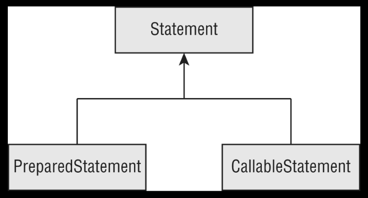

**Figure 15.4: Types of statements**

Later in the chapter, we will learn about using `CallableStatement` for queries 
that are inside the database. In this section, we look at `PreparedStatement`.

The `Statement` is  the  interface  that `PreparedStatement`  and  `CallableStatement` 
extend, both as similar to each other, except that a `PreparedStatement` takes parameters, 
while a `Statement` does not. A `Statement` just executes whatever SQL query we give it.

While it is possible to run SQL directly with `Statement`, we shouldn't. `PreparedStatement` 
is fora superior for the following reasons:
-**Performance**: in most programs, we run similar queries multiple times. When we use 
  `PreparedStatement`, the database software often devises a plan to run the query well 
  and remembers it.
-**Security**: We are protected against an attack called SQL injection when using a 
  `PreparedStatement` correctly.
-**Readability**: It's nice not to have to deal with string concatenation in building 
  a query with lots of parameters.
-**Future use**: Even if our query is being run only once or doesn't have any parameters, 
  we should still use a `PreparedStatement`. That way, future editors of the code won't 
  add a variable and have to remember to change to `PreparedStatement` then.


Using the `Statement` interface directly is not in scope for the JDBC exam, so we do not 
cover it in this book. In the following sections, we cover obtaining a `PreparedStatement`, 
executing one, working with parameters, and running multiple updates.


### Obtaining a _PreparedStatement_

To run SQL, we need to tell a `PreparedStatement` about it, getting on from a `Connection` 
is easy:
```
try (
  PreparedStatement ps = conn.prepareStatement("SELECT * FROM exhibits")
) {
  // work with ps
}
```

An instance of a `PreparedStatement` represents a SQL statement that we want to 
run using the `Connection`. It dos not execute the query yet. We get to that shortly.


Passing a SQL statement when creating the object is mandatory. We might see a trick 
on the exam.
```
try (
  var ps = conn.prepareStatement()     // does not compile
)
```

The previous example does not compile because SQL is not supplied at the time a 
`PreparedStatement` is required. We also used `var` in this example. We write JDBC 
code both using `var` and the actual class names to get the object we need.

There are overloaded signatures that allow us to specify a `ResultSet` type and 
concurrency mode. On the exam, we only need to know how to use the default options, 
which process the result in order.


### Executing a _PreparedStatement_

Now that we have a `PreparedStatement`, we can run the SQL statement. The method for 
running SQL varies depending on what kind of SQL statement it is. Remembering that we 
aren't expected to be able to read SQL, but we need to know what the first keyword 
means.


#### Modifying Data with _executeUpdate()_

Let's start with statement that change the data in a table. Those are SQL statements 
that begin with `DELETE`, `INSERT`, or `UPDATE`. They typically use a method called 
`executeUpdate()`. The name is a little tricky because the SQL UPDATE statement is 
not the only statement that uses this method. The name for the method came from the 
fact that the three SQL statements that it executes _updates the table_.

The method takes the SQL statement to run as parameter. It return the number of rows 
that were inserted, deleted, or changed. Here's an example of all three update types:
```
10: var insertSql = "INSERT INTO exhibits VALUES(10, 'Deer', 3);"
11: var updateSql = "UPDATE exhibits SET name = '' " +
12:     "WHERE name = 'None'";
13: var deleteSql = "DELETE FROM exhibits WHERE id = 10";
14: 
15: try ( var ps = conn.prepareStatement(insertSql)) {
16:   int result = ps.executeUpdate();
17:   System.out.println(result);        // 1
18: }
19: 
20: try ( var ps = conn.prepareStatement(updateSql)) {
21:   int result = ps.executeUpdate();
22:   System.out.println(result);        // 0    
23: }
24: 
25: try ( var ps = conn.prepareStatement(deleteSql)) {
26:   int result = ps.executeUpdate();
27:   System.out.println(result);        // 1
28: }
```

Notice how each distinct SQL statement need its own `prepareStatement()` call. Line 
15 creates the insert statement, and line 16 runs that statement to insert on row. The 
`result` is 1 because one row was affected. Line 20 created the update statement, and 
line 21 checks the whole table for matching records to update. Since no records match, 
the `result` is 0. Line 25 creates the delete statement, and line 26 deletes the row 
created on line 16. Again, one row is affected, so the `result` is 1.


#### Reading data with _executeQuery()_

Next, let's look at a SQL statement that begins with SELECT. This time, we use the 
`executeQuery()` method.
```
30: var sql = "SELECT * FROM exhibits";
31: try ( 
32:   var ps = conn.prepareStatement(sql);
33:   ResultSet re = ps.ExecuteQuery()
34: ) {
35:   // work with rs
36: }
```

On line 32, we create a `PreparedStatement` for our SELECT query. On line 33, we 
run it. Since we are running a query to get a result, the return type is `ResultSet`. 
In the next section, we will see how to process the `ResultSet`.


#### Processing data with _execute()_

There is a third method called `execute()` that can run either a query or an update. 
It returns a boolean so that we know whether there is a `ResultSet`. That way, we can 
call the proper method to get more detail. The pattern looks like this:
```
boolean isResultSet = ps.execute();
if (isResultSet) {
  try (ResultSet rs = ps.getResultSet()) {
    System.out.println("ran a query");
  }
} else {
  int result = ps.getUpdateCount();
  System.out.println("ran an update");
}
```

If the `PreparedStatement` refers to `sql` that is a SELECT, the `boolean` is `true`, 
and we can get the `ResultSet`. It if is not a SELECT, we can get the number of rows 
updated.


#### Using the Correct Method

What happens if we use the wrong method for a SQL statement? Let's take a look:
```
var sql = "SELECT * FROM names";
try ( var ps = conn.prepareStatement() ) {
  var result = ps.executeUpdate();
}
```

This throws a `SQLException` similar to the following:
```
Exception in thread "main" java.sql.SQLException:
  statement does not generate a row count
```

We can't get a compiler error since the SQL is a `String`. We can get an exception, 
though, and we do. We also get a `SQLException` when using `executeQuery()` with SQL 
that changes data in table.
```
Exception in thread "main" java.sql.SQLException:
  statement does not generate result set
```

Again, we get an exception because the driver can't translate the query into the 
expected return type.


### Reviewing _PrepareStatement_ Methods

To review, Table 15.3 shows which SQL statements can be run by each of the three 
key methods on `PreparedStatement`. Table 15.4 shows what is returned by each method.

**Table 15.3: SQL runnable by the execute methods**

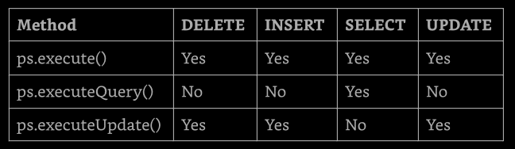


**Table 15.4: Return types of execute methods**

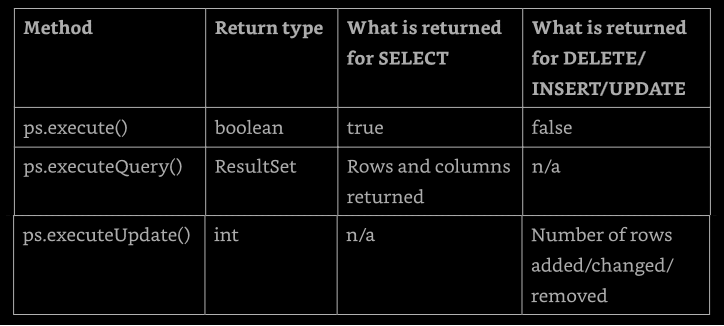


### Working with Parameters

Suppose our zoo acquires a new elephant and we want to register it in out names 
table. We've already learned enough to do this.
```
public static void register(Connection conn) throws SQLException {
  var sql = "INSERT INTO names VALUES (6, 1, 'Edith')";

  try (var ps = conn.prepareStatement()) {
    ps.executeUpdate();
  }
}
```

However, in this approach, everything is hard-coded. We want to be able to pass 
in the values as parameters. Luckily, a `PreparedStatement` allows us to set parameters. 
Instead of specifying the three values in th SQL, we can use a question mark (?). A _bind_ 
_variable_ is a placeholder that let us specify the actual values at runtime. A bind 
variable is like a parameter, and we will see bind variables references as both, variables 
and parameters. We can rewrite our SQL statement using bind variables.
```
String sql = "INSERT INTO names VALUES (?, ?, ?)";
```

Bind variables make the SQL easier to read since we no loner need to use quotes around 
`String` values in the SQL. Now we can pass the parameters to the method itself.
```
14: public static void register(
15:       Connection conn, int key, int type, String name) throws SQLException {
16:
17:   String sql = "INSERT INTO names VALUES (?, ?, ?)";
18: 
19:   try (PreparedStatement ps = conn.prepareStatement(sql)) {
20:     ps.setInt(1, key);
21:     ps.setString(3, name);
22:     ps.setInt(2, type);
23:     ps.execute();
24:   }
25: }
```

Line 19 creates a `PreparedStatement` using our SQL that contains three bind variables. 
Lines 20 to 22 set those variables. We can think of the bind variables as a list of 
parameters, where each is se in turn. Notice how the bind variables can be set in any 
order. Line 23 executes the query and runs the update.

Notice how the bind variables are counted staring with 1 rather tan 0. This is really 
important, so will repeat it. **JDBC starts counting with 1 rather than 0.** This is 
because SQL indexes starts at 1.

In the previous example, we set the parameters out of order. That's perfectly fine. The 
rule is only that they are each set before the query is executed. Let's see what happens 
if we don't set all the bind variables.
```
var sql = "INSERT INTO names VALUES (?, ?, ?)";
try (var ps = conn.prepareStatement()) {
  ps.setInt(1, key);
  ps.setInt(2, type);
  // missing set parameter number 3
  ps.executeUpdate();
}
```

The code compiles, and we get a `SQLException`. The message may vary based on our 
database driver.
```
Exception in thread "main" java.sql.SQLException: Parameter not set
```

What about if we try to set more values than we have as bind variables?
```
var sql = "INSERT INTO names VALUES (?, ?)";
try (var ps = conn.prepareStatement(sql)) {
  ps.setInt(1, key);
  ps.setInt(2, type);
  ps.setString(3, name);
  ps.executeUpdate();
}
```

Again, we get a `SQLException`, this time with a different message. On HyperSQL, 
that message was as follows:
```
Exception in thread "main" java.sql.SQLException:
  row column count mismatch in statement [INSERT INO names VALUES (?, ?)]
```

Table 15.5 shows the methods we need to know to set bind values. The ones that we 
need to know for our daily life are easy to remember since they are called set followed 
be the nme ot the type we are setting. There are many others, like dates, that are out 
of scope for the exam.

**Table 15.5: PreparedStatement methods**

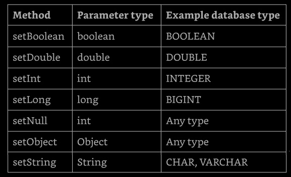


The first column shows the method name, and the second shows the type that Java uses. 
The  third  column shows the  type name that  could be in the database. There is some 
variation by databases, so we need to check our specific database documentation.

The `setNull()` method takes an `int` parameter representing the column type in the 
database. The `setObject()` method works with any Java type. If we pass a primitive, 
it will be autoboxed into a wrapper type. That means we can rewrite our example as 
follows:
```
String sql = "INSERT INTO names VALUES (?, ?, ?)";
try (PreparedStatement ps = conn.prepareStatement(sql)) {
  ps.setObject(1, key);
  ps.setObject(2, type);
  ps.setObject(3, name);
  ps.executeUpdate();
}
```

Java will handle type conversion for us. It is still better to call the more specific 
setter methods since that will gives us a compile-time error if we pass the wrong type 
instead of a runtime error.


### Updating Multiple Records

Suppose we get two new elephants and want to add both. We can use the same 
`PreparedStatement` object.
```
var sql = "INSERT INTO names VALUES (?, ?, ?)";

try (var ps = conn.prepareStatement(sql)) {
  ps.setInt(1, 20);
  ps.setInt(2, 1);
  ps.setString(3, "Ester");
  ps.executeUpdate();

  ps.setInt(1, 21);
  ps.setInt(3, "Elias");
  ps.executeUpdate();
}
```

Note that we set all three parameters when adding Ester but only two for Elias. The 
`PreparedStatement` is smart enough to remember the parameters that were already set 
and retain them. We only need to set the ones that are different.

---
**Batching Statements**

JDBC supports batching so we can run multiple statements in fewer trips to the database. 
Often the database is located on a different machine than the Java code runs on. Saving 
trips to the database saves time because network call can be expensive. For example, if 
we need to insert 1000 records into the database, inserting them as a single network call 
(as opposed to 1000 network calls) is usually _a lot_ faster. 

The `addBatch()` and `executeBatch()`methods are very useful in this situations.
```
public static void register(
      Connection conn, int firstKey, int type, String... names) throws SQLException {
  
  var sql = "INSERT INTO names VALUES (?, ?, ?)";
  var nextIndex = firstKey;

  try (var ps = conn.prepareStatement(sql)) {
    ps.setInt(2, type);

    for (var name : names) {
      ps.setInt(1, nextIndex);
      ps.setString(3, name);
      ps.addBatch();

      nextIndex++;
    }
    int[] result = ps.executeBatch();
    System.out.println(Arrays.toString(result));
  }
}
```

Now we call this method with two names:
```
register(conn, 100, 1, "Elias", "Ester");
```

The output show that the array has two elements since there are two different 
items in the batch. Each added one row in the database.
```
[1, 1]
```

We can use batching to break up large operations, such as inserting 10 million 
records  in  groups of 100.  In practice, it takes a bit of work to determine an 
appropriate batch size, but the performance of using batch if normally far better 
than inserting one row at a time (or all ten million at once).

---

[back to to](#chapter-15-jdbc)


## Getting Data from a _ResultSet_

A database isn't useful if we can't get our data. We start by showing how to go 
through a `ResultSet`. Then we go through the different methods to ge columns by type.


### Reading a _ResultSet_

When working with a `ResultSet`, most of the time, we will write a loop to look 
at each row. The code looks like this:
```
20: String sql = "SELECT id, name FROM exhibits";
21: var idToNameMap = new HashMap<Integer, String>();
22: 
23: try (
24:   var ps = conn.prepareStatement(sql);
25:   ResultSet rs = ps.executeQuery()
26: ) {
27:   while (rs.next()) {
28:     int id = rs.getInt("id");
29:     String name = rs.getString("name");
30:     idToNameMap.put(id, name);
31:   }
32:   System.out.println(idToNameMap);
33: }
```

It outputs:
```
{1=African Elephant, 2=Zebra}
```

There are a few things to notice here. First, we use the `executeQuery()` method 
on line 25, since we want to have a `ResultSet` returned. On line 27, we loop through 
the results. Each time though the loop represent on eow in the `ResultSet`. Line 28 
and 29 is the best way to get the columns for a give row.

A `ResultSet` has a _cursor_, which points to the current location in the data. Figure 
15.5 shows the positions as we loop through.

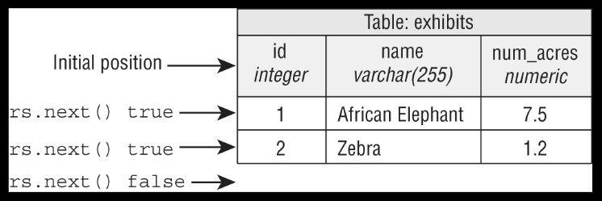

**Figure 15.5: The ResultSet cursor**

At line 25, the cursor starts by pointing to the location before the first row 
in the `ResultSet`. On the first loop iteration, `rs.next()` returns `true`, and 
the cursor moves to point to fhe first row of data. On the second loop iteration, 
`rs.next()` returns `true` again, and the cursor moves to point to the second row 
of data. The next cll to `rs.next()` returns `false`. The cursor advance beyond 
the end of the data. The `false` signifies that there is no more data available 
to get.

We did say the "best" to get data was with column names. There is another way to 
access the columns. We can use an index, counting from 1, instead of column name.
```
28:   int id = rs.getInt(1);
29:   String name = rs.getString(2);
```

Now we can see the column positions. Notice how the columns are counted starting 
with 1 rather than 0. Just like with a `PreparedStatement`, JDBC starts counting 
at i in a `ResultSet`.

The column names is better because it is clear what is going on when reading the 
code. It also allows us to change the SQL to reorder the columns.

Sometime we want to get only one row from the table. Maybe we need on one piece 
of data. Or maybe the SQL is just returning the number of rows in the table. When 
we want only one row, we use an `if` statement rather than a `while` loop.
```
var sql = "SELECT count(*) FROM exhibits";

try (
  var ps = conn.prepareStatement(sql);
  var rs = ps.executeQuery()
) {
  if (rs.next()) {
    int count = rs.getInt(1);
    System.out.println(count);
  }
}
```

It is important to check that `rs.next()` returns `true` before to call a getter 
on the `ResultSet`. If a query didn't return any rows, it would throw a `SQLException`, 
so the `if` statement checks that it is safe to call. Alternatively, we can use the 
column name.
```
var count = res.get("count");
```

Let's try to read a column that does not exist.
```
var sql = "SELECT count(*) FROM exhibits";

try (
  var ps = conn.prepareStatement(sql);
  var rs = ps.executeQuery()
) {
  if (rs.next()) {
    var count = rs.getInt("total");
    System.out.println(total);
  }
}
```

This throws a SQLException with a message like this:
```
Exception on thread "main" java.sql.SQLException: Column not found: total
```

Attempting to access a column name or index that does not exist throws a `SQLException`, 
as does getting data from a `ResultSet` when it isn't pointing at a valid row. We need 
to recognize such code. Here are a few example to watch out for. 
```
var sql = "SELECT * FROM exhibits WHERE name = 'Not in table'"

try (
  var ps = conn.prepareStatement(sql);
  var rs = ps.executeQuery();
) {
  rs.next();
  rs.getInt(1);    // SQLException
}
```

Calling `rs.next()` works. It returns `false`. However, calling a getter afterward 
throws a `SQLException` because the result set cursor does not point to a valid position. 
If a match wre returned, this code would have worked. Another:
```
var sql = "SELECT count(*) FROM exhibits";

try (
  var ps = conn.prepareStatement(sql);
  var rs = conn.executeQuery()
) {
  res.getInt(1);    // SQLException
}
```

Not calling `rs.next()` at all is a problem. The  result  set  cursor is still 
pointing to a location before the first row, so the getter has nothing to point to.

To sum up this section, it is important to remember the following:
- Always use an `if` statement or `while` loop when calling `rs.next()`.
- Column indexes begin at 1.


### Getting Data from a Column

There are lots of get methods on the `ResultSet` interface. Table 15.6 shows the 
most common get methods. These are the getter equivalents of the setters in Table 
15.5.

**Table 15.6: ResultSet get methods**
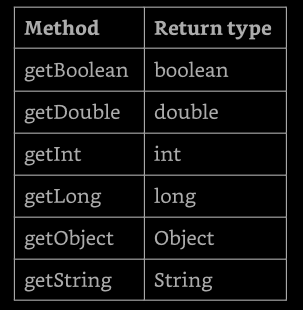


We have to notice that not all of the primitive types are in Table 15.6. There are 
`getByte()` and `getFloat()` methods but are not very used. The is no _getChar()_ 
method.

The `getObject()` method can return any type. For a primitive, is uses the wrapper 
class. Let's look at the following example.
```
16: var sql = "SELECT id, name FROM exhibits";
17: try (
18:   var ps = conn.prepareStatement(sql);
19:   var rs = ps.executeQuery()
20: ) {
21:   while (rs.next()) {
22:     Object idField = rs.getObject("id");
23:     Object nameField = rs.getObject("name");
24:     if (idField instanceof Integer id)
25:       System.out.println(id);
26:     if (nameField instanceof String name)
27:       System.out.println(name);
28:   }
29: }
```

Lines 22 and 23 get the column as whatever type of `Object` is most appropriate. 
Lines 24 to 27 use pattern matching to get the actual types. We probably won't use 
`getObject()` when writing code for a job, but we need to know that it exists.


### Using Bind Variables

We've been creating the `PreparedStatement` and `ResultSet` in the same try-with-
resources statement. This doesn't work if we have bind variables because they need 
to be set in between. Luckily, we can nest try-with-resources to handle this. The 
code below prints out the ID for any exhibits matching a given name.

```
30: var sql = "SELECT id FROM exhibits WHERE name = ?";
31: 
32: try (var ps = conn.prepareStatement(sql)) {
33:   ps.setString(1, "Zebra");
34: 
35:   try (var rs = ps.executeQuery()) {
36:     while (rs.next()) {
37:       int id = rs.getInt("id");
38:       System.out.println(id);
39:     }
40:   }
41: }
```

Carefully attention to the flow here. First we create the `PreparedStatement` on 
line 32. Then we set the bind variable on line 33. It is only after these are both 
done that we have a nested try-with-resources on line 35 to create the `ResultSet`.

[back to top](#chapter-15-jdbc)


## Calling a CallableStatement

In some situations, it is useful to store SQL queries in the database instead of 
packaging them with the Java code. This is particularly useful when there are many 
complex queries. A _stored procedure_ is code that is compiled in advance and stored 
in the database. Stored procedures are commonly written in a database-specific variant 
of SQL, which varies among database software providers.

Using a stored procedure reduces network round trips. It also allows database experts 
to own that part of the code. However, stored procedures are database-specific and 
introduce complexity into maintaining the application. Examples of stored procedures 
can be seen in the code for setting up the sample database. For now, we need to know 
how to call stored procedures, but not decide when to use them.

We will be using four stored procedures in this section.  Table 15.7 summarizes what we 
need to known about them. In the real world, none  of these would be good implementations 
since they aren't complex enough to warrant being  stored  procedures. As  we  can see in 
the table, stored procedures allow parameters to be for input only, output only, or both.

**Table 15.7: Sample stored procedures**

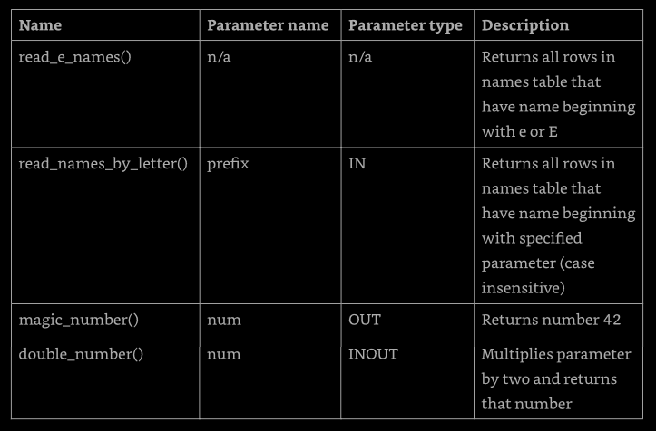


In the next four section, we look at how to cal each ot these stored procedures.


### Calling a Procedure without Parameters

Our `read_e_names()` stored procedure doesn't take any parameters. It does return 
a `ResultSet`. Since we worked with a `ResultSet` in `PreparedStatement` section, 
here we can focus on how the stored procedure is called.
```
12: String sql = "{call read_e_names()}";
13: try (
14:   CallableStatement cs = conn.prepareCall(sql);
15:   ResultSet rs = cs.executeQuery()
16: ) {
17:   while (rs.next()) {
18:     System.out.println(rs.getString(3));
19:   }
20: }
```

Line 12 introduces a new bit of syntax. A stored procedure is called by putting the 
word `call` and the procedure name in braces ({}). Line 14 creates a `CallableStatement` 
object. Here, since is not a PreparedStatement we do not use prepareStatement, we use 
the `prepareCall()` method instead.

Lines 15 to 19 should look familiar. They are the standard logic we have been using 
to get a `ResultSet` and loop through it. This stored procedure returns the underlying 
table, so the columns are the same.


### Passing an _IN_ Parameter

A stored procedure that always returns the same thing is only somewhat useful. 
We've created a new version of that stored procedure that is more generic. The 
`read_names_by_letter` stored procedure takes a parameter for the prefix or first 
letter of the stored procedure. An `IN` parameter is used for input.

This is the stored procedure created on database:
```
CREATE PROCEDURE read_name_by_letter(IN prefix VARCHAR(10))
READS SQL DATA DYNAMIC RESULT SETS 1
BEGIN ATOMIC
DECLARE RESULT CURSOR WITH RETURN FOR
  SELECT * FROM names WHERE LOWER(name) LIKE CONCAT(LOWER(prefix), '%');
OPEN RESULT;
END
```

There are two differences in calling it compared to our previous stored procedure.
```
25: var sql = "{call read_names_by_letter(?)}";
26: try (var cs = conn.prepareCall(sql)) {
27:   cs.setString("prefix", "Z");
28: 
29:   try (var rs = cs.executeQuery()) {
30:     while (rs.next()) {
31:       System.out.println(rs.getString(3));
32:     }
33:   }
34: }
```

On line 25, we have to pass a `?` to show we heave a parameter. This should be 
familiar from bind variables with a PreparedStatement. On line 27, we set the 
value fo that parameter, `prefix`. Unlike with PreparedStatement, we can use either 
the parameter number (starting from 1) or the parameter name. That means these two 
statement are equivalent:
```
cs.setString(1, "Z");
cs.setString("prefix", "Z");
```


### Returning a _OUT_ Parameter

In our previous examples, we returned a `ResultSet`. Some procedures return other 
information. Luckily, stored procedures aca have `OUT` parameter for output. The 
`magic_number()` stored procedures set its `OUT` parameter to 42. There are a few 
differences here:
```
40: var sql = "{?= call magic_number(?)}"
41: try (var cs = conn.prepareCAll(sql)) {
42:   cs.registerOutParameter(1, Types.INTEGER);
43:   cs.execute();
44:   System.out.println(cs.getInt("num"));
45: }
```

On line 40, we include two special characters (?=) to specify that the stored 
procedure has an output value. This is optional since we have the `OUT` parameter, 
but it does aid in readability.

On line 42, we register the `OUT` parameter. This is important. It allows JDBC to 
retrieve the value on line 44. We need to remember to always call `registerOutParameter()` 
for each `OUT` or `INOUT` parameter existing in the stored procedure.

On line 43, we call `execute()` instead of executeQuery() since we are not returning 
a ResultSet from our stored procedure.


### Working with _INOUT_ Parameter

Finally, it is possible to use the same parameter for both input and output. As we 
read this code, we see whether we can spot which lines are required for the `IN` part 
and which are required for the `OUT` part.

This is the procedure stored on database, note the name of the parameter:
```
CREATE PROCEDURE double_number(INOUT num INT)
READS SQL DATA
DYNAMIC RESULT SETS 1
BEGIN ATOMIC
SET num = num * 2;
END
```

This is how we call this stored procedure.

```
50: var sql = "{call double_number(?)}";
51: try (var cs = conn.prepareCall(sql)) {
52:   cs.setInt(1, 8);                            // positional parameter 1 = 8
53:   cs.registerOutParameter(1, Types.INTEGER);
54:   cs.execute();
55:   System.out.println(cs.getInt("num"));
56: }
```

For an `IN` parameter, line 52 is required since it sets the value. For an `OUT` 
parameter, line 53 is required to register it. Line 54 uses `execute()` again because 
we are not returning a ResultSet.

We have to remember that an `INOUT` parameter acts as both an `IN` parameter and an 
`OUT` parameter, so it has all the requirements of both.


### Comparing Callable Statement Parameters

Table 15.8 reviews the different types of parameters we need to know.

**Table 15.8: Stored procedure parameters types**

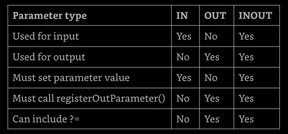


### Using Additional Options

So far, we've been creating `PreparedStatement`and `CallableStatement` with the 
default options. Both support `ResultSet` type and concurrency options. Not all 
options are available on all databases. Luckily, we just have to be able to 
recognize them when they appear.

There area three `ResultSet` integer types values:
- `ResultSet.TYPE_FORWARD_ONLY`: can go through the ResultSet on one row at a time.
- `ResultSet.TYPE_SCROLL_INSENSITIVE`: can go through the ResultSet in any order but 
    will not see changes made to the underlying database table.
- `ResultSet.SCROLL_SENSITIVE`: can go through the ResultSet in any order and will 
    see changes made to the underlying database table.


There are two `ResultSet` integer concurrency mode values:
- `ResultSet.CONCUR_READ_ONLY`: the ResultSet cannot be updated
- `ResultSet.CONCUR_UPDATABLE`: the ResultSet can b updated.


These options are integer values, not enum values, which means we can pass both 
as additional parameters after the SQL.
``` 
conn.prepareCall(sql, ResultSet.TYPE_FORWARD_ONLY, ResultSet.CONCUR_READ_ONLY);

conn.prepareStatement(sql, ResultSet.TYPE_SCROLL_INSENSITIVE, ResultSet.CONCUR_UPDATABLE);
```

We have to pay attention carefully on these parameters and always remember that the 
order in which they come. The type comes first and concurrency mode in second.

[back to top](#chapter-15-jdbc)


## Controlling Data with Transactions

Until now, any changes we made to the database took effect right away. A _commit_ 
is like saving a file. Otherwise specified, changes commit automatically.  However, 
we can change this behavior to control commits ourselves. A _transaction_ is when 
one or more statements are grouped with the final result committed or rolled back. 
_Rollback_ is like closing a file without saving. All the changes from the start 
of the transaction are discarded. First, we look at writing code to commit and 
roll back. The we look at how to control our rollback points.


### Committing and Rolling Back

Our zoo is renovating and has decided to give more space to the elephants. However, 
we don't have so much space, so the zebra exhibit will need to be made smaller. Since 
we can't invent space out of thin air, we want to ensure that the total amount of space 
remain the same. If either  adding  space for  the elephants or removing space for the 
zebras fails, we want our transaction to roll back. In the interest of simplicity, we 
assume that the database table is in a valid state before we run this code. Now, let's 
examine the code for this scenario.

```
05: public static void main(String[] args) throws SQLException {
06:   
07:   try(Connection conn = DriverManager.getConnection("jdbc:hsqldb:file:zoo")) {
08:     conn.setAutoCommit(false);
09: 
10:     var elephantRowsUpdated = updateRow(conn, 5, "African Elephant");
11:     var zebraRowsUpdated = updateRow(conn, -5, "Zebra");
12: 
13:     if (!elephantRowsUpdated || !zebraRowsUpdated)
14:       conn.rollback();
15:     else {
16:       String selectSql = """
17:         SELECT COUNT(*)
18:         FROM exhibits
19:         WHERE num_acres <= 0
20:       """;
21:       try (
22:         PreparedStatement ps = conn.prepareStatement(selectSql)
23:         ResultSet rs = ps.executeQuery()
24:       ) {
25;         rs.next();
26:         int count = res.getInt(1);          // fist column of first row
27:         if (count == 0)
28:           conn.commit();
29:         else
30:           conn.rollback()
31:       }
32:     }  // end else
33:   }  // end of try
34: }  // end main
35: 
36: private static boolean updateRow(
37:       Connection conn, int numToAdd, String name) throws SQLException {
38:   
39:   String updateSql = """
40:     UPDATE exhibits
41:     SET num_acres = num_acres + ?
42:     WHERE name = ?
43:   """
44: 
45:   try (PreparedStatement ps = conn.prepareStatement(updateSql)) {
46:     ps.setInt(1, numToAdd);
47:     ps.setString(2, name);
48:     return ps.executeUpdate() > 0;
49:   }
50: }  // end updateRow
```

The first interesting thing in this example is on line 8, where we turn off auto-
commit mode and declare that we will handle transactions ourselves. Most databases 
support disabling autocommit mode. If a database does not, it will throw a SQLException 
on line 8. We than attempt to update the number of acres allocated to each animal. 
If we are unsuccessful and no rows are updated, we roll back the transaction on line 
14, causing the state of the database to remain unchanged.

Assuming at least on row is updated, we check `exhibits`, lines 16 to 30, and make 
sure  none  of  the rows contain an invalid `num_acres` value. If this were a real 
application, we would have more logic to make sure the amount of space makes sense. 
On lines 27 to 30, we decide whether to commit the transaction to the database or 
roll back all updates made to the exhibits table.

---
**Autocommit Edge Cases**

There is two edge cases about autocommit that we need to know. Fist, when we call 
`setAutoCommit(true)` will automatically trigger a commit whe we are not already 
in autocommit. After that, _autocommit mode_ takes effect, and each statement is  
automatically committed.

The other edge cases is what happens if we have autocommit set to `false` and 
close the connection without rolling back or committing the changes. The answer 
is that the behavior is _undefined_. It may commit or roll back, depending only 
on the driver. Don't depend on this behavior; remember to commit or roll back 
at the end of a transaction!

---


### Bookmarking with Savepoints

So far, we have rolled back to the point where autocommit was turned off. We can 
use savepoints to have more control of the rollback point. Consider the following 
example:
```
20: conn.setAutoCommit(false);
21: Savepoint sp1 = conn.setSavepoint();
22: // database code
23: Savepoint sp2 = conn.setSavepoint("second savepoint");
24: // database code
25: conn.rollback(sp2);
26: // database code
27: conn.rollback(sp1);
```

Line 20 is important. We can only use savepoints when we are controlling the 
transaction. Lines 21 and 23 show how to create a `Savepoint`. The name is optional 
and typically included in the `toString()`  if we print the save point reference.

Line 25 show the first rollback. That gets rid of any changes made since that save 
point was created: in this case, the code on line 24. Then line 27 shows the second 
rollback getting rid of the code on line 22.

Order matter. If we reversed line 25 and 27, the code would throw an exception. 
Rolling back to `sp1` gets rid of any changes made after that, which includes the 
second savepoint. Similarly, calling `conn.rollback()` on line 25 would void both 
savepoints, and line 27 would again throw an exception.


### Reviewing Transaction APIs

There aren't many methods for working with transaction, but we need to know all 
the ones in Table 15.9.

**Table 15.9: Connection APIs for transaction**

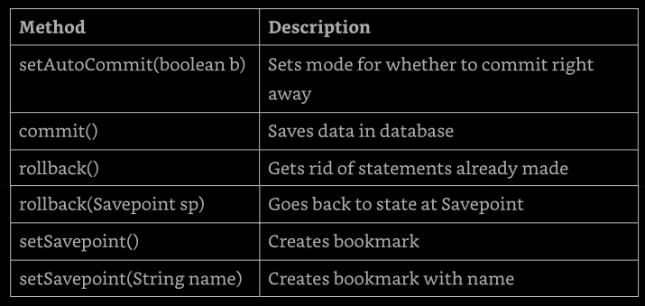

[back to top](#chapter-15-jdbc)


## Closing Database Resources

As we saw in Chapter 14, "I/O", it is important to close resources when we are 
finished with them. This is true for JDBC as well. JDBC resources, such as a 
`Connection`, are expensive to create. Not closing them creates a resource leak 
that will eventually slow our program.

Throughout the chapter, we've been using the try-with-resources syntax from Chapter 
11. The resources need to be closed in a specific order. The `ResultSet` is closed 
first, followed by the `PreparedStatement` (or `CallableStatement`) and than the 
`Connection`.

While it is a good habit to close all three resources, it isn't strictly necessary. 
Closing a JDBC resource should close any resources that it created. In particular, 
the following are true:
- Closing a `Connection` also closes `PreparedStatement`, `CallableStatement` 
    and `ResultSet`.
- Closing a `PreparedStatement` (or `CallableStatement`) also closes the `ResultSet`.

It is important to close resources in the right order. This avoids both, resources 
leaks and exceptions.

---
**Writing a Resource Leak**

In Chapter 11, we learned that it is possible to declare a type before a try-with-
resources statement. Why this method is bad?
```
40: public void bad() throws EQLException {
41:   var url = "jdbc:hsqldb:zoo";
42:   var sql = "SELECT not_a_column FROM names";
43:   var conn = DriverManager.getConnection(url);
44:   var ps = conn.prepareStatement(sql);
45:   var rs = ps.executeQuery();
46: 
47:   try (conn; ps; re) {
48:     while (rs.next())
49:       System.out.println(rs.getString(1));
50:   }
51: }
```

Suppose an exception is thrown on line 45. The try-with-resources block is never 
entered, so we don't benefit from automatic resource closing. That means this code 
has a resource leak if it fails. We don't have to write code like this.

---

There's another way to close a `ResourceSet`. JDBC automatically closes a 
`ResourceSet` when we run another SQL statement from the same statement. This 
could be a `PreparedStatement` or a `CallableStatement`.

---
**Dealing with Exceptions**

In most of this chapter, we've lived in a perfect world. Sure, we mentioned that 
a checked SQLException might be thrown by any JDBC method, but we never caught it. 
We just declared it and let the caller deal with it. Now let's catch the exception.

```
var sql = "SELECT not_a_column FROM names";
var url = "jdbc:hsqldb:zoo";
try (
  var conn = DriverManager.getConnection(url);
  var ps = conn.prepareStatement(sql);
  var rs = ps.executeQuery()
) {
  while (rs.next())
    System.out.println(rs.getString(1));
} catch (SQLException e) {
  System.out.println(e.getMessage());
  System.out.println(e.getSQLState());
  System.out.println(e.getErrorCode());
}
```

The output looks like this:
```
Column 'NOT_A_COLUMN' is either not in any table or ...
42X04
30000
```

Each of these gives us a different piece of information. The `getMessage()` method 
return a human-readable message about what went wrong. We've only included the beginning 
of it here. The `getSQLState()` method return a code as to what wen wrong. We can search 
with the database name and the SQL state to get more information about the error. In 
comparison, `getErrorCode()` is a database-specific code. On this database, it doesn't 
do anything.

---

[back to top](#chapter-15-jdbc)


## Summary

There are four basic SQL statements, one for each of the CRUD operations: create 
(INSERT) a new row, read (SELECT) data, update (UPDATE) one or more rows, and delete 
(DELETE) one or more rows.

We should be familiar with the JDBC interface: `Driver`, `Connection`, `PreparedStatement`, 
`CallableStatement`, and `ResultSet`. The interfaces are part of the Java API. A database-
specific JAR file provides the implementations.

To connect to a database, we nee the JDBC URL. A JDBC URL has three parts separated by 
colons. The first part is `jdbc:`. The second part is the name of the vendor/product. The 
third part varies by database, but it includes the location and/or name of the database. 
The location is either the `hostname`  or the `IP` address followed by an optional port.

The `DriverManager` class provides a factory method called `getConnection()` to get a 
`Connection` object.  We  create  a  `PreparedStatement` or a `CallableStatement` using 
`prepareStatement()` or `prepareCall()`, respectively. A `PreparedStatement` is used when 
the SQL is specified in our application, and a `CallableStatement()` is used when the SQL 
is  stored in the database.  A  `PreparedStatement`  allows  us  to set the values of bind 
variable. A `CallableStatement` also allows us to set `IN`, `OUT`, and `INOUT` parameters.

When running a SELECT SQL statement, the `executeQuery()` method returns a `ResultSet`. 
When running a DELETE, INSERT, our UPDATE SQL  statement, the `executeUpdate()` method 
returns the number of rows that were affected. The is also an `execute()` method that 
returns a `boolean` to indicate whether the statement was a query.

We call `rs.next()` from an `if` statement or a `while` loop to advance the cursor 
position. To get data from a column, we call a method like `getString(1)` or `getString("a")`, 
the first indicates the column by index, the second by name. Column indexes begin with 1, 
not 0. In addition to getting a `String` primitive, we can call `getObject()` to get any 
type. 

JDBC let's choose whether to automatically commit our statement or manage transactions 
ourselves. If we choose the latter, we can control when data is committed or rolled back. 
Additionally, we can set save-points to roll back to specific points.

It is important to close JDBC resource when finished with them to avoid leaking resources. 
Closing a `Connection` automatically closes the `Statement` and `ResultSet` objects 
Closing a `Statement` automatically closes the `ResultSet` object. Also, running another 
SQL statement closes the previous `ResultSet` object from that Statement.


### Essentials

**Na the five JDBC interfaces that we need to know ans where they are defined** The five 
key interface are `Driver`, `Connection`, `PreparedStatement`, `CallableStatement`, and 
`ResultSet`. The interfaces are part of the core of Java APIs. The implementation are part 
of a database driver JAR file..

**Identify correct and incorrect JDBC URLs**. A JDBC URL starts with `jdbc:`, followed by 
the vendor/product name. Next comes another colon and then a database-specific connection 
string. This database-specific string includes the location, such as `localhost' or an `IP` 
address with an optional port. I may also contain the name of the database.

**Describe how to get a `Connectio` using `DriverManager`.** After including the driver 
JAR in the classpath, call `DriverManager.getConnection(url)` or driver-specific `Connection` 
implementation class.

**Run queries using a `PreparedStatement`.** When using a `PreparedStatement` the SQL 
contains question marks (?) for the parameters or bind variables. This SQL is passed at 
the time the `PreparedStatement` is created, not when it is run. We must call a setter 
for each of these with the proper value before executing the query.

**Run queries using a `CallableStatement`.** When using a `CallableStatement`, the SQL 
look like `{ call my_procedure(?) }`. If we are returning a value, `{ ? = call procedure(?) }` 
is also permitted. We must set any parameter values before executing the query. Additionally, 
we must call `registerOurParameter()` for any OUT or INOUT parameters.

**Loop through a `ResultSet`.** Before trying to get data from a `ResultSet`, we 
call `rs.nect()` inside an if statement or while loop. This ensures that the cursor 
is in a valid position. To get data from a column, call a method like `getString(1)` 
or `getString("column_name")`. Never forgetting that SQL indexes starts at 1.

**Work with transactions.** When autocommit is `false`, the `commit()` and `rollback()` 
methods control the transaction. There is an overloaded rollback method taking a `Savepoint` 
to control to where to roll back to a specific point.

**Identify when a resource should be closed.** If we're closing all three resources, the 
`ResultSet` must be closed first, followed by the `PreparedStatement` or `CallableStatement`, 
and finally the `Connection`.


[end](#chapter-15-jdbc)
