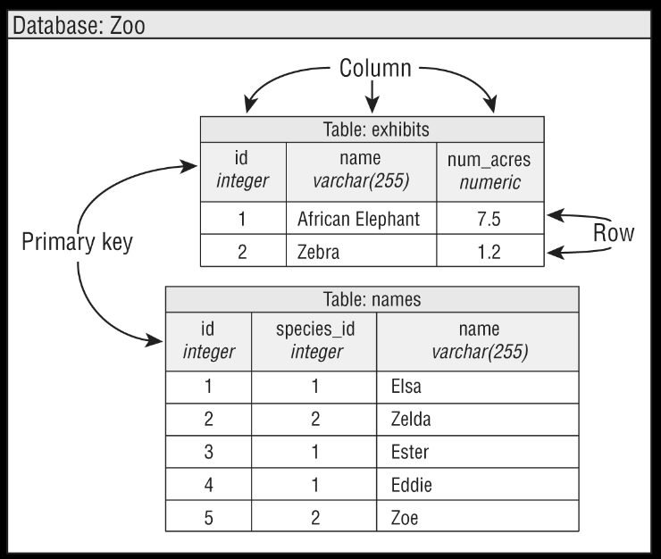
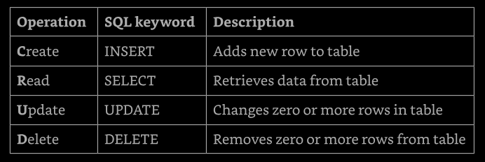
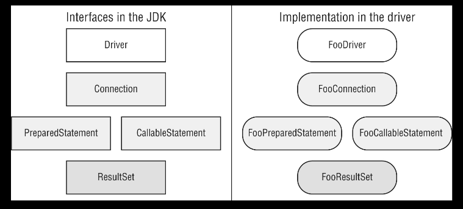
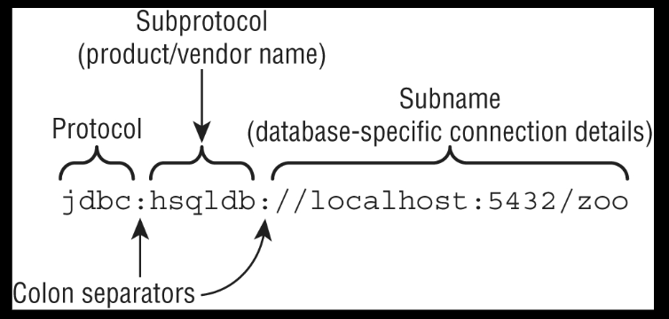
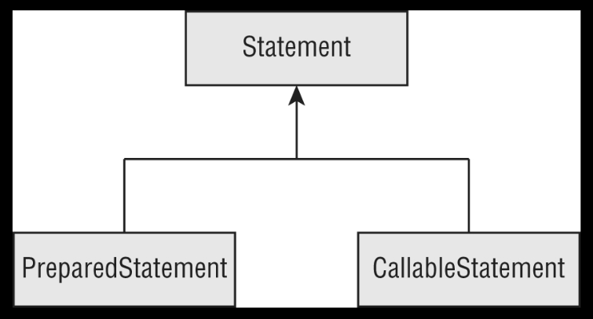
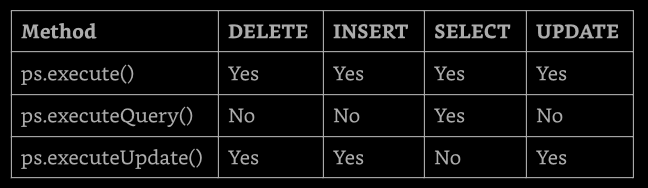
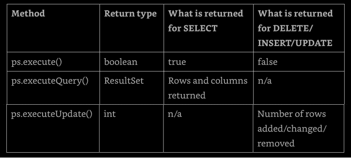

# Chapter 15: JDBC

## Objectives

### Accessing Databases using JDBC

* Create connections, create and execute basic and prepared queries 
 - callable statements
 - process queries results
 - control transaction using JDBC API


JDBC stands for Java Database Connectivity. This chapter introduces to the basics 
of accessing databases from Java. We cover the key interfaces for how to connect, perform 
queries, process the results, and work with transactions.

[Introducing Relational Database and SQL](#introducing-relational-databases-and-sql)

[Connecting to a Database](#connecting-to-a-database)

[Working with PreparedStatement](#working-with-preparedstatement)


## Introducing Relational Databases and SQL

A _relational database_ is a database tha is organized into _tables_, which consist 
of rows and columns of data. We can think of a tables as a spreadsheet. There are two 
main ways to access a relational database from Java:
* _Java Database Connectivity (JDBC)_: Access data as rows and columns. JDBC is the API 
    covered in this chapter
* _Java Persistence API (JPA)_: Access data through Java objects using a concept called 
  _object-relational mapping (ORM)_. The idea is that we don't have to write as much code, 
  and we get our data in  Java  objects.  JPA  is  not on the exam, and therefore is not 
  covered in this chapter.

A relational database is accessed through _Structured Query Language (SQL)_. SQL is a 
programming language used to interact with database records. JDBC works by sending a SQL 
command to the database and then processing the response.

In addition to relational databases, there is another type of database called a _NoSQL_ 
_database_. These databases store their data in a format other than tables, such as key/
value, document stores, and graph-based databases. NoSQL is out of scope for the exam also.

In the following sections we introduce a small relational database that we will be 
using for the examples in this chapter and present the SQL to access it. We also cover 
some vocabulary that are necessary for working with databases. The instructions to 
download and set up the database fot the example in this chapter are here: 
[selikoff.net/ocp17](https://www.selikoff.net/2022/01/22/ocp-17-book-bonus-creating-a-hsql-database-in-java-17/)


### Identifying the Structure of a Relational Database

Our sample database hat two table. One has a row for each species that is in our 
zoo. The other has a row for each animal. These two relate to each other because an 
animal belongs to a species. These relationships are wy this type of database is called 
relational database. Figure 15.1 shows the structure of out database.



**Figure 15.1: Tables in relational database**

As we can see, we have two tables. One is name `exhibits` and the other is named 
`names`. Each table has a _primary key_, which gives us a unique way to reference each 
row. After all, two animal might have the same name, but they can't have the same `ID`. 
In out example, it so happens that the primary key is only one column. In some cases, 
it is a combination of columns, called _compound key_.


## Writing Basic SQL Statements

The most basic SQL commands are resumed to four types of statements for working with 
data in tables. They are referred to as CRUD (create, read, update, delete). The SQL 
keyword don't match the acronym, so we need to pay attention to the SQL keyword for 
each in Table 15.1.

**Table 15.1: The CRUD operation**




Unlike Java, SQL keywords are case insensitive. This means `select`, `SELECT`, and 
`Select` are all equivalent. Like Java primitive types, SQL has a number of data types. 
Most are self-explanatory, like `INTEGER`. There's also `DECIMAL`, which functions a lot 
like a `double` in Java. The one that needs to note is `VARCHAR`, standing for "variable 
character", which is like a `String` in Java. The _variable_ part means that the database 
should use only as much space as it needs to store the value.


## Introducing the Interfaces of JDBC

There are five key interfaces of JDBC that we need to know. They are declared in the 
JDK. The are just like all of the other interfaces and classes that we've seen in this 
book. For example, in Chapter 9, "Collection and Generics", we worked with the interface 
`List` and the concrete class `ArrayList`.

With JDBC, the concrete classes come from the JDBC driver. Each database has a different 
JAR file with theses classes. For example, PostgreSQL's JAR is called sometimes like 
`postgresql-9.4-1201.jdbc4.jar`. MySQL's JAR is called sometimes like `mysql-connector-java-5.1.36.jar`. 
The exact name depends on the vendor and version of the driver JAR.

This driver JAR contains an implementation of these key interfaces along with a number 
of other interfaces. The key is that the provided implementations know how to communicate 
with a database. There are also different types of drivers; luckily, we don't need to use 
all of them in the same project.

Figure 15.2 shows the five key interfaces that we need to know the most. It also shows 
that the implementation is provided by an imaginary `Foo` driver JAR. They cleverly stick 
the name `Foo` for all classes.



**Figure 15.2: Key JDBC interfaces**

Notice that we didn't mention what the implementing classes are called in any real 
database. The main point is that we shouldn't know. With JDBC, we use only the interfaces 
in our code and never the implementation classes directly. In fact, they might no even 
be public classes.

What do these five interfaces do? On a very high level, we have the following:
- Driver: Establishes a connection to the database
- Connection: Sends commands to a database
- PreparedStatement: Executes SQL query
- CallableStatement: Executes commands stored in the database
- ResultSet: Reads the results of a query

All database interfaces are in the package `java.sql` so, sometimes the imports 
are omitted.

In this next example, we show what JDBC code looks like, end to end. If you are 
new to JDBC, just notice that three of the five interfaces are in the code. If 
you are experienced, notice that here we uses the `DriverManager` class instead 
of the `DataSource` interface.

```
import java.sql.*;

public class MyFirstDatabaseConnection{
  public static void main(String[] args) throws SQLException {
    String url = "jdbc:hsqldb:file:zoo";
    try (
      Connection conn = DriverManager.getConnection(url);
      PreparedStatement ps = conn.prepareStatement("SELECT name FROM exhibits");
      ResultSet rs = ps.executeQuery()
    ) {
      while (rs.next())
        System.out.println(rs.getString(1));
    }
  }
}
```

If the URL were using out imaginary Foo driver, `DriverManager` would return an 
instance of FooConnection. Calling `preparedStatement()` would then return an instance 
of FooPreparedStatement, and  calling  `executeQuery()`  would  return  an instance of 
FooResultSet. Since the URL uses `hsqldb` instead, it returns the implementation that 
HyperSQL has provided for these interfaces. We don't need to know their names. In the 
rest of the chapter, we explain how to use all five of the interfaces and go into more 
detail about what they do. By the end of the chapter, writing code like this will be 
easy.

---
**Compiling with Modules**

Almost all packages on the exam are in the `java.base` module. As we saw in Chapter 
12, Module, this module is included automatically when we run our application as a module.

In contrast, the JDBC classes are all in the module `java.sql`. They are also in the 
package `java.sql`. The names are the same, so they should be easy to remember. When 
working with SQL, we need the `java.sql` module and `import java.sql.*`.

Is recommended separating the studies for JDBC and modules. We can use the `classpath` 
when working with JDBC and reserve our practice with module path for when we are studying 
modules.

That said, to use JDBC code with modules, remember to update the `module-info` file to 
include the following:
```
    requires java.sql;
```

---

[back to top](#chapter-15-jdbc)


## Connecting to a Database

The first step in doing anything with a database is connecting to it. First we 
will see how to build the JDBC URL. Then we will use it to get a `Connection` to 
the database.


### Building a JDBC URL

To access a website we need to know it URL. To access our e-mail, we need to know 
our username and password. JDBC is no different. To access a database, we need to know 
this information about it.

Unlike web URLs, JDBC URLs have a variety of formats. the have three parts in common, 
as shown in Figure 15.3. The first piece is always the name. It is the protocol `jdbc`. 
The second part is the _subprotocol_, which is the name of the database or, been more 
precise, the _database vendor name_, such as `hsqldb`, `mysql`, or `postgres`. The third 
part is the _subname_, which  is  a  database-specific  format. Colons (:) separate the 
three parts.



**Figure 15.3: The JDBC URL format**


The subname typically contains information about the database such as its location 
and/or name. The syntax varies. We need to know about the three main parts. We don't 
need to memorize the subname formats. We've already seen one such URL: 
```
jdbc:hsqldb:file:zoo
```

Notice the three parts. It starts with `jdbc`, and then comes the subprotocol `hsqldb`. 
It ends with the subname, which tells us we are using the `file` system. And finally, 
the location is then the database name: `zoo`. Other examples of sub-names are shown here:
```
jdbc:postgresql://localhost/zoo
jdbc:oracle:thin:@123.123.123.123:1521:zoo
jdbc:mysql://localhost:3306
jdbc:mysql://localhost:3306/zoo?profileSQL=true
```

We can see that each of these JDBC URLs begins with `jdbc`, followed by a colon, 
followed by the vendor/product name. After that, the URLs vary. Notice how all of 
them include the location of the database: `localhost`, `123.123.123.123:1521`, and 
`localhost:3306`. Also notice that the `port` is optional when using the default 
location.


### Getting a Database _Connection_

There are two main ways to get a `Connection`: `DriverManager` and `DataSource`. 
`DriverManager` is the on covered on the exam, but is not used in professional projects. 
A `DataSource` has more features than `DriverManager`. For example, it can pool connections 
or store the database connection information outside the application.

The `DriverManager` class is in the JDK, as it is an API that comes with Java. It uses 
the factory pattern, which means that you call a static method to get a `Connection` rather 
than calling a constructor. As we saw in Chapter 11, "Exceptions and Localization", the 
factory pattern means that e can get any implementation of the interface when calling the 
method. The good news i that the method has an easy-to-remember nat: `getConnection()`. To 
get a `Connection` from hte HyperSQL database, we write the following:
 
 ```
import java.sql.*;

public class TestConnect {
  public static void main(String[] args) throws SQLException {
    try (
      Connection conn = DriverManager.getConnection("jdbc:hsqldb:file:zoo")
    ) {
      System.out.println(conn);
    }
  }
}
 ```

 As in Chapter 11, we use a try-with-resources statement to ensure that database 
 resources are closed. We cover closing database resources in more detail later in the 
 chapter. We also throw the checked `SQLException`, which means something went wrong. 
 Fro example, we might have forgotten the set the location of the database driver in 
 our classpath.

 Assuming the program runs successfully, it print something like this:
 ```
org.hsqldb.jdbc.JDBCConnection@3dfc5fb8
 ```

 The details to the output aren't important. Just notice that the class is not 
 `Connection`. It is a vendor implementation of `Connection`.

 There is also a signature that takes a username and password.
 ```
import java.sql.*;

public class TestExternal {
  public static void main(String[] args) throws SQLException {
    try (
      Connection conn = DriverManager.getConnection(
        "jdbc:postgresql://localhost:5432/ocp-book", "username", "password")
    ) {
      System.out.println(conn);
    }
  }
}
 ```

 Notice tha three parameters that are passed to `getConnection()`. The first is 
 the JDBC URL that we learned about in the previous section. The second is the 
 username for accessing the database, and the third is the password for this user. 
 The username and the password should not have be hardcoded in the code, they 
 have to be stored in other places, in some kind of configuration or environment 
 variable.

 When we run this with the Postgres driver JAR, it would print something like this:
 ```
org.postgresql.jdbc4.Jdbc4Connection@edd1f14
```

Again, notice that it is a driver-specific implementation class. We can tell from 
the package name. Since the package is `org.postgresql.jdbc4`, it is part of the 
PostgreSQL driver.

Unless the exam specifies a command line, we can assume that the correct JDBC 
driver JAR is in the classpath. The exam creators explicitly ask about the driver 
JAR if the want someone to think about it.
The nice thing about the factory pattern is that it takes care of the logic of 
creating a class for us. We don't need to know the name of the class that implements 
`Connection`, and we don't need to know how it is created. Of course we are a little 
curious about how this is done.

`DriverManager` looks through any drivers it can find to see whether they can handle 
the JDBC URL. If so, it creates a `Connection` using that driver. If not, it gives up 
and throws a `SQLException`.

We might see `Class.forName()` in some code. It was required with order drivers (
that were designed for oder version of JDBC) before getting a `Connection`.

[back to top](#chapter-15-jdbc)


## Working with _PreparedStatement_

In Java, we have a choice of working with a `Statement`, `PreparedStatement`, or 
`CallableStatement`. The latter two are sub-interfaces fo `Statement`, as show in 
Figure 14.4.



**Figure 15.4: Types of statements**

Later in the chapter, we will learn about using `CallableStatement` for queries 
that are inside the database. In this section, we look at `PreparedStatement`.

The `Statement` is  the  interface  that `PreparedStatement`  and  `CallableStatement` 
extend, both as similar to each other, except that a `PreparedStatement` takes parameters, 
while a `Statement` does not. A `Statement` just executes whatever SQL query we give it.

While it is possible to run SQL directly with `Statement`, we shouldn't. `PreparedStatement` 
is fora superior for the following reasons:
-**Performance**: in most programs, we run similar queries multiple times. When we use 
  `PreparedStatement`, the database software often devises a plan to run the query well 
  and remembers it.
-**Security**: We are protected against an attack called SQL injection when using a 
  `PreparedStatement` correctly.
-**Readability**: It's nice not to have to deal with string concatenation in building 
  a query with lots of parameters.
-**Future use**: Even if our query is being run only once or doesn't have any parameters, 
  we should still use a `PreparedStatement`. That way, future editors of the code won't 
  add a variable and have to remember to change to `PreparedStatement` then.


Using the `Statement` interface directly is not in scope for the JDBC exam, so we do not 
cover it in this book. In the following sections, we cover obtaining a `PreparedStatement`, 
executing one, working with parameters, and running multiple updates.


### Obtaining a _PreparedStatement_

To run SQL, we need to tell a `PreparedStatement` about it, getting on from a `Connection` 
is easy:
```
try (
  PreparedStatement ps = conn.prepareStatement("SELECT * FROM exhibits")
) {
  // work with ps
}
```

An instance of a `PreparedStatement` represents a SQL statement that we want to 
run using the `Connection`. It dos not execute the query yet. We get to that shortly.


Passing a SQL statement when creating the object is mandatory. We might see a trick 
on the exam.
```
try (
  var ps = conn.prepareStatement()     // does not compile
)
```

The previous example does not compile because SQL is not supplied at the time a 
`PreparedStatement` is required. We also used `var` in this example. We write JDBC 
code both using `var` and the actual class names to get the object we need.

There are overloaded signatures that allow us to specify a `ResultSet` type and 
concurrency mode. On the exam, we only need to know how to use the default options, 
which process the result in order.


### Executing a _PreparedStatement_

Now that we have a `PreparedStatement`, we can run the SQL statement. The method for 
running SQL varies depending on what kind of SQL statement it is. Remembering that we 
aren't expected to be able to read SQL, but we need to know what the first keyword 
means.


#### Modifying Data with _executeUpdate()_

Let's start with statement that change the data in a table. Those are SQL statements 
that begin with `DELETE`, `INSERT`, or `UPDATE`. They typically use a method called 
`executeUpdate()`. The name is a little tricky because the SQL UPDATE statement is 
not the only statement that uses this method. The name for the method came from the 
fact that the three SQL statements that it executes _updates the table_.

The method takes the SQL statement to run as parameter. It return the number of rows 
that were inserted, deleted, or changed. Here's an example of all three update types:
```
10: var insertSql = "INSERT INTO exhibits VALUES(10, 'Deer', 3);"
11: var updateSql = "UPDATE exhibits SET name = '' " +
12:     "WHERE name = 'None'";
13: var deleteSql = "DELETE FROM exhibits WHERE id = 10";
14: 
15: try ( var ps = conn.prepareStatement(insertSql)) {
16:   int result = ps.executeUpdate();
17:   System.out.println(result);        // 1
18: }
19: 
20: try ( var ps = conn.prepareStatement(updateSql)) {
21:   int result = ps.executeUpdate();
22:   System.out.println(result);        // 0    
23: }
24: 
25: try ( var ps = conn.prepareStatement(deleteSql)) {
26:   int result = ps.executeUpdate();
27:   System.out.println(result);        // 1
28: }
```

Notice how each distinct SQL statement need its own `prepareStatement()` call. Line 
15 creates the insert statement, and line 16 runs that statement to insert on row. The 
`result` is 1 because one row was affected. Line 20 created the update statement, and 
line 21 checks the whole table for matching records to update. Since no records match, 
the `result` is 0. Line 25 creates the delete statement, and line 26 deletes the row 
created on line 16. Again, one row is affected, so the `result` is 1.


#### Reading data with _executeQuery()_

Next, let's look at a SQL statement that begins with SELECT. This time, we use the 
`executeQuery()` method.
```
30: var sql = "SELECT * FROM exhibits";
31: try ( 
32:   var ps = conn.prepareStatement(sql);
33:   ResultSet re = ps.ExecuteQuery()
34: ) {
35:   // work with rs
36: }
```

On line 32, we create a `PreparedStatement` for our SELECT query. On line 33, we 
run it. Since we are running a query to get a result, the return type is `ResultSet`. 
In the next section, we will see how to process the `ResultSet`.


#### Processing data with _execute()_

There is a third method called `execute()` that can run either a query or an update. 
It returns a boolean so that we know whether there is a `ResultSet`. That way, we can 
call the proper method to get more detail. The pattern looks like this:
```
boolean isResultSet = ps.execute();
if (isResultSet) {
  try (ResultSet rs = ps.getResultSet()) {
    System.out.println("ran a query");
  }
} else {
  int result = ps.getUpdateCount();
  System.out.println("ran an update");
}
```

If the `PreparedStatement` refers to `sql` that is a SELECT, the `boolean` is `true`, 
and we can get the `ResultSet`. It if is not a SELECT, we can get the number of rows 
updated.


#### Using the Correct Method

What happens if we use the wrong method for a SQL statement? Let's take a look:
```
var sql = "SELECT * FROM names";
try ( var ps = conn.prepareStatement() ) {
  var result = ps.executeUpdate();
}
```

This throws a `SQLException` similar to the following:
```
Exception in thread "main" java.sql.SQLException:
  statement does not generate a row count
```

We can't get a compiler error since the SQL is a `String`. We can get an exception, 
though, and we do. We also get a `SQLException` when using `executeQuery()` with SQL 
that changes data in table.
```
Exception in thread "main" java.sql.SQLException:
  statement does not generate result set
```

Again, we get an exception because the driver can't translate the query into the 
expected return type.


### Reviewing _PrepareStatement_ Methods

To review, Table 15.3 shows which SQL statements can be run by each of the three 
key methods on `PreparedStatement`. Table 15.4 shows what is returned by each method.

**Table 15.3: SQL runnable by the execute methods**




**Table 15.4: Return types of execute methods**




### Working with Parameters